### Sprawozdanie z laboratorium nr 1

**Przedmiot:** Aplikacje w środowisku kontenerowym

**Temat:** Pierwsze kroki z Dockerem

**Data wykonania:** 21.10.2026

**Autor:** Miłosz Samotyjak

**Numer indeksu:** 25988

**Grupa:** 235IC A1

---

#### 1. Cel laboratorium

Poznanie podstaw Dockera: instalacja, uruchamianie kontenerów, pobieranie obrazów, podstawowe komendy CLI.

---

#### 2. Wstęp teoretyczny

Współczesna inżynieria oprogramowania w dużej mierze opiera się na mikroserwisach, powtarzalności środowisk uruchomieniowych i automatyzacji procesów CI/CD. Jednym z największych problemów tradycyjnego wdrażania aplikacji był syndrom "u mnie działa" - wynikający z drobnych różnic w wersjach bibliotek, zmiennych środowiskowych lub konfiguracji systemu operacyjnego między maszyną deweloperską a serwerem produkcyjnym. Odpowiedzią na ten problem stała się konteneryzacja, której standardem de facto stał się ekosystem Docker.

**Wirtualizacja a konteneryzacja**

Aby zrozumieć działanie Dockera, kluczowe jest rozróżnienie pomiędzy klasyczną wirtualizacją na poziomie sprzętu a wirtualizacją na poziomie systemu operacyjnego.
- Maszyny wirtualne (VM) - każda maszyna wirtualna wymaga pełnej instalacji oddzielnego, gościnnego systemu operacyjnego. Skutkuje to znacznym narzutem na pamięć RAM, przestrzeń dyskową i moc procesora, a czas uruchamiania liczy się w minutach,
- kontenery - dzielą one wspólne jądro (kernel) systemu operacyjnego hosta, izolując jedynie przestrzeń użytkownika przy pomocy mechanizmów jądra Linuxa:
  - namespaces (przestrzenie nazw) - zapewniają izolację procesów, sieci, punktów montowania dysków i użytkowników,
  - cgroups (control groups) - pozwalają na limitowanie i monitorowanie zasobów sprzętowych przydzielonych poszczególnym kontenerom.
Dzięki temu kontenery są wyjątkowo lekkie - uruchamiają się w ułamki sekund i zużywają minimalną ilość zasobów ponad to, czego wymaga sama aplikacja.

**Docker**

Docker - otwarta platforma umożliwiająca pakowanie aplikacji wraz ze wszystkimi jej zależnościami (kodem, bibliotekami, plikami konfiguracyjnymi i środowiskiem wykonawczym) w pojedynczą, przenośną jednostkę zwaną kontenerem.

Architektura Dockera opiera się na modelu klient-serwer:
- Docker Daemon (dockerd) - usługa działająca w tle na maszynie hosta odpowiedzialna za budowanie, uruchamianie i monitorowanie kontenerów oraz zarządzanie obrazami, sieciami i wolumenami danych,
- Docker CLI (`docker`) - narzędzie wiersza poleceń, przez które użytkownik wydaje polecenia (np. `docker run`, `docker build`). Klient komunikuje się z daemonem przez interfejs REST API,
- obraz (Docker Image) - niezmienny, warstwowy szablon zawierający instrukcje niezbędne do utworzenia kontenera. Tworzony jest za pomocą pliku konfiguracyjnego Dockerfile,
- kontener (Docker Container) - działająca, odizolowana instancja obrazu. Na warstwy obrazu nakładana jest cienka, zapisywalna warstwa kontenera, w której zachodzą zmiany w trakcie jego pracy,
- wolumeny (Volumes) - mechanizm trwałości danych. Z racji tego, że kontenery są z założenia ulotne, wolumeny pozwalają montować katalogi hosta do wnętrza kontenera, gwarantując przetrwanie danych (np. baz danych).

---

#### 3. Przebieg ćwiczeń

##### Ćwiczenie 1.1 — Sprawdzenie wersji Docker

**Opis:** Sprawdzono wersję klienta Docker (`docker --version`), informacje o kompilacji klienta i serwera Docker (`docker version`) i raport o stanie środowiska i konfiguracji Dockera (`docker info`).

**Użyte polecenia:**

```zsh
# Sprawdź wersję Docker
docker --version

# Szczegółowe informacje
docker version

# Informacje o systemie Docker
docker info
```

**Wynik działania:**

```zsh
mewosh@Mioszs-Air ~ % docker --version
Docker version 29.1.2, build 890dcca
```

```zsh
mewosh@Mioszs-Air ~ % docker version
Client:
 Version:           29.1.2
 API version:       1.52
 Go version:        go1.25.5
 Git commit:        890dcca
 Built:             Tue Dec  2 21:54:24 2025
 OS/Arch:           darwin/arm64
 Context:           desktop-linux

Server: Docker Desktop 4.54.0 (212467)
 Engine:
  Version:          29.1.2
  API version:      1.52 (minimum version 1.44)
  Go version:       go1.25.5
  Git commit:       de45c2a
  Built:            Tue Dec  2 21:55:52 2025
  OS/Arch:          linux/arm64
  Experimental:     false
 containerd:
  Version:          v2.2.0
  GitCommit:        1c4457e00facac03ce1d75f7b6777a7a851e5c41
 runc:
  Version:          1.3.4
  GitCommit:        v1.3.4-0-gd6d73eb8
 docker-init:
  Version:          0.19.0
  GitCommit:        de40ad0
```

```zsh
mewosh@Mioszs-Air ~ % docker info
Client:
 Version:    29.1.2
 Context:    desktop-linux
 Debug Mode: false
 Plugins:
  ai: Docker AI Agent - Ask Gordon (Docker Inc.)
    Version:  v1.17.0
    Path:     /Users/mewosh/.docker/cli-plugins/docker-ai
  buildx: Docker Buildx (Docker Inc.)
    Version:  v0.30.1-desktop.1
    Path:     /Users/mewosh/.docker/cli-plugins/docker-buildx
  compose: Docker Compose (Docker Inc.)
    Version:  v2.40.3-desktop.1
    Path:     /Users/mewosh/.docker/cli-plugins/docker-compose
  debug: Get a shell into any image or container (Docker Inc.)
    Version:  0.0.45
    Path:     /Users/mewosh/.docker/cli-plugins/docker-debug
  desktop: Docker Desktop commands (Docker Inc.)
    Version:  v0.2.0
    Path:     /Users/mewosh/.docker/cli-plugins/docker-desktop
  extension: Manages Docker extensions (Docker Inc.)
    Version:  v0.2.31
    Path:     /Users/mewosh/.docker/cli-plugins/docker-extension
  init: Creates Docker-related starter files for your project (Docker Inc.)
    Version:  v1.4.0
    Path:     /Users/mewosh/.docker/cli-plugins/docker-init
  mcp: Docker MCP Plugin (Docker Inc.)
    Version:  v0.28.0
    Path:     /Users/mewosh/.docker/cli-plugins/docker-mcp
  model: Docker Model Runner (Docker Inc.)
    Version:  v1.0.2
    Path:     /Users/mewosh/.docker/cli-plugins/docker-model
  offload: Docker Offload (Docker Inc.)
    Version:  v0.5.29
    Path:     /Users/mewosh/.docker/cli-plugins/docker-offload
  pass: Docker Pass Secrets Manager Plugin (beta) (Docker Inc.)
    Version:  v0.0.15
    Path:     /Users/mewosh/.docker/cli-plugins/docker-pass
  sandbox: Docker Sandbox (Docker Inc.)
    Version:  v0.6.0
    Path:     /Users/mewosh/.docker/cli-plugins/docker-sandbox
  sbom: View the packaged-based Software Bill Of Materials (SBOM) for an image (Anchore Inc.)
    Version:  0.6.0
    Path:     /Users/mewosh/.docker/cli-plugins/docker-sbom
  scout: Docker Scout (Docker Inc.)
    Version:  v1.18.3
    Path:     /Users/mewosh/.docker/cli-plugins/docker-scout

Server:
 Containers: 2
  Running: 0
  Paused: 0
  Stopped: 2
 Images: 17
 Server Version: 29.1.2
 Storage Driver: overlayfs
  driver-type: io.containerd.snapshotter.v1
 Logging Driver: json-file
 Cgroup Driver: cgroupfs
 Cgroup Version: 2
 Plugins:
  Volume: local
  Network: bridge host ipvlan macvlan null overlay
  Log: awslogs fluentd gcplogs gelf journald json-file local splunk syslog
 CDI spec directories:
  /etc/cdi
  /var/run/cdi
 Discovered Devices:
  cdi: docker.com/gpu=webgpu
 Swarm: inactive
 Runtimes: runc io.containerd.runc.v2
 Default Runtime: runc
 Init Binary: docker-init
 containerd version: 1c4457e00facac03ce1d75f7b6777a7a851e5c41
 runc version: v1.3.4-0-gd6d73eb8
 init version: de40ad0
 Security Options:
  seccomp
   Profile: builtin
  cgroupns
 Kernel Version: 6.12.54-linuxkit
 Operating System: Docker Desktop
 OSType: linux
 Architecture: aarch64
 CPUs: 8
 Total Memory: 7.653GiB
 Name: docker-desktop
 ID: 389582a2-96cf-4cb0-ba78-475d87a8da38
 Docker Root Dir: /var/lib/docker
 Debug Mode: false
 HTTP Proxy: http.docker.internal:3128
 HTTPS Proxy: http.docker.internal:3128
 No Proxy: hubproxy.docker.internal
 Labels:
  com.docker.desktop.address=unix:///Users/mewosh/Library/Containers/com.docker.docker/Data/docker-cli.sock
 Experimental: false
 Insecure Registries:
  hubproxy.docker.internal:5555
  127.0.0.0/8
  ::1/128
 Live Restore Enabled: false
 Firewall Backend: iptables
```

**Screenshot:**

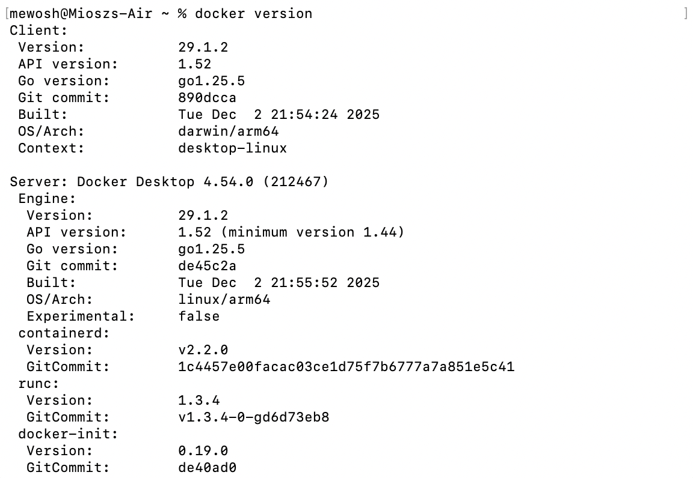

Rys. 1 - Wynik uruchomienia polecenia `docker version` - sprawdzenie informacji o kompilacji klienta i serwera Docker.

---

##### Ćwiczenie 1.2 — Hello World

**Opis:** Uruchomiono kontener `hello-world` przygotowany przez zespół Dockera. Kontener nie został znaleziony na komputerze więc Docker pobrał odpowiedni obraz z Docker Huba, utworzył na podstawie obrazu kontener i uruchomił go dzięki czemu wypisany został tekst w terminalu.

**Użyte polecenia:**

```zsh
# Uruchom pierwszy kontener
docker run hello-world
```

**Wynik działania:**

```zsh
mewosh@Mioszs-Air ~ % docker run hello-world
Unable to find image 'hello-world:latest' locally
latest: Pulling from library/hello-world
58dee6a49ef1: Pull complete 
c3bdf82c34d1: Download complete 
Digest: sha256:11a3eb1597e864c51b3f56733cb2e8a90bf0c284bfc05f9444d81c558bc848aa
Status: Downloaded newer image for hello-world:latest

Hello from Docker!
This message shows that your installation appears to be working correctly.

To generate this message, Docker took the following steps:
 1. The Docker client contacted the Docker daemon.
 2. The Docker daemon pulled the "hello-world" image from the Docker Hub.
    (arm64v8)
 3. The Docker daemon created a new container from that image which runs the
    executable that produces the output you are currently reading.
 4. The Docker daemon streamed that output to the Docker client, which sent it
    to your terminal.

To try something more ambitious, you can run an Ubuntu container with:
 $ docker run -it ubuntu bash

Share images, automate workflows, and more with a free Docker ID:
 https://hub.docker.com/

For more examples and ideas, visit:
 https://docs.docker.com/get-started/
```

**Screenshot:**

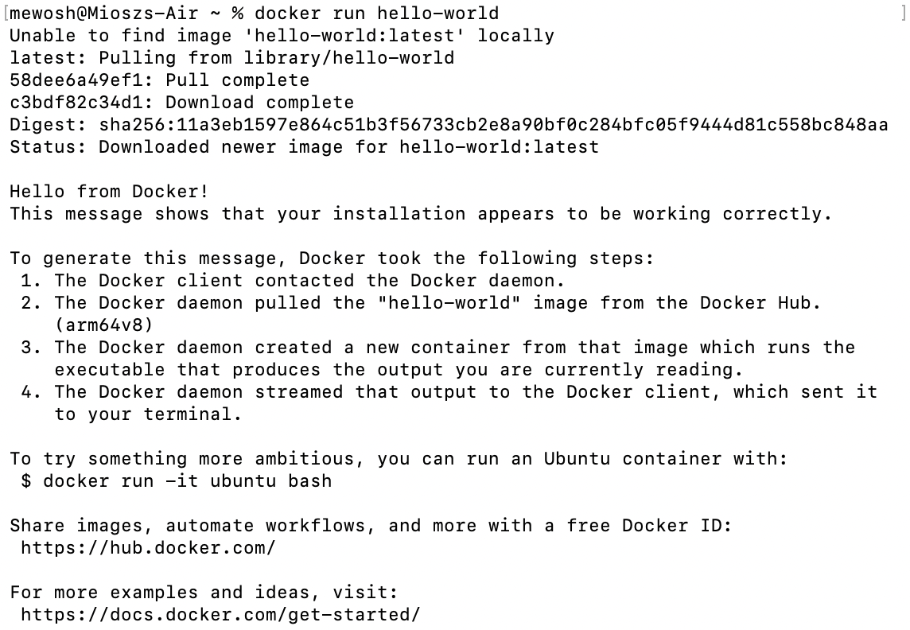

Rys. 2 - Wynik uruchomienia polecenia `docker run hello-world` - pobranie obrazu, utworzenie i uruchomienie kontenera oraz wypisanie tekstu w terminalu.

---

##### Ćwiczenie 1.3 — Sprawdzenie pobranych obrazów i kontenerów

**Opis:** Sprawdzono listę obrazów i kontenerów Dockera.

**Użyte polecenia:**

```zsh
# Lista pobranych obrazów
docker images

# Lista wszystkich kontenerów (w tym zatrzymanych)
docker ps -a
```

**Wynik działania:**

```zsh
mewosh@Mioszs-Air ~ % docker images
                                                                                                                                      i Info →   U  In Use
IMAGE                                                                                                    ID             DISK USAGE   CONTENT SIZE   EXTRA
blog-app:latest                                                                                          f544587a385b        210MB         58.5MB        
catthehacker/ubuntu:act-latest                                                                           c2fb744be8c4        2.3GB          549MB        
esporthub-backend:dev                                                                                    3fdfbc91b5b8       1.28GB          315MB        
esporthub-web:latest                                                                                     8fb7106acfc7       1.58GB          387MB    U   
esporthub:dev                                                                                            22d5027e1083        379MB         95.2MB        
fyneio/fyne-cross-images:windows                                                                         5663afcd79d4       2.89GB          613MB        
hello-world:latest                                                                                       11a3eb1597e8       22.6kB         10.3kB    U   
isilab4-web:latest                                                                                       d29b88a51f04        221MB         61.6MB        
isilab5-web:latest                                                                                       6efc1592735d        194MB         54.5MB        
mcr.microsoft.com/mssql/server:2022-latest                                                               db9a8fe3098b       2.23GB          593MB        
mcr.microsoft.com/mssql/server@sha256:49b45a911dc535e9345fbfd7101a1bd8a1e190a5f29b877ef75387a061e5fcf0   49b45a911dc5       2.27GB          604MB        
mcr.microsoft.com/mssql/server@sha256:a93989eebfb50ae37ee0bfecfaf03648421859558eef6cbff9dec0db3976f192   a93989eebfb5       2.51GB          657MB        
moby/buildkit:buildx-stable-1                                                                            0168606be231        348MB          105MB        
polchan-backend:latest                                                                                   73906fbeb25b        402MB          101MB        
postgres:18-alpine                                                                                       96d56f7f57c6        404MB          113MB    U   
postgres@sha256:96d56f7f57c6aacd1fcb908bc83b345ec5f83231ee486dd66a1baadce274db88                         96d56f7f57c6        404MB          113MB    U   
testcontainers/ryuk:0.14.0@sha256:7c1a8a9a47c780ed0f983770a662f80deb115d95cce3e2daa3d12115b8cd28f0       7c1a8a9a47c7       4.26MB         2.12MB        
```

```zsh
mewosh@Mioszs-Air ~ % docker ps -a
CONTAINER ID   IMAGE                  COMMAND                  CREATED          STATUS                      PORTS     NAMES
f30a112b4f70   hello-world            "/hello"                 10 minutes ago   Exited (0) 6 minutes ago              wizardly_meitner
7954f19f1271   postgres:18.4-alpine   "docker-entrypoint.s…"   4 months ago     Exited (0) 4 months ago               esporthub-db-1
db8f773ba507   esporthub-web          "dotnet watch run --…"   4 months ago     Exited (137) 4 months ago             esporthub-web-1
```

**Pytanie:** Dlaczego kontener `hello-world` ma status `Exited`?

**Odpowiedź:** Kontener posiada status `Exited`, ponieważ kontener działa do momentu aż główny skrypt wewnątrz kontenera nie zakończy swojego działania. Skrypt wewnątrz kontenera `hello-world` zakończył swoje działanie wypisując tekst w terminalu więc razem ze skryptem swoje działanie zakończył również kontener.

**Screenshot:**

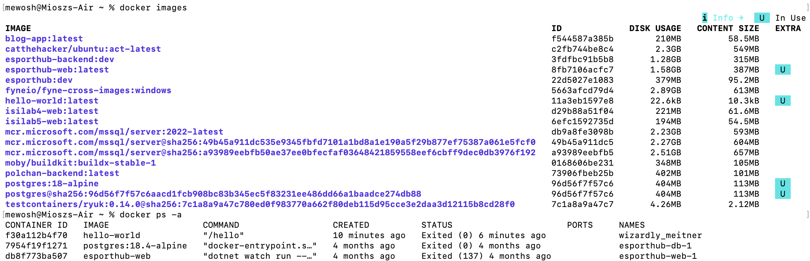

Rys. 3 - Wynik uruchomienia poleceń `docker images` - wypisanie listy obrazów i `docker ps -a` - wypisanie wszystkich konterów, łącznie z zatrzymanymi.

---

##### Ćwiczenie 2.1 — Pobieranie obrazów

**Opis:** Pobrano obrazy Ubuntu, Alpine i nginx.

**Użyte polecenia:**

```zsh
# Pobierz obraz Ubuntu
docker pull ubuntu:22.04

# Pobierz obraz Alpine (bardzo mały)
docker pull alpine:3.19

# Pobierz obraz Nginx
docker pull nginx:alpine

# Sprawdź listę obrazów
docker images
```

**Wynik działania:**

```zsh
mewosh@Mioszs-Air ~ % docker pull ubuntu:22.04
22.04: Pulling from library/ubuntu
2908c4fa36d8: Pull complete 
ab786f2fe2be: Download complete 
Digest: sha256:0a9887931b0e38af2e3487ed39e29436b0535c4f3f52e57745baaf79d1898956
Status: Downloaded newer image for ubuntu:22.04
docker.io/library/ubuntu:22.04
```

```zsh
mewosh@Mioszs-Air ~ % docker pull alpine:3.19
3.19: Pulling from library/alpine
5711127a7748: Pull complete 
ac150686e4d6: Download complete 
a9ab4fd7d75c: Download complete 
Digest: sha256:6baf43584bcb78f2e5847d1de515f23499913ac9f12bdf834811a3145eb11ca1
Status: Downloaded newer image for alpine:3.19
docker.io/library/alpine:3.19
```

```zsh
mewosh@Mioszs-Air ~ % docker pull nginx:alpine
alpine: Pulling from library/nginx
e6d3b58473ab: Pull complete 
797b5b160c63: Pull complete 
b7e361d793e4: Pull complete 
ee29503805b0: Pull complete 
23f02fcd8bd9: Pull complete 
a9986cd6f37d: Pull complete 
f5bdf65b7069: Pull complete 
85f32b96e514: Pull complete 
18bf203efdd5: Download complete 
f048204f955f: Download complete 
Digest: sha256:892bb2152464f0c5d8972593a5f5afaf8054552580b699d95f8ff4af08c2d33d
Status: Downloaded newer image for nginx:alpine
docker.io/library/nginx:alpine
```

**Screenshot:**

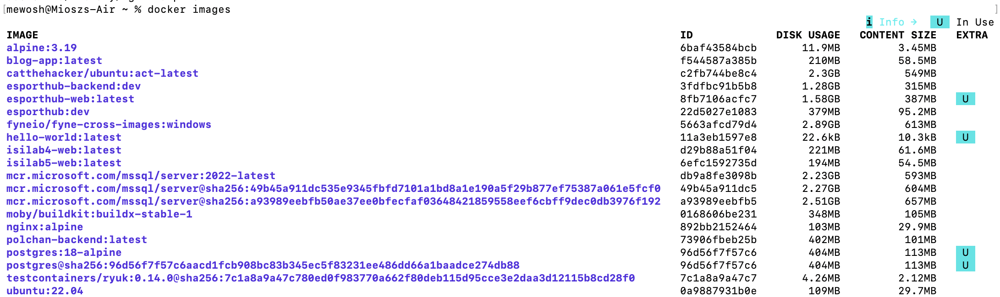

Rys. 4 - Wynik polecenia `docker images` po pobraniu nowych obrazów - widać, że lista powiększyła się o pozycje `alpine:3.19`, `nginx:alpine` i `ubuntu:22.04`.

---

##### Ćwiczenie 2.2 — Porównanie rozmiarów obrazów

**Opis:** Porównano rozmiar 3 obrazów - `alpine:3.19`, `nginx:alpine` i `ubuntu:22.04`.

**Użyte polecenia:**

```zsh
# Porównaj rozmiary
docker images --format "table {{.Repository}}\t{{.Tag}}\t{{.Size}}"
```

**Wynik działania:**

```zsh
mewosh@Mioszs-Air ~ % docker images --format "table {{.Repository}}\t{{.Tag}}\t{{.Size}}"
REPOSITORY                       TAG               SIZE
nginx                            alpine            103MB
ubuntu                           22.04             109MB
fyneio/fyne-cross-images         windows           2.89GB
esporthub-web                    latest            1.58GB
esporthub                        dev               379MB
esporthub-backend                dev               1.28GB
isilab5-web                      latest            194MB
catthehacker/ubuntu              act-latest        2.3GB
postgres                         18-alpine         404MB
moby/buildkit                    buildx-stable-1   348MB
isilab4-web                      latest            221MB
blog-app                         latest            210MB
mcr.microsoft.com/mssql/server   <none>            2.51GB
hello-world                      latest            22.6kB
polchan-backend                  latest            402MB
mcr.microsoft.com/mssql/server   <none>            2.27GB
mcr.microsoft.com/mssql/server   2022-latest       2.23GB
alpine                           3.19              11.9MB
testcontainers/ryuk              0.14.0            4.26MB
```

**Pytanie:** Który obraz jest najmniejszy? Dlaczego?

**Odpowiedź:** Najmniejszy jest obraz `Alpine:3.19`, ponieważ zawiera minimalny system operacyjny i pliki potrzebne do jego uruchomienia bez żadnego dodatkowego oprogramowania. Dla porównania, obraz `nginx:alpine` mimo tego, że jest oparty na systemie Alpine jest większy od obrazu Alpine, ponieważ oprócz systemu operacyjnego Alpine zawiera dodatkowe skrypty i pliki konfiguracyjne potrzebne do uruchomienia serwera nginx.

**Screenshot:**

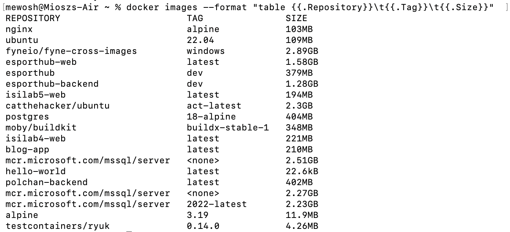

Rys. 5 - Wynik polecenia `docker images --format "table {{.Repository}}\t{{.Tag}}\t{{.Size}}"` - wypisane w formie tabelarycznej informacje o obrazie: repozytorium, tag i rozmiar.

---

##### Ćwiczenie 2.3 — Wyszukiwanie obrazów

**Opis:** Wyszukano obrazy Dockera znajdujące się w rejestrze Docker Hub.

**Użyte polecenia:**

```zsh
# Wyszukaj obrazy Python na Docker Hub
docker search python --limit 5

# Wyszukaj obrazy z co najmniej 100 gwiazdkami
docker search --filter stars=100 python
```

**Wynik działania:**

```zsh
mewosh@Mioszs-Air ~ % docker search python --limit 5
NAME              DESCRIPTION                                     STARS     OFFICIAL
python            Python is an interpreted, interactive, objec…   10539     [OK]
circleci/python   Python is an interpreted, interactive, objec…   117       
cimg/python                                                       25        
demisto/python    The Demisto base python image                   5         
ubuntu/python     A chiselled Ubuntu rock with the Python runt…   34        
```

```zsh
mewosh@Mioszs-Air ~ % docker search --filter stars=100 python
NAME              DESCRIPTION                                     STARS     OFFICIAL
python            Python is an interpreted, interactive, objec…   10539     [OK]
circleci/python   Python is an interpreted, interactive, objec…   117       
```

**Screenshot:**

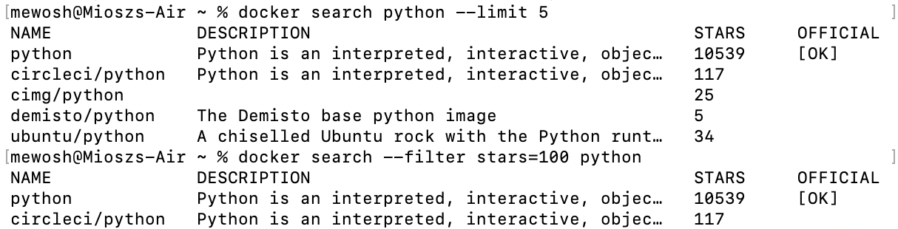

Rys. 6 - Wynik poleceń `docker search python --limit 5` - wyszukanie 5 obrazów Python i `docker search --filter stars=100 python` - wyszukanie wszystkich obrazów Python, które mają minimum 100 gwiazdek. W przypadku obu poleceń w formie tabelarycznej wyświetlane są informacje o nazwie, opisie i liczbie gwiazdek obrazu oraz informacja czy obraz pochodzi z listy oficjalnych obrazów Dockera utrzymywanych przez zespół Dockera wraz z twórcami danego oprogramowania.

---

##### Ćwiczenie 2.4 — Inspekcja obrazu

**Opis:** Sprawdzono szczegóły dotyczące obrazu Ubuntu i historii jego warstw. Zamiast nazwy obrazu użyto jego ID z powodu problemu opisanego w sekcji [5. Napotkane problemy i ich rozwiązania](#5-napotkane-problemy-i-ich-rozwiązania).

**Użyte polecenia:**

```zsh
# Szczegóły obrazu
docker image inspect 0a9887931b0e #ID obrazu ubuntu:22.04

# Historia warstw
docker history 0a9887931b0e

# Tylko rozmiar
docker image inspect 0a9887931b0e --format='{{.Size}}'
```

**Wynik działania:**

```zsh
mewosh@mioszs-macbook-air ~ % docker image inspect 0a9887931b0e
[
    {
        "Id": "sha256:0a9887931b0e38af2e3487ed39e29436b0535c4f3f52e57745baaf79d1898956",
        "RepoTags": [
            "ubuntu:22.04"
        ],
        "RepoDigests": [
            "ubuntu@sha256:0a9887931b0e38af2e3487ed39e29436b0535c4f3f52e57745baaf79d1898956"
        ],
        "Created": "2026-10-02T10:22:46.739909784Z",
        "Config": {
            "Env": [
                "PATH=/usr/local/sbin:/usr/local/bin:/usr/sbin:/usr/bin:/sbin:/bin"
            ],
            "Cmd": [
                "/bin/bash"
            ],
            "Labels": {
                "org.opencontainers.image.version": "22.04"
            }
        },
        "Architecture": "arm64",
        "Variant": "v8",
        "Os": "linux",
        "Size": 27693903,
        "RootFS": {
            "Type": "layers",
            "Layers": [
                "sha256:a3979fa7e3e4c597ab5823023a448d917d4ad7ae75204aa6737f4b091d233712"
            ]
        },
        "Metadata": {
            "LastTagTime": "2026-10-19T13:24:59.506314878Z"
        },
        "Descriptor": {
            "mediaType": "application/vnd.oci.image.index.v1+json",
            "digest": "sha256:0a9887931b0e38af2e3487ed39e29436b0535c4f3f52e57745baaf79d1898956",
            "size": 6688
        }
    }
]
```

```zsh
mewosh@mioszs-macbook-air ~ % docker history 0a9887931b0e
IMAGE          CREATED       CREATED BY                                      SIZE      COMMENT
0a9887931b0e   2 weeks ago   /bin/sh -c #(nop)  CMD ["/bin/bash"]            0B        
<missing>      2 weeks ago   /bin/sh -c #(nop) ADD file:1e8b3941ec802b3e9…   79.5MB    
<missing>      2 weeks ago   /bin/sh -c #(nop)  LABEL org.opencontainers.…   0B        
<missing>      2 weeks ago   /bin/sh -c #(nop)  ARG LAUNCHPAD_BUILD_ARCH     0B        
<missing>      2 weeks ago   /bin/sh -c #(nop)  ARG RELEASE                  0B        
```

```zsh
mewosh@mioszs-macbook-air ~ % docker image inspect 0a9887931b0e --format='{{.Size}}'
27693903
```

**Screenshot:**

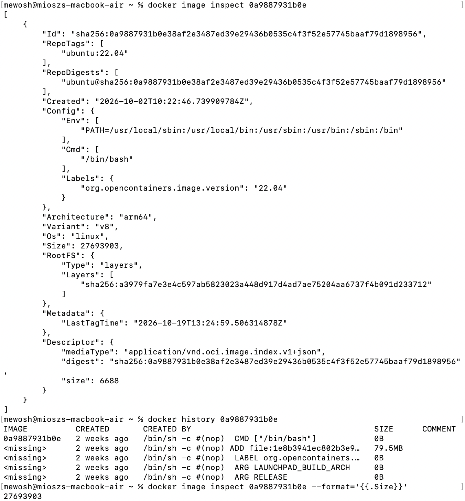

Rys. 7 - Wynik poleceń `docker image inspect 0a9887931b0e` - wypisanie szczegółów obrazu `ubuntu:22.04`, `docker history 0a9887931b0e` - wypisanie historii warstw obrazu Ubuntu (wykonane operacje podczas jego tworzenia, kolejność ich nakładania oraz informacja ile miejsca zajęła każda z operacji) i `docker image inspect 0a9887931b0e --format='{{.Size}}'` - wypisanie tylko rozmiaru obrazu Ubuntu.

---

##### Ćwiczenie 2.5 — Usuwanie obrazów

**Opis:** Usunięto obraz `hello-world` i zweryfikowano, że przestał on widnieć wśród pobranych obrazów.

**Użyte polecenia:**

```zsh
# Sprawdzenie listy obrazów przed usunięciem obrazu hello-world
docker images

# Usuń obraz hello-world (najpierw usuń kontener)
docker rm $(docker ps -aq --filter ancestor=hello-world)
docker rmi hello-world

# Sprawdź
docker images
```

**Wynik działania:**

```zsh
mewosh@mioszs-macbook-air ~ % docker images
                                                                                                                                                i Info →   U  In Use
IMAGE                                                                                                    ID             DISK USAGE   CONTENT SIZE   EXTRA
alpine:3.19                                                                                              6baf43584bcb       11.9MB         3.45MB        
blog-app:latest                                                                                          f544587a385b        210MB         58.5MB        
catthehacker/ubuntu:act-latest                                                                           c2fb744be8c4        2.3GB          549MB        
esporthub-backend:dev                                                                                    3fdfbc91b5b8       1.28GB          315MB        
esporthub-web:latest                                                                                     8fb7106acfc7       1.58GB          387MB    U   
esporthub:dev                                                                                            22d5027e1083        379MB         95.2MB        
fyneio/fyne-cross-images:windows                                                                         5663afcd79d4       2.89GB          613MB        
hello-world:latest                                                                                       11a3eb1597e8       22.6kB         10.3kB    U   
isilab4-web:latest                                                                                       d29b88a51f04        221MB         61.6MB        
isilab5-web:latest                                                                                       6efc1592735d        194MB         54.5MB        
mcr.microsoft.com/mssql/server:2022-latest                                                               db9a8fe3098b       2.23GB          593MB        
mcr.microsoft.com/mssql/server@sha256:49b45a911dc535e9345fbfd7101a1bd8a1e190a5f29b877ef75387a061e5fcf0   49b45a911dc5       2.27GB          604MB        
mcr.microsoft.com/mssql/server@sha256:a93989eebfb50ae37ee0bfecfaf03648421859558eef6cbff9dec0db3976f192   a93989eebfb5       2.51GB          657MB        
moby/buildkit:buildx-stable-1                                                                            0168606be231        348MB          105MB        
nginx:alpine                                                                                             892bb2152464        103MB         29.9MB        
polchan-backend:latest                                                                                   73906fbeb25b        402MB          101MB        
postgres:18-alpine                                                                                       96d56f7f57c6        404MB          113MB    U   
postgres@sha256:96d56f7f57c6aacd1fcb908bc83b345ec5f83231ee486dd66a1baadce274db88                         96d56f7f57c6        404MB          113MB    U   
testcontainers/ryuk:0.14.0@sha256:7c1a8a9a47c780ed0f983770a662f80deb115d95cce3e2daa3d12115b8cd28f0       7c1a8a9a47c7       4.26MB         2.12MB        
ubuntu:22.04                                                                                             0a9887931b0e        109MB         29.7MB        
```

```zsh
mewosh@mioszs-macbook-air ~ % docker rm $(docker ps -aq --filter ancestor=hello-world)
f30a112b4f70
```

```zsh
mewosh@mioszs-macbook-air ~ % docker rmi hello-world
Untagged: hello-world:latest
Deleted: sha256:11a3eb1597e864c51b3f56733cb2e8a90bf0c284bfc05f9444d81c558bc848aa
```

```zsh
mewosh@mioszs-macbook-air ~ % docker images
                                                                                                                                                i Info →   U  In Use
IMAGE                                                                                                    ID             DISK USAGE   CONTENT SIZE   EXTRA
alpine:3.19                                                                                              6baf43584bcb       11.9MB         3.45MB        
blog-app:latest                                                                                          f544587a385b        210MB         58.5MB        
catthehacker/ubuntu:act-latest                                                                           c2fb744be8c4        2.3GB          549MB        
esporthub-backend:dev                                                                                    3fdfbc91b5b8       1.28GB          315MB        
esporthub-web:latest                                                                                     8fb7106acfc7       1.58GB          387MB    U   
esporthub:dev                                                                                            22d5027e1083        379MB         95.2MB        
fyneio/fyne-cross-images:windows                                                                         5663afcd79d4       2.89GB          613MB        
isilab4-web:latest                                                                                       d29b88a51f04        221MB         61.6MB        
isilab5-web:latest                                                                                       6efc1592735d        194MB         54.5MB        
mcr.microsoft.com/mssql/server:2022-latest                                                               db9a8fe3098b       2.23GB          593MB        
mcr.microsoft.com/mssql/server@sha256:49b45a911dc535e9345fbfd7101a1bd8a1e190a5f29b877ef75387a061e5fcf0   49b45a911dc5       2.27GB          604MB        
mcr.microsoft.com/mssql/server@sha256:a93989eebfb50ae37ee0bfecfaf03648421859558eef6cbff9dec0db3976f192   a93989eebfb5       2.51GB          657MB        
moby/buildkit:buildx-stable-1                                                                            0168606be231        348MB          105MB        
nginx:alpine                                                                                             892bb2152464        103MB         29.9MB        
polchan-backend:latest                                                                                   73906fbeb25b        402MB          101MB        
postgres:18-alpine                                                                                       96d56f7f57c6        404MB          113MB    U   
postgres@sha256:96d56f7f57c6aacd1fcb908bc83b345ec5f83231ee486dd66a1baadce274db88                         96d56f7f57c6        404MB          113MB    U   
testcontainers/ryuk:0.14.0@sha256:7c1a8a9a47c780ed0f983770a662f80deb115d95cce3e2daa3d12115b8cd28f0       7c1a8a9a47c7       4.26MB         2.12MB        
ubuntu:22.04                                                                                             0a9887931b0e        109MB         29.7MB        
```

**Screenshot:**

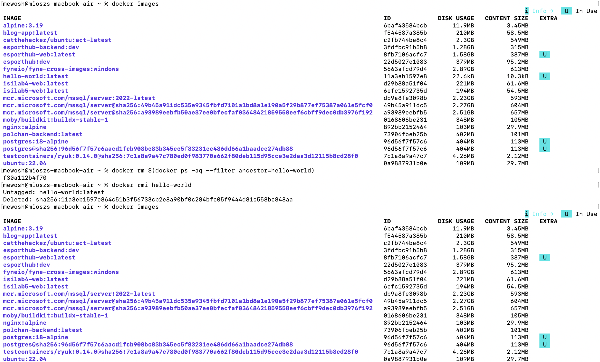

Rys. 8 - Wynik poleceń `docker rm $(docker ps -aq --filter ancestor=hello-world)` - wyszukanie ID wszystkich kontenerów utworzonych na podstawie obrazu `hello-world` a następnie ich usunięcie, `docker rmi hello-world` - usunięcie obrazu `hello-world`. Zweryfikowano poprawność poprzednich komend poleceniem `docker images` - widoczne zniknięcie obrazu `hello-world` z listy.

---

##### Ćwiczenie 3.1 — Tryb interaktywny

**Opis:** Interakcja z obrazem Ubuntu za pomocą powłoki.

**Użyte polecenia:**

```zsh
# Uruchom Ubuntu interaktywnie
docker run -it ubuntu:22.04 bash

# Wewnątrz kontenera:
cat /etc/os-release
whoami
hostname
ls /
pwd

# Zainstaluj pakiet
apt-get update && apt-get install -y curl
curl --version

# Wyjdź z kontenera
exit
```

**Wynik działania:**

```zsh
mewosh@mioszs-macbook-air ~ % docker run -it ubuntu:22.04 bash
root@a20c7bad002c:/#
```

```zsh
root@a20c7bad002c:/# cat /etc/os-release
PRETTY_NAME="Ubuntu 22.04.5 LTS"
NAME="Ubuntu"
VERSION_ID="22.04"
VERSION="22.04.5 LTS (Jammy Jellyfish)"
VERSION_CODENAME=jammy
ID=ubuntu
ID_LIKE=debian
HOME_URL="https://www.ubuntu.com/"
SUPPORT_URL="https://help.ubuntu.com/"
BUG_REPORT_URL="https://bugs.launchpad.net/ubuntu/"
PRIVACY_POLICY_URL="https://www.ubuntu.com/legal/terms-and-policies/privacy-policy"
UBUNTU_CODENAME=jammy
```

```zsh
root@a20c7bad002c:/# whoami
root
```

```zsh
root@a20c7bad002c:/# hostname
a20c7bad002c
```

```zsh
root@a20c7bad002c:/# ls /
bin   dev  home  media  opt   root  sbin  sys  usr
boot  etc  lib   mnt    proc  run   srv   tmp  var
```

```zsh
root@a20c7bad002c:/# pwd
/
```

```zsh
root@a20c7bad002c:/# apt-get update && apt-get install -y curl
Get:1 http://ports.ubuntu.com/ubuntu-ports jammy InRelease [270 kB]
Get:2 http://ports.ubuntu.com/ubuntu-ports jammy-updates InRelease [128 kB]
Get:3 http://ports.ubuntu.com/ubuntu-ports jammy-backports InRelease [127 kB]
Get:4 http://ports.ubuntu.com/ubuntu-ports jammy-security InRelease [129 kB]
Get:5 http://ports.ubuntu.com/ubuntu-ports jammy/universe arm64 Packages [17.2 MB]
Get:6 http://ports.ubuntu.com/ubuntu-ports jammy/main arm64 Packages [1758 kB]
Get:7 http://ports.ubuntu.com/ubuntu-ports jammy/multiverse arm64 Packages [224 kB]
Get:8 http://ports.ubuntu.com/ubuntu-ports jammy/restricted arm64 Packages [24.2 kB]
Get:9 http://ports.ubuntu.com/ubuntu-ports jammy-updates/main arm64 Packages [4566 kB]
Get:10 http://ports.ubuntu.com/ubuntu-ports jammy-updates/restricted arm64 Packages [8359 kB]
Get:11 http://ports.ubuntu.com/ubuntu-ports jammy-updates/multiverse arm64 Packages [81.6 kB]
Get:12 http://ports.ubuntu.com/ubuntu-ports jammy-updates/universe arm64 Packages [1716 kB]
Get:13 http://ports.ubuntu.com/ubuntu-ports jammy-backports/universe arm64 Packages [33.7 kB]
Get:14 http://ports.ubuntu.com/ubuntu-ports jammy-backports/main arm64 Packages [82.5 kB]
Get:15 http://ports.ubuntu.com/ubuntu-ports jammy-security/universe arm64 Packages [1421 kB]
Get:16 http://ports.ubuntu.com/ubuntu-ports jammy-security/main arm64 Packages [4252 kB]
Get:17 http://ports.ubuntu.com/ubuntu-ports jammy-security/restricted arm64 Packages [8061 kB]
Get:18 http://ports.ubuntu.com/ubuntu-ports jammy-security/multiverse arm64 Packages [75.6 kB]
Fetched 48.5 MB in 6s (8747 kB/s)                            
Reading package lists... Done
Reading package lists... Done
Building dependency tree... Done
Reading state information... Done
The following additional packages will be installed:
  ca-certificates libbrotli1 libcurl4 libldap-2.5-0 libldap-common
  libnghttp2-14 libpsl5 librtmp1 libsasl2-2 libsasl2-modules
  libsasl2-modules-db libssh-4 openssl publicsuffix
Suggested packages:
  libsasl2-modules-gssapi-mit | libsasl2-modules-gssapi-heimdal
  libsasl2-modules-ldap libsasl2-modules-otp libsasl2-modules-sql
The following NEW packages will be installed:
  ca-certificates curl libbrotli1 libcurl4 libldap-2.5-0 libldap-common
  libnghttp2-14 libpsl5 librtmp1 libsasl2-2 libsasl2-modules
  libsasl2-modules-db libssh-4 openssl publicsuffix
0 upgraded, 15 newly installed, 0 to remove and 2 not upgraded.
Need to get 2944 kB of archives.
After this operation, 6812 kB of additional disk space will be used.
Get:1 http://ports.ubuntu.com/ubuntu-ports jammy-updates/main arm64 openssl arm64 3.0.2-0ubuntu1.30 [1160 kB]
Get:2 http://ports.ubuntu.com/ubuntu-ports jammy-updates/main arm64 ca-certificates all 20260601~22.04.1 [141 kB]
Get:3 http://ports.ubuntu.com/ubuntu-ports jammy-updates/main arm64 libnghttp2-14 arm64 1.43.0-1ubuntu0.4 [76.2 kB]
Get:4 http://ports.ubuntu.com/ubuntu-ports jammy/main arm64 libpsl5 arm64 0.21.0-1.2build2 [58.3 kB]
Get:5 http://ports.ubuntu.com/ubuntu-ports jammy/main arm64 publicsuffix all 20211207.1025-1 [129 kB]
Get:6 http://ports.ubuntu.com/ubuntu-ports jammy/main arm64 libbrotli1 arm64 1.0.9-2build6 [314 kB]
Get:7 http://ports.ubuntu.com/ubuntu-ports jammy-updates/main arm64 libsasl2-modules-db arm64 2.1.27+dfsg2-3ubuntu1.2 [21.1 kB]
Get:8 http://ports.ubuntu.com/ubuntu-ports jammy-updates/main arm64 libsasl2-2 arm64 2.1.27+dfsg2-3ubuntu1.2 [55.6 kB]
Get:9 http://ports.ubuntu.com/ubuntu-ports jammy-updates/main arm64 libldap-2.5-0 arm64 2.5.20+dfsg-0ubuntu0.22.04.1 [182 kB]
Get:10 http://ports.ubuntu.com/ubuntu-ports jammy/main arm64 librtmp1 arm64 2.4+20151223.gitfa8646d.1-2build4 [59.2 kB]
Get:11 http://ports.ubuntu.com/ubuntu-ports jammy-updates/main arm64 libssh-4 arm64 0.9.6-2ubuntu0.22.04.8 [187 kB]
Get:12 http://ports.ubuntu.com/ubuntu-ports jammy-security/main arm64 libcurl4 arm64 7.81.0-1ubuntu1.30 [287 kB]
Get:13 http://ports.ubuntu.com/ubuntu-ports jammy-security/main arm64 curl arm64 7.81.0-1ubuntu1.30 [190 kB]
Get:14 http://ports.ubuntu.com/ubuntu-ports jammy-updates/main arm64 libldap-common all 2.5.20+dfsg-0ubuntu0.22.04.1 [16.4 kB]
Get:15 http://ports.ubuntu.com/ubuntu-ports jammy-updates/main arm64 libsasl2-modules arm64 2.1.27+dfsg2-3ubuntu1.2 [68.4 kB]
Fetched 2944 kB in 1s (4635 kB/s)          
debconf: delaying package configuration, since apt-utils is not installed
Selecting previously unselected package openssl.
(Reading database ... 4387 files and directories currently installed.)
Preparing to unpack .../00-openssl_3.0.2-0ubuntu1.30_arm64.deb ...
Unpacking openssl (3.0.2-0ubuntu1.30) ...
Selecting previously unselected package ca-certificates.
Preparing to unpack .../01-ca-certificates_20260601~22.04.1_all.deb ...
Unpacking ca-certificates (20260601~22.04.1) ...
Selecting previously unselected package libnghttp2-14:arm64.
Preparing to unpack .../02-libnghttp2-14_1.43.0-1ubuntu0.4_arm64.deb ...
Unpacking libnghttp2-14:arm64 (1.43.0-1ubuntu0.4) ...
Selecting previously unselected package libpsl5:arm64.
Preparing to unpack .../03-libpsl5_0.21.0-1.2build2_arm64.deb ...
Unpacking libpsl5:arm64 (0.21.0-1.2build2) ...
Selecting previously unselected package publicsuffix.
Preparing to unpack .../04-publicsuffix_20211207.1025-1_all.deb ...
Unpacking publicsuffix (20211207.1025-1) ...
Selecting previously unselected package libbrotli1:arm64.
Preparing to unpack .../05-libbrotli1_1.0.9-2build6_arm64.deb ...
Unpacking libbrotli1:arm64 (1.0.9-2build6) ...
Selecting previously unselected package libsasl2-modules-db:arm64.
Preparing to unpack .../06-libsasl2-modules-db_2.1.27+dfsg2-3ubuntu1.2_arm64.deb ...
Unpacking libsasl2-modules-db:arm64 (2.1.27+dfsg2-3ubuntu1.2) ...
Selecting previously unselected package libsasl2-2:arm64.
Preparing to unpack .../07-libsasl2-2_2.1.27+dfsg2-3ubuntu1.2_arm64.deb ...
Unpacking libsasl2-2:arm64 (2.1.27+dfsg2-3ubuntu1.2) ...
Selecting previously unselected package libldap-2.5-0:arm64.
Preparing to unpack .../08-libldap-2.5-0_2.5.20+dfsg-0ubuntu0.22.04.1_arm64.deb ...
Unpacking libldap-2.5-0:arm64 (2.5.20+dfsg-0ubuntu0.22.04.1) ...
Selecting previously unselected package librtmp1:arm64.
Preparing to unpack .../09-librtmp1_2.4+20151223.gitfa8646d.1-2build4_arm64.deb ...
Unpacking librtmp1:arm64 (2.4+20151223.gitfa8646d.1-2build4) ...
Selecting previously unselected package libssh-4:arm64.
Preparing to unpack .../10-libssh-4_0.9.6-2ubuntu0.22.04.8_arm64.deb ...
Unpacking libssh-4:arm64 (0.9.6-2ubuntu0.22.04.8) ...
Selecting previously unselected package libcurl4:arm64.
Preparing to unpack .../11-libcurl4_7.81.0-1ubuntu1.30_arm64.deb ...
Unpacking libcurl4:arm64 (7.81.0-1ubuntu1.30) ...
Selecting previously unselected package curl.
Preparing to unpack .../12-curl_7.81.0-1ubuntu1.30_arm64.deb ...
Unpacking curl (7.81.0-1ubuntu1.30) ...
Selecting previously unselected package libldap-common.
Preparing to unpack .../13-libldap-common_2.5.20+dfsg-0ubuntu0.22.04.1_all.deb ...
Unpacking libldap-common (2.5.20+dfsg-0ubuntu0.22.04.1) ...
Selecting previously unselected package libsasl2-modules:arm64.
Preparing to unpack .../14-libsasl2-modules_2.1.27+dfsg2-3ubuntu1.2_arm64.deb ...
Unpacking libsasl2-modules:arm64 (2.1.27+dfsg2-3ubuntu1.2) ...
Setting up libpsl5:arm64 (0.21.0-1.2build2) ...
Setting up libbrotli1:arm64 (1.0.9-2build6) ...
Setting up libsasl2-modules:arm64 (2.1.27+dfsg2-3ubuntu1.2) ...
Setting up libnghttp2-14:arm64 (1.43.0-1ubuntu0.4) ...
Setting up libldap-common (2.5.20+dfsg-0ubuntu0.22.04.1) ...
Setting up libsasl2-modules-db:arm64 (2.1.27+dfsg2-3ubuntu1.2) ...
Setting up librtmp1:arm64 (2.4+20151223.gitfa8646d.1-2build4) ...
Setting up libsasl2-2:arm64 (2.1.27+dfsg2-3ubuntu1.2) ...
Setting up libssh-4:arm64 (0.9.6-2ubuntu0.22.04.8) ...
Setting up openssl (3.0.2-0ubuntu1.30) ...
Setting up publicsuffix (20211207.1025-1) ...
Setting up libldap-2.5-0:arm64 (2.5.20+dfsg-0ubuntu0.22.04.1) ...
Setting up ca-certificates (20260601~22.04.1) ...
debconf: unable to initialize frontend: Dialog
debconf: (No usable dialog-like program is installed, so the dialog based frontend cannot be used. at /usr/share/perl5/Debconf/FrontEnd/Dialog.pm line 78.)
debconf: falling back to frontend: Readline
debconf: unable to initialize frontend: Readline
debconf: (Can't locate Term/ReadLine.pm in @INC (you may need to install the Term::ReadLine module) (@INC contains: /etc/perl /usr/local/lib/aarch64-linux-gnu/perl/5.34.0 /usr/local/share/perl/5.34.0 /usr/lib/aarch64-linux-gnu/perl5/5.34 /usr/share/perl5 /usr/lib/aarch64-linux-gnu/perl-base /usr/lib/aarch64-linux-gnu/perl/5.34 /usr/share/perl/5.34 /usr/local/lib/site_perl) at /usr/share/perl5/Debconf/FrontEnd/Readline.pm line 7.)
debconf: falling back to frontend: Teletype
Updating certificates in /etc/ssl/certs...
121 added, 0 removed; done.
Setting up libcurl4:arm64 (7.81.0-1ubuntu1.30) ...
Setting up curl (7.81.0-1ubuntu1.30) ...
Processing triggers for libc-bin (2.35-0ubuntu3.15) ...
Processing triggers for ca-certificates (20260601~22.04.1) ...
Updating certificates in /etc/ssl/certs...
0 added, 0 removed; done.
Running hooks in /etc/ca-certificates/update.d...
done.
```

```zsh
root@a20c7bad002c:/# curl --version
curl 7.81.0 (aarch64-unknown-linux-gnu) libcurl/7.81.0 OpenSSL/3.0.2 zlib/1.2.11 brotli/1.0.9 zstd/1.4.8 libidn2/2.3.2 libpsl/0.21.0 (+libidn2/2.3.2) libssh/0.9.6/openssl/zlib nghttp2/1.43.0 librtmp/2.3 OpenLDAP/2.5.20
Release-Date: 2022-01-05
Protocols: dict file ftp ftps gopher gophers http https imap imaps ldap ldaps mqtt pop3 pop3s rtmp rtsp scp sftp smb smbs smtp smtps telnet tftp 
Features: alt-svc AsynchDNS brotli GSS-API HSTS HTTP2 HTTPS-proxy IDN IPv6 Kerberos Largefile libz NTLM NTLM_WB PSL SPNEGO SSL TLS-SRP UnixSockets zstd
```

```zsh
root@a20c7bad002c:/# exit
exit
mewosh@mioszs-macbook-air ~ % 
```

**Pytanie:** Co się stanie z zainstalowanym `curl` po wyjściu z kontenera?

**Odpowiedź:** Polecenie `curl` pozostanie fizycznie na dysku komputera, jak również pozostanie zainstalowane w zatrzymanym kontenerze. Polecenie `docker run -it ubuntu:22.04 bash` za każdym razem tworzy nowy, czysty kontener na podstawie obrazu Ubuntu, dlatego po ponownym wywołaniu tego polecenia zobaczymy, że polecenie `curl` nie jest zainstalowane. Gdy natomiast uruchomimy poleceniem `docker start` poprzednio zatrzymany kontener, zobaczymy, że poprzednio zainstalowane polecenie `curl` jest dalej obecne.

**Screenshot:**

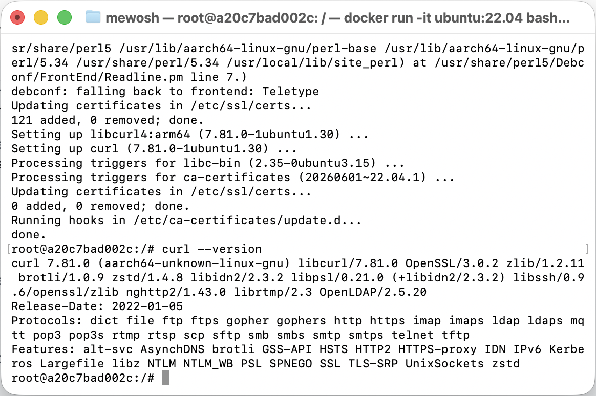

Rys. 9 - Uruchomiona sesja interaktywna w nowo utworzonym kontenerze.

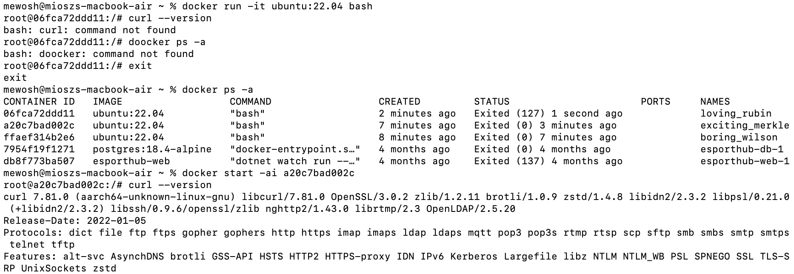

Rys. 10 - Wykazanie, że w nowo utworzonym kontenerze poleceniem `docker run -it ubuntu:22.04 bash` system nie rozpoznaje polecenia `curl`, natomiast w poprzednio utworzonym kontenerze to polecenie jest rozpoznawane.

---

##### Ćwiczenie 3.2 — Tryb detached (w tle)

**Opis:** Uruchomiono kontener nginx w tle, zweryfikowano czy został uruchomiony, sprawdzono jego logi i szczegóły.

**Użyte polecenia:**

```zsh
# Uruchom Nginx w tle
docker run -d --name moj-nginx nginx:alpine

# Sprawdź działające kontenery
docker ps

# Sprawdź logi
docker logs moj-nginx

# Sprawdź szczegóły
docker inspect moj-nginx
```

**Wynik działania:**

```zsh
mewosh@mioszs-macbook-air ~ % docker run -d --name moj-nginx nginx:alpine
ca0f3c3f746f515c6dc727abf0d0cd4fab99453448f3d03e75474de802a34104
```

```zsh
mewosh@mioszs-macbook-air ~ % docker ps
CONTAINER ID   IMAGE          COMMAND                  CREATED         STATUS         PORTS     NAMES
ca0f3c3f746f   nginx:alpine   "/docker-entrypoint.…"   7 seconds ago   Up 6 seconds   80/tcp    moj-nginx
```

```zsh
mewosh@mioszs-macbook-air ~ % docker logs moj-nginx
/docker-entrypoint.sh: /docker-entrypoint.d/ is not empty, will attempt to perform configuration
/docker-entrypoint.sh: Looking for shell scripts in /docker-entrypoint.d/
/docker-entrypoint.sh: Launching /docker-entrypoint.d/10-listen-on-ipv6-by-default.sh
10-listen-on-ipv6-by-default.sh: info: Getting the checksum of /etc/nginx/conf.d/default.conf
10-listen-on-ipv6-by-default.sh: info: Enabled listen on IPv6 in /etc/nginx/conf.d/default.conf
/docker-entrypoint.sh: Sourcing /docker-entrypoint.d/15-local-resolvers.envsh
/docker-entrypoint.sh: Launching /docker-entrypoint.d/20-envsubst-on-templates.sh
/docker-entrypoint.sh: Launching /docker-entrypoint.d/30-tune-worker-processes.sh
/docker-entrypoint.sh: Configuration complete; ready for start up
2026/10/19 15:30:38 [notice] 1#1: using the "epoll" event method
2026/10/19 15:30:38 [notice] 1#1: nginx/1.31.7
2026/10/19 15:30:38 [notice] 1#1: built by gcc 15.2.0 (Alpine 15.2.0) 
2026/10/19 15:30:38 [notice] 1#1: OS: Linux 6.12.54-linuxkit
2026/10/19 15:30:38 [notice] 1#1: getrlimit(RLIMIT_NOFILE): 1048576:1048576
2026/10/19 15:30:38 [notice] 1#1: start worker processes
2026/10/19 15:30:38 [notice] 1#1: start worker process 30
2026/10/19 15:30:38 [notice] 1#1: start worker process 31
2026/10/19 15:30:38 [notice] 1#1: start worker process 32
2026/10/19 15:30:38 [notice] 1#1: start worker process 33
2026/10/19 15:30:38 [notice] 1#1: start worker process 34
2026/10/19 15:30:38 [notice] 1#1: start worker process 35
2026/10/19 15:30:38 [notice] 1#1: start worker process 36
2026/10/19 15:30:38 [notice] 1#1: start worker process 37
```

```zsh
mewosh@mioszs-macbook-air ~ % docker inspect moj-nginx
[
    {
        "Id": "ca0f3c3f746f515c6dc727abf0d0cd4fab99453448f3d03e75474de802a34104",
        "Created": "2026-10-19T15:30:38.508639667Z",
        "Path": "/docker-entrypoint.sh",
        "Args": [
            "nginx",
            "-g",
            "daemon off;"
        ],
        "State": {
            "Status": "running",
            "Running": true,
            "Paused": false,
            "Restarting": false,
            "OOMKilled": false,
            "Dead": false,
            "Pid": 3416,
            "ExitCode": 0,
            "Error": "",
            "StartedAt": "2026-10-19T15:30:38.547626501Z",
            "FinishedAt": "0001-01-01T00:00:00Z"
        },
        "Image": "sha256:892bb2152464f0c5d8972593a5f5afaf8054552580b699d95f8ff4af08c2d33d",
        "ResolvConfPath": "/var/lib/docker/containers/ca0f3c3f746f515c6dc727abf0d0cd4fab99453448f3d03e75474de802a34104/resolv.conf",
        "HostnamePath": "/var/lib/docker/containers/ca0f3c3f746f515c6dc727abf0d0cd4fab99453448f3d03e75474de802a34104/hostname",
        "HostsPath": "/var/lib/docker/containers/ca0f3c3f746f515c6dc727abf0d0cd4fab99453448f3d03e75474de802a34104/hosts",
        "LogPath": "/var/lib/docker/containers/ca0f3c3f746f515c6dc727abf0d0cd4fab99453448f3d03e75474de802a34104/ca0f3c3f746f515c6dc727abf0d0cd4fab99453448f3d03e75474de802a34104-json.log",
        "Name": "/moj-nginx",
        "RestartCount": 0,
        "Driver": "overlayfs",
        "Platform": "linux",
        "MountLabel": "",
        "ProcessLabel": "",
        "AppArmorProfile": "",
        "ExecIDs": null,
        "HostConfig": {
            "Binds": null,
            "ContainerIDFile": "",
            "LogConfig": {
                "Type": "json-file",
                "Config": {}
            },
            "NetworkMode": "bridge",
            "PortBindings": {},
            "RestartPolicy": {
                "Name": "no",
                "MaximumRetryCount": 0
            },
            "AutoRemove": false,
            "VolumeDriver": "",
            "VolumesFrom": null,
            "ConsoleSize": [
                24,
                80
            ],
            "CapAdd": null,
            "CapDrop": null,
            "CgroupnsMode": "private",
            "Dns": null,
            "DnsOptions": [],
            "DnsSearch": [],
            "ExtraHosts": null,
            "GroupAdd": null,
            "IpcMode": "private",
            "Cgroup": "",
            "Links": null,
            "OomScoreAdj": 0,
            "PidMode": "",
            "Privileged": false,
            "PublishAllPorts": false,
            "ReadonlyRootfs": false,
            "SecurityOpt": null,
            "UTSMode": "",
            "UsernsMode": "",
            "ShmSize": 67108864,
            "Runtime": "runc",
            "Isolation": "",
            "CpuShares": 0,
            "Memory": 0,
            "NanoCpus": 0,
            "CgroupParent": "",
            "BlkioWeight": 0,
            "BlkioWeightDevice": [],
            "BlkioDeviceReadBps": [],
            "BlkioDeviceWriteBps": [],
            "BlkioDeviceReadIOps": [],
            "BlkioDeviceWriteIOps": [],
            "CpuPeriod": 0,
            "CpuQuota": 0,
            "CpuRealtimePeriod": 0,
            "CpuRealtimeRuntime": 0,
            "CpusetCpus": "",
            "CpusetMems": "",
            "Devices": [],
            "DeviceCgroupRules": null,
            "DeviceRequests": null,
            "MemoryReservation": 0,
            "MemorySwap": 0,
            "MemorySwappiness": null,
            "OomKillDisable": null,
            "PidsLimit": null,
            "Ulimits": [],
            "CpuCount": 0,
            "CpuPercent": 0,
            "IOMaximumIOps": 0,
            "IOMaximumBandwidth": 0,
            "MaskedPaths": [
                "/proc/acpi",
                "/proc/asound",
                "/proc/interrupts",
                "/proc/kcore",
                "/proc/keys",
                "/proc/latency_stats",
                "/proc/sched_debug",
                "/proc/scsi",
                "/proc/timer_list",
                "/proc/timer_stats",
                "/sys/devices/virtual/powercap",
                "/sys/firmware"
            ],
            "ReadonlyPaths": [
                "/proc/bus",
                "/proc/fs",
                "/proc/irq",
                "/proc/sys",
                "/proc/sysrq-trigger"
            ]
        },
        "GraphDriver": {
            "Data": null,
            "Name": ""
        },
        "Mounts": [],
        "Config": {
            "Hostname": "ca0f3c3f746f",
            "Domainname": "",
            "User": "",
            "AttachStdin": false,
            "AttachStdout": false,
            "AttachStderr": false,
            "ExposedPorts": {
                "80/tcp": {}
            },
            "Tty": false,
            "OpenStdin": false,
            "StdinOnce": false,
            "Env": [
                "PATH=/usr/local/sbin:/usr/local/bin:/usr/sbin:/usr/bin:/sbin:/bin",
                "NGINX_VERSION=1.31.7",
                "PKG_RELEASE=1",
                "DYNPKG_RELEASE=1",
                "NJS_VERSION=1.0.2",
                "NJS_RELEASE=1",
                "ACME_VERSION=0.4.1"
            ],
            "Cmd": [
                "nginx",
                "-g",
                "daemon off;"
            ],
            "Image": "nginx:alpine",
            "Volumes": null,
            "WorkingDir": "/",
            "Entrypoint": [
                "/docker-entrypoint.sh"
            ],
            "OnBuild": null,
            "Labels": {
                "maintainer": "NGINX Docker Maintainers \u003cdocker-maint@nginx.com\u003e"
            },
            "StopSignal": "SIGQUIT",
            "StopTimeout": 1
        },
        "NetworkSettings": {
            "Bridge": "",
            "SandboxID": "838311ad7107cd06da76a5b6280305f50f1610fbe6c5ad024426a2946e54c6a3",
            "SandboxKey": "/var/run/docker/netns/838311ad7107",
            "Ports": {
                "80/tcp": null
            },
            "HairpinMode": false,
            "LinkLocalIPv6Address": "",
            "LinkLocalIPv6PrefixLen": 0,
            "SecondaryIPAddresses": null,
            "SecondaryIPv6Addresses": null,
            "EndpointID": "",
            "Gateway": "",
            "GlobalIPv6Address": "",
            "GlobalIPv6PrefixLen": 0,
            "IPAddress": "",
            "IPPrefixLen": 0,
            "IPv6Gateway": "",
            "MacAddress": "",
            "Networks": {
                "bridge": {
                    "IPAMConfig": null,
                    "Links": null,
                    "Aliases": null,
                    "MacAddress": "f6:43:d2:43:47:56",
                    "DriverOpts": null,
                    "GwPriority": 0,
                    "NetworkID": "75ee1278fe19801a660404eeee38a239e006ec3b9ba89c6d99214cb8e500a71a",
                    "EndpointID": "642ebc5f719db42c313d1ae43e0d2db088a84999c2ba15af94e8aea6db31c2e7",
                    "Gateway": "172.17.0.1",
                    "IPAddress": "172.17.0.2",
                    "IPPrefixLen": 16,
                    "IPv6Gateway": "",
                    "GlobalIPv6Address": "",
                    "GlobalIPv6PrefixLen": 0,
                    "DNSNames": null
                }
            }
        },
        "ImageManifestDescriptor": {
            "mediaType": "application/vnd.oci.image.manifest.v1+json",
            "digest": "sha256:2d829ce6bc998fecd1cd72204c358c0c0614bab5edd9471dfcf8b92a49f4d323",
            "size": 2497,
            "annotations": {
                "com.docker.official-images.bashbrew.arch": "arm64v8",
                "org.opencontainers.image.base.digest": "sha256:53cc40bd63d20f1b289a9c34eb91953866b83ab2b9e4986ac82c97f123223e60",
                "org.opencontainers.image.base.name": "nginx:1.31.7-alpine-slim",
                "org.opencontainers.image.created": "2026-10-14T20:11:35Z",
                "org.opencontainers.image.revision": "4b9f658be76820b24e4ef4605413a5c08707a512",
                "org.opencontainers.image.source": "https://github.com/nginx/docker-nginx.git#4b9f658be76820b24e4ef4605413a5c08707a512:mainline/alpine",
                "org.opencontainers.image.url": "https://hub.docker.com/_/nginx",
                "org.opencontainers.image.version": "1.31.7-alpine"
            },
            "platform": {
                "architecture": "arm64",
                "os": "linux",
                "variant": "v8"
            }
        }
    }
]
```

**Screenshot:**

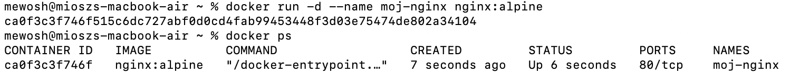

Rys. 11 - Wynik polecenia `docker ps` - wypisanie jedynego uruchomionego kontenera (nginx).

---

##### Ćwiczenie 3.3 — Mapowanie portów

**Opis:** Zatrzymano i usunięto poprzedni kontener nginx, uruchomiono nowy kontener nginx z mapowaniem portów, zweryfikowano, że został on uruchomiony a strona powitalna prawidłowo się wyświetla.

**Użyte polecenia:**

```zsh
# Zatrzymaj poprzedni kontener
docker stop moj-nginx
docker rm moj-nginx

# Uruchom z mapowaniem portów
docker run -d --name moj-nginx -p 8080:80 nginx:alpine

# Sprawdź
docker ps

# Otwórz w przeglądarce: http://localhost:8080
# Lub użyj curl:
curl http://localhost:8080
```

**Wynik działania:**

```zsh
mewosh@mioszs-macbook-air ~ % docker stop moj-nginx
moj-nginx
```

```zsh
mewosh@mioszs-macbook-air ~ % docker rm moj-nginx
moj-nginx
```

```zsh
mewosh@mioszs-macbook-air ~ % docker run -d --name moj-nginx -p 8080:80 nginx:alpine
55a4c2ef160f20895949dd7b097989112420886140c154a9031c3551b8fc44be
```

```zsh
mewosh@mioszs-macbook-air ~ % docker ps
CONTAINER ID   IMAGE          COMMAND                  CREATED         STATUS         PORTS                                     NAMES
55a4c2ef160f   nginx:alpine   "/docker-entrypoint.…"   5 seconds ago   Up 4 seconds   0.0.0.0:8080->80/tcp, [::]:8080->80/tcp   moj-nginx
```

**Screenshot:**

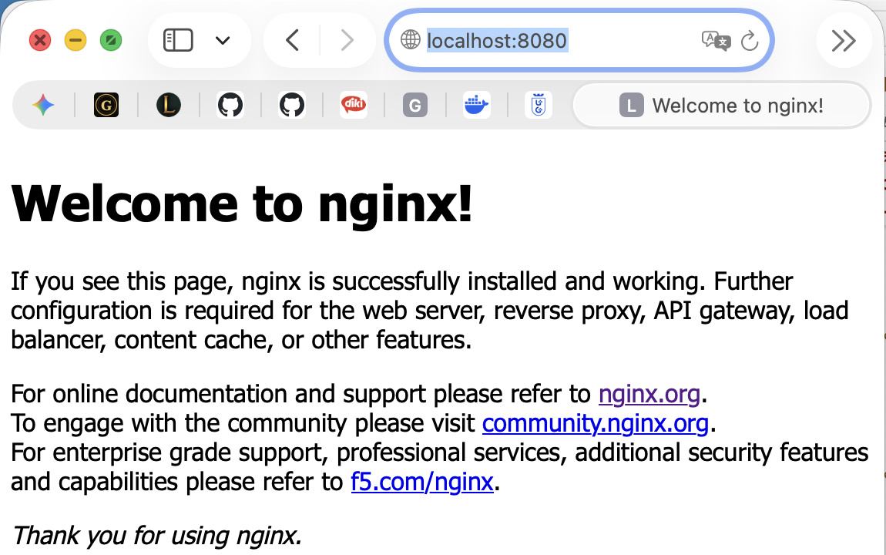

Rys. 12 - Strona powitalna nginx.

---

##### Ćwiczenie 3.4 — Zmienne środowiskowe

**Opis:** Uruchomienie i obsługa kontenera mysql z użyciem zmiennych środowiskowych.

**Użyte polecenia:**

```zsh
# Uruchom kontener ze zmiennymi środowiskowymi
docker run -d --name moj-mysql \
  -e MYSQL_ROOT_PASSWORD=mojehaslo \
  -e MYSQL_DATABASE=testdb \
  -p 3306:3306 \
  mysql:8

# Sprawdź logi (poczekaj na inicjalizację)
docker logs -f moj-mysql
# Ctrl+C aby przerwać śledzenie logów

# Połącz się z bazą
docker exec -it moj-mysql mysql -u root -p mojehaslo -e "SHOW DATABASES;"
```

**Wynik działania:**

```zsh
mewosh@mioszs-macbook-air ~ % docker run -d --name moj-mysql \
  -e MYSQL_ROOT_PASSWORD=mojehaslo \
  -e MYSQL_DATABASE=testdb \
  -p 3306:3306 \
  mysql:8
Unable to find image 'mysql:8' locally
8: Pulling from library/mysql
9a58cacc6b5c: Pull complete 
ebd9edd1f865: Pull complete 
69c97d6063ee: Pull complete 
187b3ea816c4: Pull complete 
b1be88c1a954: Pull complete 
a7f73fdba829: Pull complete 
bd3898dc44c7: Pull complete 
5ecdc743ad91: Pull complete 
1953d80eb3b9: Pull complete 
83b64b116894: Pull complete 
fdecb8cd4a9e: Download complete 
f7fbb1d178cb: Download complete 
Digest: sha256:24989179f58856db763f418010c1169fecc944e3ec1ea7e921572d83eb070f70
Status: Downloaded newer image for mysql:8
c0e57c0c457ad8e9c910c00197133ddb5b7e7545f922d30c87f6361a2888f57e
```

```zsh
mewosh@mioszs-macbook-air ~ % docker logs -f moj-mysql
2026-10-19 15:44:28+00:00 [Note] [Entrypoint]: Entrypoint script for MySQL Server 8.4.11-1.el9 started.
2026-10-19 15:44:28+00:00 [Note] [Entrypoint]: Switching to dedicated user 'mysql'
2026-10-19 15:44:28+00:00 [Note] [Entrypoint]: Entrypoint script for MySQL Server 8.4.11-1.el9 started.
2026-10-19 15:44:28+00:00 [Note] [Entrypoint]: Initializing database files
2026-10-19T15:44:28.688879Z 0 [System] [MY-015017] [Server] MySQL Server Initialization - start.
2026-10-19T15:44:28.689634Z 0 [System] [MY-013169] [Server] /usr/sbin/mysqld (mysqld 8.4.11) initializing of server in progress as process 79
2026-10-19T15:44:28.697894Z 1 [System] [MY-013576] [InnoDB] InnoDB initialization has started.
2026-10-19T15:44:28.821278Z 1 [System] [MY-013577] [InnoDB] InnoDB initialization has ended.
2026-10-19T15:44:29.321342Z 6 [Warning] [MY-010453] [Server] root@localhost is created with an empty password ! Please consider switching off the --initialize-insecure option.
2026-10-19T15:44:30.683319Z 0 [System] [MY-015018] [Server] MySQL Server Initialization - end.
2026-10-19 15:44:30+00:00 [Note] [Entrypoint]: Database files initialized
2026-10-19 15:44:30+00:00 [Note] [Entrypoint]: Starting temporary server
2026-10-19T15:44:30.714412Z 0 [System] [MY-015015] [Server] MySQL Server - start.
2026-10-19T15:44:30.892502Z 0 [System] [MY-010116] [Server] /usr/sbin/mysqld (mysqld 8.4.11) starting as process 120
2026-10-19T15:44:30.903111Z 1 [System] [MY-013576] [InnoDB] InnoDB initialization has started.
2026-10-19T15:44:31.023506Z 1 [System] [MY-013577] [InnoDB] InnoDB initialization has ended.
2026-10-19T15:44:31.180708Z 0 [Warning] [MY-010068] [Server] CA certificate ca.pem is self signed.
2026-10-19T15:44:31.180738Z 0 [System] [MY-013602] [Server] Channel mysql_main configured to support TLS. Encrypted connections are now supported for this channel.
2026-10-19T15:44:31.182951Z 0 [Warning] [MY-011810] [Server] Insecure configuration for --pid-file: Location '/var/run/mysqld' in the path is accessible to all OS users. Consider choosing a different directory.
2026-10-19T15:44:31.194016Z 0 [System] [MY-011323] [Server] X Plugin ready for connections. Socket: /var/run/mysqld/mysqlx.sock
2026-10-19T15:44:31.194084Z 0 [System] [MY-010931] [Server] /usr/sbin/mysqld: ready for connections. Version: '8.4.11'  socket: '/var/run/mysqld/mysqld.sock'  port: 0  MySQL Community Server - GPL.
2026-10-19 15:44:31+00:00 [Note] [Entrypoint]: Temporary server started.
'/var/lib/mysql/mysql.sock' -> '/var/run/mysqld/mysqld.sock'
2026-10-19 15:44:32+00:00 [Note] [Entrypoint]: Creating database testdb

2026-10-19 15:44:32+00:00 [Note] [Entrypoint]: Stopping temporary server
2026-10-19T15:44:32.149459Z 11 [System] [MY-013172] [Server] Received SHUTDOWN from user root. Shutting down mysqld (Version: 8.4.11).
2026-10-19T15:44:33.623482Z 0 [System] [MY-010910] [Server] /usr/sbin/mysqld: Shutdown complete (mysqld 8.4.11)  MySQL Community Server - GPL.
2026-10-19T15:44:33.623512Z 0 [System] [MY-015016] [Server] MySQL Server - end.
2026-10-19 15:44:34+00:00 [Note] [Entrypoint]: Temporary server stopped

2026-10-19 15:44:34+00:00 [Note] [Entrypoint]: MySQL init process done. Ready for start up.

2026-10-19T15:44:34.176308Z 0 [System] [MY-015015] [Server] MySQL Server - start.
2026-10-19T15:44:34.335591Z 0 [System] [MY-010116] [Server] /usr/sbin/mysqld (mysqld 8.4.11) starting as process 1
2026-10-19T15:44:34.339242Z 1 [System] [MY-013576] [InnoDB] InnoDB initialization has started.
2026-10-19T15:44:34.415714Z 1 [System] [MY-013577] [InnoDB] InnoDB initialization has ended.
2026-10-19T15:44:34.548770Z 0 [Warning] [MY-010068] [Server] CA certificate ca.pem is self signed.
2026-10-19T15:44:34.548791Z 0 [System] [MY-013602] [Server] Channel mysql_main configured to support TLS. Encrypted connections are now supported for this channel.
2026-10-19T15:44:34.550117Z 0 [Warning] [MY-011810] [Server] Insecure configuration for --pid-file: Location '/var/run/mysqld' in the path is accessible to all OS users. Consider choosing a different directory.
2026-10-19T15:44:34.559249Z 0 [System] [MY-011323] [Server] X Plugin ready for connections. Bind-address: '::' port: 33060, socket: /var/run/mysqld/mysqlx.sock
2026-10-19T15:44:34.559301Z 0 [System] [MY-010931] [Server] /usr/sbin/mysqld: ready for connections. Version: '8.4.11'  socket: '/var/run/mysqld/mysqld.sock'  port: 3306  MySQL Community Server - GPL.
^C%                                                 
```

```zsh
mewosh@mioszs-macbook-air ~ % docker exec -it moj-mysql mysql -u root -pmojehaslo -e "SHOW DATABASES;" 
mysql: [Warning] Using a password on the command line interface can be insecure.
+--------------------+
| Database           |
+--------------------+
| information_schema |
| mysql              |
| performance_schema |
| sys                |
| testdb             |
+--------------------+
```

**Screenshot:**

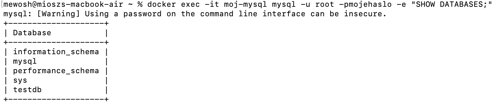

Rys. 13 - Lista znalezionych baz danych w kontenerze mysql.

---

##### Ćwiczenie 3.5 — Automatyczne usuwanie kontenera

**Opis:** Automatyczne usuwanie kontenerów po zakończeniu ich działania i weryfikacja, że rzeczywiście zostały usunięte.

**Użyte polecenia:**

```zsh
# Kontener usunie się po zakończeniu
docker run --rm ubuntu:22.04 echo "Ten kontener się sam usunie"

# Sprawdź — nie powinno go być
docker ps -a | grep "sam usunie"

# Interaktywny z auto-usuwaniem
docker run --rm -it alpine:3.19 sh -c "echo 'Alpine Linux'; cat /etc/os-release"
```

**Wynik działania:**

```zsh
mewosh@mioszs-macbook-air ~ % docker run --rm ubuntu:22.04 echo "Ten kontener się sam usunie"
Ten kontener się sam usunie
```

```zsh
mewosh@mioszs-macbook-air ~ % docker ps -a | grep "sam usunie"
mewosh@mioszs-macbook-air ~ %
```

```zsh
mewosh@mioszs-macbook-air ~ % docker run --rm -it alpine:3.19 sh -c "echo 'Alpine Linux'; cat /etc/os-release"
Alpine Linux
NAME="Alpine Linux"
ID=alpine
VERSION_ID=3.19.9
PRETTY_NAME="Alpine Linux v3.19"
HOME_URL="https://alpinelinux.org/"
BUG_REPORT_URL="https://gitlab.alpinelinux.org/alpine/aports/-/issues"
mewosh@mioszs-macbook-air ~ % 
```

**Screenshot:**

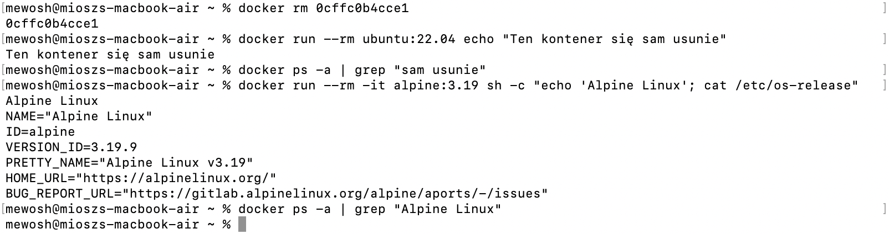

Rys. 14 - Automatyczne usuwanie kontenerów po zakończeniu ich działania i weryfikacja, że rzeczywiście zostały usunięte.

---

##### Ćwiczenie 3.6 — Nadawanie nazw kontenerom

**Opis:** Sprawdzono automatycznie wygenerowaną nazwę kontenera i nadano własną nazwę kontenerowi.

**Użyte polecenia:**

```zsh
# Bez nazwy — Docker generuje losową
docker run -d nginx:alpine
docker ps  # zobacz losową nazwę

# Z nazwą
docker run -d --name web-server nginx:alpine
docker ps  # zobacz nazwę "web-server"

# Sprzątanie
docker stop $(docker ps -q)
docker rm $(docker ps -aq)
```

**Wynik działania:**

```zsh
mewosh@mioszs-macbook-air ~ % docker run -d nginx:alpine
5f498e70f11b1ecea696a28489dbdfce183c4dde7674fa4e50b0b198d64424c2
```

```zsh
mewosh@mioszs-macbook-air ~ % docker ps
CONTAINER ID   IMAGE          COMMAND                  CREATED          STATUS          PORTS                                         NAMES
5f498e70f11b   nginx:alpine   "/docker-entrypoint.…"   8 seconds ago    Up 7 seconds    80/tcp                                        priceless_elion
c0e57c0c457a   mysql:8        "docker-entrypoint.s…"   19 minutes ago   Up 19 minutes   0.0.0.0:3306->3306/tcp, [::]:3306->3306/tcp   moj-mysql
55a4c2ef160f   nginx:alpine   "/docker-entrypoint.…"   25 minutes ago   Up 25 minutes   0.0.0.0:8080->80/tcp, [::]:8080->80/tcp       moj-nginx
```

```zsh
mewosh@mioszs-macbook-air ~ % docker run -d --name web-server nginx:alpine
d52813a45dc39338e5f37959a638ad8fad6b3b269ae454f67ac0ebe311835a03
```

```zsh
mewosh@mioszs-macbook-air ~ % docker ps
CONTAINER ID   IMAGE          COMMAND                  CREATED          STATUS          PORTS                                         NAMES
d52813a45dc3   nginx:alpine   "/docker-entrypoint.…"   4 seconds ago    Up 4 seconds    80/tcp                                        web-server
5f498e70f11b   nginx:alpine   "/docker-entrypoint.…"   31 seconds ago   Up 30 seconds   80/tcp                                        priceless_elion
c0e57c0c457a   mysql:8        "docker-entrypoint.s…"   20 minutes ago   Up 20 minutes   0.0.0.0:3306->3306/tcp, [::]:3306->3306/tcp   moj-mysql
55a4c2ef160f   nginx:alpine   "/docker-entrypoint.…"   26 minutes ago   Up 26 minutes   0.0.0.0:8080->80/tcp, [::]:8080->80/tcp       moj-nginx
```

```zsh
mewosh@mioszs-macbook-air ~ % docker stop $(docker ps -q)
d52813a45dc3
5f498e70f11b
c0e57c0c457a
55a4c2ef160f
```

```zsh
mewosh@mioszs-macbook-air ~ % docker rm $(docker ps -aq)
d52813a45dc3
5f498e70f11b
c0e57c0c457a
55a4c2ef160f
06fca72ddd11
a20c7bad002c
ffaef314b2e6
7954f19f1271
db8f773ba507
```

**Screenshot:**

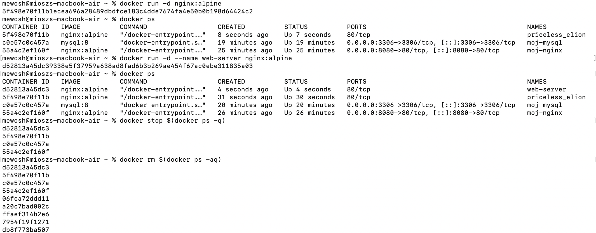

Rys. 15 - Utworzenie kontenera z automatycznie nadaną nazwą `priceless_elion` i utworzenie kontenera z własną nazwą `web-server`.

---

##### Ćwiczenie 4.1 — Start, stop, restart

**Opis:** Utworzono, zatrzymano, uruchomiono ponownie, zrestartowano i zweryfikowano działanie kontenera nginx.

**Użyte polecenia:**

```zsh
# Uruchom kontener
docker run -d --name test-nginx -p 8080:80 nginx:alpine

# Zatrzymaj
docker stop test-nginx

# Sprawdź status
docker ps -a

# Uruchom ponownie
docker start test-nginx

# Restart
docker restart test-nginx

# Sprawdź
curl http://localhost:8080
```

**Wynik działania:**

```zsh
mewosh@mioszs-macbook-air ~ % docker run -d --name test-nginx -p 8080:80 nginx:alpine
3baa6a86c1d49defcc4ecb00e29eda25f49efe062a27c0edb46925e66ea3943f
```

```zsh
mewosh@mioszs-macbook-air ~ % docker stop test-nginx
test-nginx
```

```zsh
mewosh@mioszs-macbook-air ~ % docker ps -a
CONTAINER ID   IMAGE          COMMAND                  CREATED          STATUS                     PORTS     NAMES
3baa6a86c1d4   nginx:alpine   "/docker-entrypoint.…"   17 seconds ago   Exited (0) 4 seconds ago             test-nginx
```

```zsh
mewosh@mioszs-macbook-air ~ % docker start test-nginx
test-nginx
```

```zsh
mewosh@mioszs-macbook-air ~ % docker restart test-nginx
test-nginx
```

```zsh
mewosh@mioszs-macbook-air ~ % curl http://localhost:8080
<!DOCTYPE html>
<html>
<head>
<title>Welcome to nginx!</title>
<style>
html { color-scheme: light dark; }
body { width: 35em; margin: 0 auto;
font-family: Tahoma, Verdana, Arial, sans-serif; }
</style>
</head>
<body>
<h1>Welcome to nginx!</h1>
<p>If you see this page, nginx is successfully installed and working.
Further configuration is required for the web server, reverse proxy, 
API gateway, load balancer, content cache, or other features.</p>

<p>For online documentation and support please refer to
<a href="https://nginx.org/">nginx.org</a>.<br/>
To engage with the community please visit
<a href="https://community.nginx.org/">community.nginx.org</a>.<br/>
For enterprise grade support, professional services, additional 
security features and capabilities please refer to
<a href="https://f5.com/nginx">f5.com/nginx</a>.</p>

<p><em>Thank you for using nginx.</em></p>
</body>
</html>
```

**Screenshot:**

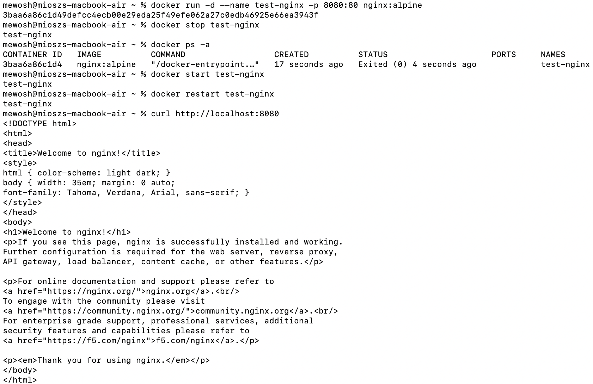

Rys. 16 - Wynik poleceń `docker run -d --name test-nginx -p 8080:80 nginx:alpine` - utworzenie i uruchomienie kontenera nginx o nazwie `test-nginx` z mapowaniem portów `8080:80`, `docker stop test-nginx` - zatrzymanie kontenera `test-nginx`, `docker ps -a` - wypisanie listy wszystkich kontenerów, `docker start test-nginx` - uruchomienie poprzednio utworzonego kontenera `test-nginx`, `docker restart test-nginx` - restart kontenera `test-nginx` i `curl http://localhost:8080` - odpytanie serwera nginx w celu weryfikacji jego działania.

---

##### Ćwiczenie 4.2 — Wykonywanie komend w kontenerze (exec)

**Opis:** Wykonano polecenia powłoki systemowej w kontenerze Ubuntu i sprawdzono działające procesy zarówno z zewnątrz, jak również ze środka kontenera.

**Użyte polecenia:**

```zsh
# Uruchom kontener
docker run -d --name moj-ubuntu ubuntu:22.04 sleep 3600

# Wykonaj komendę
docker exec moj-ubuntu cat /etc/os-release

# Interaktywna sesja
docker exec -it moj-ubuntu bash

# Wewnątrz:
apt-get update && apt-get install -y procps
ps aux
exit

# Sprawdź procesy z zewnątrz
docker top moj-ubuntu
```

**Wynik działania:**

```zsh
mewosh@mioszs-macbook-air ~ % docker run -d --name moj-ubuntu ubuntu:22.04 sleep 3600
33dd0ecf249ba3bc53d8444b9f788d44a556a3aa9c41f968f6d808f156fed8c1
```

```zsh
mewosh@mioszs-macbook-air ~ % docker exec moj-ubuntu cat /etc/os-release
PRETTY_NAME="Ubuntu 22.04.5 LTS"
NAME="Ubuntu"
VERSION_ID="22.04"
VERSION="22.04.5 LTS (Jammy Jellyfish)"
VERSION_CODENAME=jammy
ID=ubuntu
ID_LIKE=debian
HOME_URL="https://www.ubuntu.com/"
SUPPORT_URL="https://help.ubuntu.com/"
BUG_REPORT_URL="https://bugs.launchpad.net/ubuntu/"
PRIVACY_POLICY_URL="https://www.ubuntu.com/legal/terms-and-policies/privacy-policy"
UBUNTU_CODENAME=jammy
```

```zsh
mewosh@mioszs-macbook-air ~ % docker exec -it moj-ubuntu bash
root@33dd0ecf249b:/#
```

```zsh
root@33dd0ecf249b:/# apt-get update && apt-get install -y procps
Get:1 http://ports.ubuntu.com/ubuntu-ports jammy InRelease [270 kB]
Get:2 http://ports.ubuntu.com/ubuntu-ports jammy-updates InRelease [128 kB]
Get:3 http://ports.ubuntu.com/ubuntu-ports jammy-backports InRelease [127 kB]
Get:4 http://ports.ubuntu.com/ubuntu-ports jammy-security InRelease [129 kB]
Get:5 http://ports.ubuntu.com/ubuntu-ports jammy/universe arm64 Packages [17.2 MB]
Get:6 http://ports.ubuntu.com/ubuntu-ports jammy/multiverse arm64 Packages [224 kB]
Get:7 http://ports.ubuntu.com/ubuntu-ports jammy/main arm64 Packages [1758 kB]
Get:8 http://ports.ubuntu.com/ubuntu-ports jammy/restricted arm64 Packages [24.2 kB]
Get:9 http://ports.ubuntu.com/ubuntu-ports jammy-updates/main arm64 Packages [4566 kB]
Get:10 http://ports.ubuntu.com/ubuntu-ports jammy-updates/multiverse arm64 Packages [81.6 kB]
Get:11 http://ports.ubuntu.com/ubuntu-ports jammy-updates/universe arm64 Packages [1716 kB]
Get:12 http://ports.ubuntu.com/ubuntu-ports jammy-updates/restricted arm64 Packages [8359 kB]
Get:13 http://ports.ubuntu.com/ubuntu-ports jammy-backports/main arm64 Packages [82.5 kB]
Get:14 http://ports.ubuntu.com/ubuntu-ports jammy-backports/universe arm64 Packages [33.7 kB]
Get:15 http://ports.ubuntu.com/ubuntu-ports jammy-security/universe arm64 Packages [1421 kB]
Get:16 http://ports.ubuntu.com/ubuntu-ports jammy-security/restricted arm64 Packages [8061 kB]
Get:17 http://ports.ubuntu.com/ubuntu-ports jammy-security/multiverse arm64 Packages [75.6 kB]
Get:18 http://ports.ubuntu.com/ubuntu-ports jammy-security/main arm64 Packages [4253 kB]
Fetched 48.5 MB in 5s (9254 kB/s)                            
Reading package lists... Done
Reading package lists... Done
Building dependency tree... Done
Reading state information... Done
procps is already the newest version (2:3.3.17-6ubuntu2.1).
0 upgraded, 0 newly installed, 0 to remove and 2 not upgraded.
```

```zsh
root@33dd0ecf249b:/# ps aux
USER       PID %CPU %MEM    VSZ   RSS TTY      STAT START   TIME COMMAND
root         1  0.0  0.0   2228  1080 ?        Ss   17:07   0:00 sleep 3600
root        13  0.0  0.0   4144  3268 pts/0    Ss   17:07   0:00 bash
root       226  0.0  0.0   6464  2432 pts/0    R+   17:08   0:00 ps aux
```

```zsh
root@33dd0ecf249b:/# exit
exit
mewosh@mioszs-macbook-air ~ %
```

```zsh
mewosh@mioszs-macbook-air ~ % docker top moj-ubuntu
UID                 PID                 PPID                C                   STIME               TTY                 TIME                CMD
root                1018                995                 0                   17:07               ?                   00:00:00            sleep 3600
```

**Screenshot:**

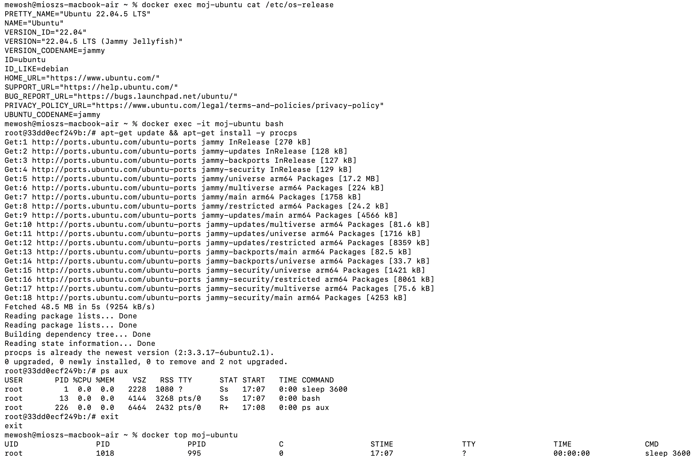

Rys. 17 - Wynik poleceń `docker exec *` - wypisanie zawartości pliku `/etc/os-release`, aktualizacja pakietów, instalacja pakietu `procps` i wypisanie procesów wewnątrz kontenera oraz `docker top` - wypisanie działających procesów z zewnątrz kontenera.

---

##### Ćwiczenie 4.3 — Kopiowanie plików (docker cp)

**Opis:** Utworzono pliki na komputerze hosta i w konterze a następnie skopiowano pliki między hostem i kontenerem.

**Użyte polecenia:**

```zsh
# Utwórz plik na hoście
echo 'Witaj z hosta!' > plik-z-hosta.txt

# Skopiuj do kontenera
docker cp plik-z-hosta.txt moj-ubuntu:/tmp/

# Sprawdź w kontenerze
docker exec moj-ubuntu cat /tmp/plik-z-hosta.txt

# Utwórz plik w kontenerze
docker exec moj-ubuntu bash -c "echo 'Witaj z kontenera' > /tmp/plik-z-kontenera.txt"

# Skopiuj z kontenera na hosta
docker cp moj-ubuntu:/tmp/plik-z-kontenera.txt ./

# Sprawdź na hoście
cat plik-z-kontenera.txt
```

**Wynik działania:**

```zsh
mewosh@mioszs-macbook-air ~ % echo 'Witaj z hosta!' > plik-z-hosta.txt
mewosh@mioszs-macbook-air ~ %
```

```zsh
mewosh@mioszs-macbook-air ~ % docker cp plik-z-hosta.txt moj-ubuntu:/tmp/
Successfully copied 2.05kB to moj-ubuntu:/tmp/
```

```zsh
mewosh@mioszs-macbook-air ~ % docker exec moj-ubuntu cat /tmp/plik-z-hosta.txt
Witaj z hosta!
```

```zsh
mewosh@mioszs-macbook-air ~ % docker exec moj-ubuntu bash -c "echo 'Witaj z kontenera' > /tmp/plik-z-kontenera.txt"
mewosh@mioszs-macbook-air ~ %
```

```zsh
mewosh@mioszs-macbook-air ~ % docker cp moj-ubuntu:/tmp/plik-z-kontenera.txt ./
Successfully copied 2.05kB to /Users/mewosh/./
```

```zsh
mewosh@mioszs-macbook-air ~ % cat plik-z-kontenera.txt
Witaj z kontenera
```

**Screenshot:**

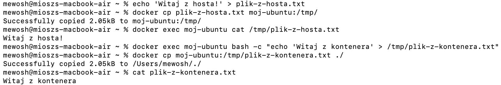

Rys. 18 - Wynik tworzenia i kopiowania plików między hostem i kontenerem - zawartość pliku utworzonego na hoście została poprawnie odczytana z poziomu kontenera, jak również zawartość pliku utworzonego w kontenerze została poprawnie odczytana z poziomu hosta.

---

##### Ćwiczenie 4.4 — Logi kontenerów

**Opis:** Uruchomiono skrypt wypisujący w nieskończoność logi wewnątrz kontenera i odczytano wypisane logi.

**Użyte polecenia:**

```zsh
# Uruchom kontener generujący logi
docker run -d --name logger ubuntu:22.04 \
  bash -c "while true; do echo \"Log: \$(date)\"; sleep 2; done"

# Wszystkie logi
docker logs logger

# Ostatnie 5 linii
docker logs --tail 5 logger

# Śledzenie na żywo
docker logs -f logger
# Ctrl+C aby przerwać

# Z timestampami
docker logs -t --tail 3 logger
```

**Wynik działania:**

```zsh
mewosh@mioszs-macbook-air ~ % docker run -d --name logger ubuntu:22.04 \
  bash -c "while true; do echo \"Log: \$(date)\"; sleep 2; done"
f1d59485c998c979e0c930577d14f83bde14f879b691ce69e810a3f2375acde7
```

```zsh
mewosh@mioszs-macbook-air ~ % docker logs logger
Log: Mon Oct 19 17:43:57 UTC 2026
Log: Mon Oct 19 17:43:59 UTC 2026
Log: Mon Oct 19 17:44:01 UTC 2026
Log: Mon Oct 19 17:44:03 UTC 2026
```

```zsh
mewosh@mioszs-macbook-air ~ % docker logs --tail 5 logger
Log: Mon Oct 19 17:44:01 UTC 2026
Log: Mon Oct 19 17:44:03 UTC 2026
Log: Mon Oct 19 17:44:05 UTC 2026
Log: Mon Oct 19 17:44:07 UTC 2026
Log: Mon Oct 19 17:44:09 UTC 2026
```

```zsh
mewosh@mioszs-macbook-air ~ % docker logs -f logger
Log: Mon Oct 19 17:43:57 UTC 2026
Log: Mon Oct 19 17:43:59 UTC 2026
Log: Mon Oct 19 17:44:01 UTC 2026
Log: Mon Oct 19 17:44:03 UTC 2026
Log: Mon Oct 19 17:44:05 UTC 2026
Log: Mon Oct 19 17:44:07 UTC 2026
Log: Mon Oct 19 17:44:09 UTC 2026
Log: Mon Oct 19 17:44:11 UTC 2026
Log: Mon Oct 19 17:44:13 UTC 2026
Log: Mon Oct 19 17:44:15 UTC 2026
Log: Mon Oct 19 17:44:17 UTC 2026
^C%                     
```

```zsh
mewosh@mioszs-macbook-air ~ % docker logs -t --tail 3 logger
2026-10-19T17:44:17.407337757Z Log: Mon Oct 19 17:44:17 UTC 2026
2026-10-19T17:44:19.413770799Z Log: Mon Oct 19 17:44:19 UTC 2026
2026-10-19T17:44:21.418862342Z Log: Mon Oct 19 17:44:21 UTC 2026
```

**Screenshot:**

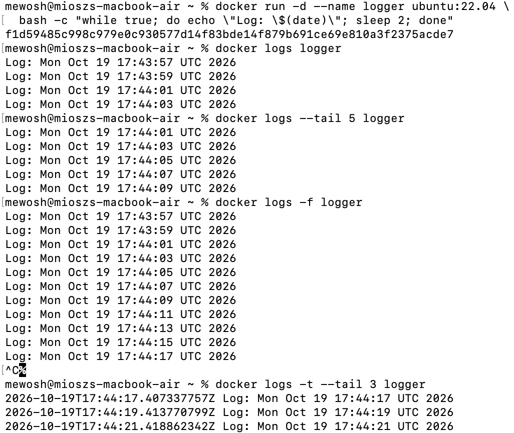

Rys. 19 - Wynik polecenia zawierającego nieskończoną pętlę wypisującą tekst "Log: " z obecną datą, wynik odczytania wszystkich i 5 najnowszych logów, wynik odczytywania logów przybywających w czasie rzeczywistym oraz wynik wypisania najnowszych 3 logów wraz z timestampem ich wystąpienia.

---

##### Ćwiczenie 4.5 — Statystyki zasobów

**Opis:** Uruchomiono 2 kontenery a następnie sprawdzono wykorzystanie zasobów sprzętowych z różnymi opcjami formatowania tekstu wynikowego.

**Użyte polecenia:**

```zsh
# Uruchom kilka kontenerów
docker run -d --name web1 nginx:alpine
docker run -d --name web2 nginx:alpine

# Statystyki na żywo
docker stats
# Ctrl+C aby przerwać

# Jednorazowy snapshot
docker stats --no-stream

# Formatowanie
docker stats --no-stream --format "table {{.Name}}\t{{.CPUPerc}}\t{{.MemUsage}}"
```

**Wynik działania:**

```zsh
mewosh@mioszs-macbook-air ~ % docker run -d --name web1 nginx:alpine
333e6b9411b05c81c15a5019f2799daa3e17b31beb1fc1c8d3eaef37026364d4
```

```zsh
mewosh@mioszs-macbook-air ~ % docker run -d --name web2 nginx:alpine
4d744c9285c7c8c92f01898d8d2f5a2db9b50e7bc987589f31e5054114601cd4
```

```zsh
mewosh@mioszs-macbook-air ~ % docker stats
CONTAINER ID   NAME         CPU %     MEM USAGE / LIMIT     MEM %     NET I/O          BLOCK I/O        PIDS 
4d744c9285c7   web2         0.00%     7.277MiB / 7.653GiB   0.09%     872B / 126B      0B / 12.3kB      9 
333e6b9411b0   web1         0.00%     7.375MiB / 7.653GiB   0.09%     998B / 126B      0B / 12.3kB      9 
f1d59485c998   logger       0.19%     1.055MiB / 7.653GiB   0.01%     1.38kB / 126B    94.2kB / 0B      2 
33dd0ecf249b   moj-ubuntu   0.00%     18.78MiB / 7.653GiB   0.24%     48.7MB / 117kB   18MB / 129MB     1 
3baa6a86c1d4   test-nginx   0.00%     7.254MiB / 7.653GiB   0.09%     2.6kB / 1.68kB   24.6kB / 4.1kB   9
```

```zsh
mewosh@mioszs-macbook-air ~ % docker stats --no-stream
CONTAINER ID   NAME         CPU %     MEM USAGE / LIMIT     MEM %     NET I/O          BLOCK I/O        PIDS
4d744c9285c7   web2         0.00%     7.277MiB / 7.653GiB   0.09%     872B / 126B      0B / 12.3kB      9
333e6b9411b0   web1         0.00%     7.375MiB / 7.653GiB   0.09%     998B / 126B      0B / 12.3kB      9
f1d59485c998   logger       0.33%     1.18MiB / 7.653GiB    0.02%     1.38kB / 126B    94.2kB / 0B      2
33dd0ecf249b   moj-ubuntu   0.00%     18.78MiB / 7.653GiB   0.24%     48.7MB / 117kB   18MB / 129MB     1
3baa6a86c1d4   test-nginx   0.00%     7.254MiB / 7.653GiB   0.09%     2.6kB / 1.68kB   24.6kB / 4.1kB   9
```

```zsh
mewosh@mioszs-macbook-air ~ % docker stats --no-stream --format "table {{.Name}}\t{{.CPUPerc}}\t{{.MemUsage}}"
NAME         CPU %     MEM USAGE / LIMIT
web2         0.00%     7.277MiB / 7.653GiB
web1         0.00%     7.375MiB / 7.653GiB
logger       0.37%     1.008MiB / 7.653GiB
moj-ubuntu   0.00%     18.78MiB / 7.653GiB
test-nginx   0.00%     7.254MiB / 7.653GiB
```

**Screenshot:**

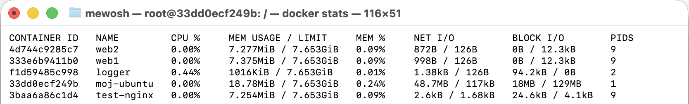

Rys. 20 - Wynik wykonania polecenia `docker stats` - wyświetlanie statystyk zużycia zasobów przez kontenery w czasie rzeczywistym.

---

##### Ćwiczenie 5.1 — docker inspect

**Opis:** Uruchomiono i sprawdzono parametry kontenera nginx, m.in.: adres IP, stan, mapowanie portów i zmienne środowiskowe.

**Użyte polecenia:**

```zsh
# Uruchom kontener
docker run -d --name inspect-test -p 9090:80 nginx:alpine

# Pełna inspekcja
docker inspect inspect-test

# Adres IP
docker inspect -f '{{range .NetworkSettings.Networks}}{{.IPAddress}}{{end}}' inspect-test

# Stan kontenera
docker inspect -f '{{.State.Status}}' inspect-test

# Mapowanie portów
docker inspect -f '{{json .NetworkSettings.Ports}}' inspect-test

# Zmienne środowiskowe
docker inspect -f '{{json .Config.Env}}' inspect-test
```

**Wynik działania:**

```zsh
mewosh@mioszs-macbook-air ~ % docker run -d --name inspect-test -p 9090:80 nginx:alpine
978c04ca1c8a0cad49c6728f91dcee8a6a387eda9a665e9265a30ab032f31a55
```

```zsh
mewosh@mioszs-macbook-air ~ % docker inspect inspect-test
[
    {
        "Id": "978c04ca1c8a0cad49c6728f91dcee8a6a387eda9a665e9265a30ab032f31a55",
        "Created": "2026-10-19T18:15:32.157043597Z",
        "Path": "/docker-entrypoint.sh",
        "Args": [
            "nginx",
            "-g",
            "daemon off;"
        ],
        "State": {
            "Status": "running",
            "Running": true,
            "Paused": false,
            "Restarting": false,
            "OOMKilled": false,
            "Dead": false,
            "Pid": 3853,
            "ExitCode": 0,
            "Error": "",
            "StartedAt": "2026-10-19T18:15:32.195002055Z",
            "FinishedAt": "0001-01-01T00:00:00Z"
        },
        "Image": "sha256:892bb2152464f0c5d8972593a5f5afaf8054552580b699d95f8ff4af08c2d33d",
        "ResolvConfPath": "/var/lib/docker/containers/978c04ca1c8a0cad49c6728f91dcee8a6a387eda9a665e9265a30ab032f31a55/resolv.conf",
        "HostnamePath": "/var/lib/docker/containers/978c04ca1c8a0cad49c6728f91dcee8a6a387eda9a665e9265a30ab032f31a55/hostname",
        "HostsPath": "/var/lib/docker/containers/978c04ca1c8a0cad49c6728f91dcee8a6a387eda9a665e9265a30ab032f31a55/hosts",
        "LogPath": "/var/lib/docker/containers/978c04ca1c8a0cad49c6728f91dcee8a6a387eda9a665e9265a30ab032f31a55/978c04ca1c8a0cad49c6728f91dcee8a6a387eda9a665e9265a30ab032f31a55-json.log",
        "Name": "/inspect-test",
        "RestartCount": 0,
        "Driver": "overlayfs",
        "Platform": "linux",
        "MountLabel": "",
        "ProcessLabel": "",
        "AppArmorProfile": "",
        "ExecIDs": null,
        "HostConfig": {
            "Binds": null,
            "ContainerIDFile": "",
            "LogConfig": {
                "Type": "json-file",
                "Config": {}
            },
            "NetworkMode": "bridge",
            "PortBindings": {
                "80/tcp": [
                    {
                        "HostIp": "",
                        "HostPort": "9090"
                    }
                ]
            },
            "RestartPolicy": {
                "Name": "no",
                "MaximumRetryCount": 0
            },
            "AutoRemove": false,
            "VolumeDriver": "",
            "VolumesFrom": null,
            "ConsoleSize": [
                51,
                116
            ],
            "CapAdd": null,
            "CapDrop": null,
            "CgroupnsMode": "private",
            "Dns": null,
            "DnsOptions": [],
            "DnsSearch": [],
            "ExtraHosts": null,
            "GroupAdd": null,
            "IpcMode": "private",
            "Cgroup": "",
            "Links": null,
            "OomScoreAdj": 0,
            "PidMode": "",
            "Privileged": false,
            "PublishAllPorts": false,
            "ReadonlyRootfs": false,
            "SecurityOpt": null,
            "UTSMode": "",
            "UsernsMode": "",
            "ShmSize": 67108864,
            "Runtime": "runc",
            "Isolation": "",
            "CpuShares": 0,
            "Memory": 0,
            "NanoCpus": 0,
            "CgroupParent": "",
            "BlkioWeight": 0,
            "BlkioWeightDevice": [],
            "BlkioDeviceReadBps": [],
            "BlkioDeviceWriteBps": [],
            "BlkioDeviceReadIOps": [],
            "BlkioDeviceWriteIOps": [],
            "CpuPeriod": 0,
            "CpuQuota": 0,
            "CpuRealtimePeriod": 0,
            "CpuRealtimeRuntime": 0,
            "CpusetCpus": "",
            "CpusetMems": "",
            "Devices": [],
            "DeviceCgroupRules": null,
            "DeviceRequests": null,
            "MemoryReservation": 0,
            "MemorySwap": 0,
            "MemorySwappiness": null,
            "OomKillDisable": null,
            "PidsLimit": null,
            "Ulimits": [],
            "CpuCount": 0,
            "CpuPercent": 0,
            "IOMaximumIOps": 0,
            "IOMaximumBandwidth": 0,
            "MaskedPaths": [
                "/proc/acpi",
                "/proc/asound",
                "/proc/interrupts",
                "/proc/kcore",
                "/proc/keys",
                "/proc/latency_stats",
                "/proc/sched_debug",
                "/proc/scsi",
                "/proc/timer_list",
                "/proc/timer_stats",
                "/sys/devices/virtual/powercap",
                "/sys/firmware"
            ],
            "ReadonlyPaths": [
                "/proc/bus",
                "/proc/fs",
                "/proc/irq",
                "/proc/sys",
                "/proc/sysrq-trigger"
            ]
        },
        "GraphDriver": {
            "Data": null,
            "Name": ""
        },
        "Mounts": [],
        "Config": {
            "Hostname": "978c04ca1c8a",
            "Domainname": "",
            "User": "",
            "AttachStdin": false,
            "AttachStdout": false,
            "AttachStderr": false,
            "ExposedPorts": {
                "80/tcp": {}
            },
            "Tty": false,
            "OpenStdin": false,
            "StdinOnce": false,
            "Env": [
                "PATH=/usr/local/sbin:/usr/local/bin:/usr/sbin:/usr/bin:/sbin:/bin",
                "NGINX_VERSION=1.31.7",
                "PKG_RELEASE=1",
                "DYNPKG_RELEASE=1",
                "NJS_VERSION=1.0.2",
                "NJS_RELEASE=1",
                "ACME_VERSION=0.4.1"
            ],
            "Cmd": [
                "nginx",
                "-g",
                "daemon off;"
            ],
            "Image": "nginx:alpine",
            "Volumes": null,
            "WorkingDir": "/",
            "Entrypoint": [
                "/docker-entrypoint.sh"
            ],
            "OnBuild": null,
            "Labels": {
                "maintainer": "NGINX Docker Maintainers \u003cdocker-maint@nginx.com\u003e"
            },
            "StopSignal": "SIGQUIT",
            "StopTimeout": 1
        },
        "NetworkSettings": {
            "Bridge": "",
            "SandboxID": "396466a5f871f6a8628f7ccaf339869628e828a3da21f61e2344f6aa8adf1145",
            "SandboxKey": "/var/run/docker/netns/396466a5f871",
            "Ports": {
                "80/tcp": [
                    {
                        "HostIp": "0.0.0.0",
                        "HostPort": "9090"
                    },
                    {
                        "HostIp": "::",
                        "HostPort": "9090"
                    }
                ]
            },
            "HairpinMode": false,
            "LinkLocalIPv6Address": "",
            "LinkLocalIPv6PrefixLen": 0,
            "SecondaryIPAddresses": null,
            "SecondaryIPv6Addresses": null,
            "EndpointID": "",
            "Gateway": "",
            "GlobalIPv6Address": "",
            "GlobalIPv6PrefixLen": 0,
            "IPAddress": "",
            "IPPrefixLen": 0,
            "IPv6Gateway": "",
            "MacAddress": "",
            "Networks": {
                "bridge": {
                    "IPAMConfig": null,
                    "Links": null,
                    "Aliases": null,
                    "MacAddress": "1a:21:78:9d:72:b7",
                    "DriverOpts": null,
                    "GwPriority": 0,
                    "NetworkID": "fd10c4e58165462829de741c0a9182921788c5aa7d92cfdcfbf0d0bbadcfdc9d",
                    "EndpointID": "fae5fc24260e9fb707557fdf0c0829c8b6de3a6b3dcf8ab6ccc62424eedb3fb7",
                    "Gateway": "172.17.0.1",
                    "IPAddress": "172.17.0.3",
                    "IPPrefixLen": 16,
                    "IPv6Gateway": "",
                    "GlobalIPv6Address": "",
                    "GlobalIPv6PrefixLen": 0,
                    "DNSNames": null
                }
            }
        },
        "ImageManifestDescriptor": {
            "mediaType": "application/vnd.oci.image.manifest.v1+json",
            "digest": "sha256:2d829ce6bc998fecd1cd72204c358c0c0614bab5edd9471dfcf8b92a49f4d323",
            "size": 2497,
            "annotations": {
                "com.docker.official-images.bashbrew.arch": "arm64v8",
                "org.opencontainers.image.base.digest": "sha256:53cc40bd63d20f1b289a9c34eb91953866b83ab2b9e4986ac82c97f123223e60",
                "org.opencontainers.image.base.name": "nginx:1.31.7-alpine-slim",
                "org.opencontainers.image.created": "2026-10-14T20:11:35Z",
                "org.opencontainers.image.revision": "4b9f658be76820b24e4ef4605413a5c08707a512",
                "org.opencontainers.image.source": "https://github.com/nginx/docker-nginx.git#4b9f658be76820b24e4ef4605413a5c08707a512:mainline/alpine",
                "org.opencontainers.image.url": "https://hub.docker.com/_/nginx",
                "org.opencontainers.image.version": "1.31.7-alpine"
            },
            "platform": {
                "architecture": "arm64",
                "os": "linux",
                "variant": "v8"
            }
        }
    }
]
```

```zsh
mewosh@mioszs-macbook-air ~ % docker inspect -f '{{range .NetworkSettings.Networks}}{{.IPAddress}}{{end}}' inspect-test
172.17.0.3
```

```zsh
mewosh@mioszs-macbook-air ~ % docker inspect -f '{{.State.Status}}' inspect-test
running
```

```zsh
mewosh@mioszs-macbook-air ~ % docker inspect -f '{{json .NetworkSettings.Ports}}' inspect-test
{"80/tcp":[{"HostIp":"0.0.0.0","HostPort":"9090"},{"HostIp":"::","HostPort":"9090"}]}
```

```zsh
mewosh@mioszs-macbook-air ~ % docker inspect -f '{{json .Config.Env}}' inspect-test
["PATH=/usr/local/sbin:/usr/local/bin:/usr/sbin:/usr/bin:/sbin:/bin","NGINX_VERSION=1.31.7","PKG_RELEASE=1","DYNPKG_RELEASE=1","NJS_VERSION=1.0.2","NJS_RELEASE=1","ACME_VERSION=0.4.1"]
```

**Screenshot:**

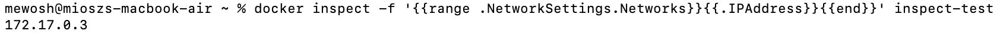

Rys. 21 - Wynik polecenia `docker inspect -f '{{range .NetworkSettings.Networks}}{{.IPAddress}}{{end}}' inspect-test` - wyświetlenie adresu IP kontenera.

---

##### Ćwiczenie 5.2 — docker diff

**Opis:** Wprowadzono zmiany w kontenerze i porównano je z oryginalnym stanem obrazu Ubuntu, na podstawie którego utworzono kontener.

**Użyte polecenia:**

```zsh
# Uruchom kontener i zmodyfikuj go
docker run -it --name diff-test ubuntu:22.04 bash

# Wewnątrz kontenera:
touch /nowy-plik.txt
echo "test" > /tmp/dane.txt
rm /etc/issue
exit

# Sprawdź zmiany
docker diff diff-test
```

**Wynik działania:**

```zsh
mewosh@mioszs-macbook-air ~ % docker run -it --name diff-test ubuntu:22.04 bash
root@46b912290005:/# 
```

```zsh
root@46b912290005:/# touch /nowy-plik.txt
root@46b912290005:/# 
```

```zsh
root@46b912290005:/# echo "test" > /tmp/dane.txt
root@46b912290005:/# 
```

```zsh
root@46b912290005:/# rm /etc/issue
root@46b912290005:/# 
```

```zsh
root@46b912290005:/# exit
exit
mewosh@mioszs-macbook-air ~ % 
```

```zsh
mewosh@mioszs-macbook-air ~ % docker diff diff-test
C /tmp
A /tmp/dane.txt
A /nowy-plik.txt
C /root
A /root/.bash_history
C /etc
D /etc/issue
```

**Pytanie:** Co oznaczają litery A, C, D w wyniku `docker diff`?

**Odpowiedź:** Litery A (Added), C (Changed) i D (Delete) oznaczają kolejno, że plik lub katalog został dodany (nie istniał w oryginalnym obrazie), zmodyfikowany lub usunięty (istniał w oryginalnym obrazie ale został skasowany).

**Screenshot:**

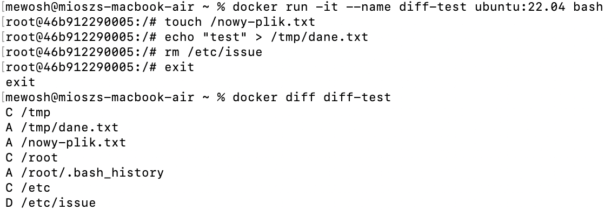

Rys. 22 - Wynik polecenia `docker diff diff-test` - wypisanie zmian w kontenerze względem stanu oryginalnego obrazu.

---

##### Ćwiczenie 5.3 — docker port

**Opis:** Uruchomiono kontener nginx i sprawdzono, czy podana konfiguracja mapowania portów została prawidłowo zaaplikowana.

**Użyte polecenia:**

```zsh
docker run -d --name port-test -p 8081:80 -p 8443:443 nginx:alpine

# Sprawdź mapowanie portów
docker port port-test
docker port port-test 80
```

**Wynik działania:**

```zsh
mewosh@mioszs-macbook-air ~ % docker run -d --name port-test -p 8081:80 -p 8443:443 nginx:alpine
ccf6288ebe3c1f12a4fa0548268f7650f27ceea5b6c29a3d91c3081914dd5b8f
```

```zsh
mewosh@mioszs-macbook-air ~ % docker port port-test
80/tcp -> 0.0.0.0:8081
80/tcp -> [::]:8081
443/tcp -> 0.0.0.0:8443
443/tcp -> [::]:8443
```

```zsh
mewosh@mioszs-macbook-air ~ % docker port port-test 80
0.0.0.0:8081
[::]:8081
```

**Screenshot:**

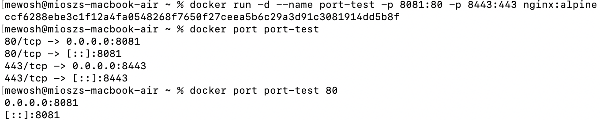

Rys. 23 - Wynik poleceń `docker port *` - wypisanie mapowań portów komputera hosta na porty wewnątrz kontenera.

---

##### Ćwiczenie 6.1 — Usuwanie kontenerów i obrazów

**Opis:** Zatrzymano i usunięto wszystkie kontenery, usunięto nieużywane obrazy i pozostałe komponenty Dockera oraz sprawdzono zajętość dysku przed i po czyszczeniu.

**Użyte polecenia:**

```zsh
# Zatrzymaj wszystkie kontenery
docker stop $(docker ps -q)

# Usuń wszystkie zatrzymane kontenery
docker container prune -f

# Sprawdź zajętość dysku
docker system df

# Usuń nieużywane obrazy
docker image prune -f

# Usuń WSZYSTKO nieużywane
docker system prune -f

# Sprawdź ponownie
docker system df
```

**Wynik działania:**

```zsh
mewosh@mioszs-macbook-air ~ % docker stop $(docker ps -q)
ccf6288ebe3c
978c04ca1c8a
4d744c9285c7
333e6b9411b0
f1d59485c998
3baa6a86c1d4
```

```zsh
mewosh@mioszs-macbook-air ~ % docker container prune -f
Deleted Containers:
ccf6288ebe3c1f12a4fa0548268f7650f27ceea5b6c29a3d91c3081914dd5b8f
46b9122900054b2264e697b394c3bfb9bcb2e6ecbae11699ebdf3940bd9457ac
978c04ca1c8a0cad49c6728f91dcee8a6a387eda9a665e9265a30ab032f31a55
4d744c9285c7c8c92f01898d8d2f5a2db9b50e7bc987589f31e5054114601cd4
333e6b9411b05c81c15a5019f2799daa3e17b31beb1fc1c8d3eaef37026364d4
f1d59485c998c979e0c930577d14f83bde14f879b691ce69e810a3f2375acde7
33dd0ecf249ba3bc53d8444b9f788d44a556a3aa9c41f968f6d808f156fed8c1
3baa6a86c1d49defcc4ecb00e29eda25f49efe062a27c0edb46925e66ea3943f

Total reclaimed space: 81.16MB
```

```zsh
mewosh@mioszs-macbook-air ~ % docker system df
TYPE            TOTAL     ACTIVE    SIZE      RECLAIMABLE
Images          21        0         17.03GB   467.8MB (2%)
Containers      0         0         0B        0B
Local Volumes   12        0         1.54GB    1.54GB (100%)
Build Cache     35        0         1.564GB   294.9MB
```

```zsh
mewosh@mioszs-macbook-air ~ % docker image prune -f
Deleted Images:
untagged: sha256:da8e16b6a048dd4e73716863e98cdd37d44c3d1838a357a7af2fba772221b0c0
deleted: sha256:da8e16b6a048dd4e73716863e98cdd37d44c3d1838a357a7af2fba772221b0c0
deleted: sha256:79ce7ab896ca985e97158a1a6129a2182e4592cc8f6b0f2c973f47ca80f540f5
untagged: sha256:dedb62a5d634a7518ed8b39537dfa0fafe039a8938a9b625f7c8800554635dad
deleted: sha256:dedb62a5d634a7518ed8b39537dfa0fafe039a8938a9b625f7c8800554635dad
deleted: sha256:dd9fd48caf089d3f1af8323a8e5f9e8b4b6502d9e118347385e8c939a1ea4c44
deleted: sha256:eef9bb500d7167ccd8d887616c01959f020e5bdf6e0bb87567093b229f73f06e

Total reclaimed space: 14.25kB
```

```zsh
mewosh@mioszs-macbook-air ~ % docker system prune -f
Deleted Networks:
esporthub_default

Deleted build cache objects:
qiqtfm2pu4fjtaihzh3wp6hwl
gamfjlq776zen2b0fglc9kggt
kw0w6kvb3z0z6n8uo3xglsiau

Total reclaimed space: 294.9MB
```

```zsh
mewosh@mioszs-macbook-air ~ % docker system df
TYPE            TOTAL     ACTIVE    SIZE      RECLAIMABLE
Images          19        0         16.81GB   875.1MB (5%)
Containers      0         0         0B        0B
Local Volumes   12        0         1.54GB    1.54GB (100%)
Build Cache     32        0         1.269GB   0B
```

**Screenshot:**

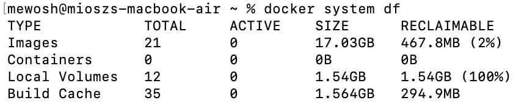

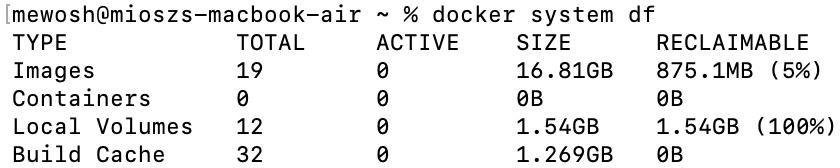

Rys. 24 - Wynik polecenia `docker system df` przed i po czyszczeniu obrazów i innych nieużywanych komponentów - zwolniono ponad 500 MB pamięci.

---

##### Zadania do samodzielnego wykonania

##### Ćwiczenie 1 — Serwer HTTP

**Opis:** Uruchomiono kontener o nazwie `serwer-http` na podstawie obrazu `httpd:alpine` z przekierowaniem portu 8888 hosta na port 80 (domyślny port protokołu HTTP i serwera Apache httpd) kontenera.

**Użyte polecenia:**

```zsh
docker run -d --name serwer-http -p 8888:80 httpd:alpine
```

**Wynik działania:**

```zsh
mewosh@mioszs-macbook-air ~ % docker run -d --name serwer-http -p 8888:80 httpd:alpine
Unable to find image 'httpd:alpine' locally
alpine: Pulling from library/httpd
5039119939d5: Pull complete 
c6e2904ac185: Pull complete 
a507aa80ad00: Pull complete 
4f4fb700ef54: Pull complete 
9b7d232c6e6d: Pull complete 
98b3bd652a0c: Pull complete 
bd25f633d976: Download complete 
6c5941cad9ef: Download complete 
Digest: sha256:3440c39d8d6f54fa9ad2549e5a60c19ddd435faadc29c1ad28aa795f71888889
Status: Downloaded newer image for httpd:alpine
c5d7f2c6c2c62d421095836d83ae719a62f48cead3d22d2d5c120bce6ef3abd2
```

**Screenshot:**

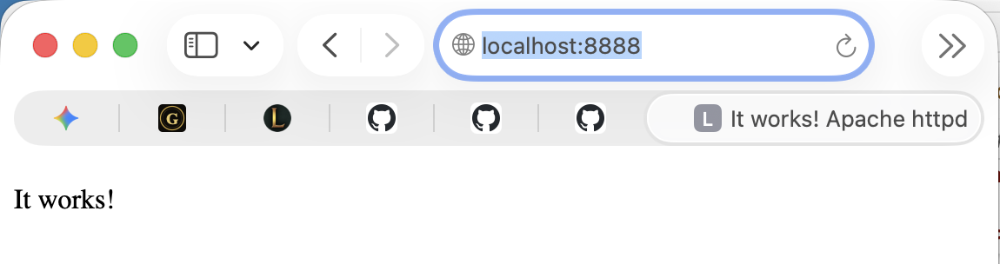

Rys. 25 - Strona powitalna serwera HTTP na porcie 8888.

---

##### Ćwiczenie 2 — Baza PostgreSQL

**Opis:** Stworzono kontener PostgreSQL z hasłem `student123` i bazą danych `uczelnia`. Zweryfikowano, że baza danych została uruchomiona i przyjmuje połączenia a następnie utworzono tabelę `studenci` i zweryfikowano jej istnienie.

**Użyte polecenia:**

```zsh
docker run -d \
  --name baza-postgresql \
  -e POSTGRES_PASSWORD=student123 \
  -e POSTGRES_DB=uczelnia \
  -v pgdata:/var/lib/postgresql \
  postgres

docker logs -f baza-postgresql
# CTRL+C

docker exec -i baza-postgresql psql uczelnia -U postgres << 'EOF'
CREATE TABLE studenci (
  id uuid PRIMARY KEY DEFAULT gen_random_uuid(),
  imie VARCHAR(50) NOT NULL,
  nazwisko VARCHAR(100) NOT NULL,
  nr_albumu CHAR(5) NOT NULL UNIQUE
);
EOF

docker exec -i baza-postgresql psql uczelnia -U postgres -c '\d studenci'
```

**Wynik działania:**

```zsh
mewosh@mioszs-macbook-air ~ % docker run -d \
  --name baza-postgresql \
  -e POSTGRES_PASSWORD=student123 \
  -e POSTGRES_DB=uczelnia \
  -v pgdata:/var/lib/postgresql \
  postgres
Unable to find image 'postgres:latest' locally
latest: Pulling from library/postgres
7ceb07498658: Pull complete 
19fcd068927b: Pull complete 
dae9c1725998: Pull complete 
c344258f5c4b: Pull complete 
a97c43a6325a: Pull complete 
145ddee77a61: Pull complete 
adef3e37879a: Pull complete 
7f4f6f4ec9d3: Pull complete 
21a9e5df9938: Pull complete 
bbeda6b4abb7: Pull complete 
729e9c644210: Pull complete 
364028cfe3c1: Pull complete 
9aa353a8667f: Pull complete 
6c044be2c0a9: Download complete 
c899644b9c0a: Download complete 
Digest: sha256:74935e72241653ca55e0414067e6d8763aceb8a810eb51b452253ec3dcfc4336
Status: Downloaded newer image for postgres:latest
b306297ef32bb8fe592cf98e23366c74ec03862a0037a25459364fa7be3d8808
```

```zsh
mewosh@mioszs-macbook-air ~ % docker logs -f baza-postgresql
The files belonging to this database system will be owned by user "postgres".
This user must also own the server process.

The database cluster will be initialized with locale "en_US.utf8".
The default database encoding has accordingly been set to "UTF8".
The default text search configuration will be set to "english".

Data page checksums are enabled.

fixing permissions on existing directory /var/lib/postgresql/18/docker ... ok
creating subdirectories ... ok
selecting dynamic shared memory implementation ... posix
selecting default "max_connections" ... 100
selecting default "shared_buffers" ... 128MB
selecting default time zone ... Etc/UTC
creating configuration files ... ok
running bootstrap script ... ok
performing post-bootstrap initialization ... ok
initdb: warning: enabling "trust" authentication for local connections
initdb: hint: You can change this by editing pg_hba.conf or using the option -A, or --auth-local and --auth-host, the next time you run initdb.
syncing data to disk ... ok


Success. You can now start the database server using:

    pg_ctl -D /var/lib/postgresql/18/docker -l logfile start

waiting for server to start....2026-10-20 13:56:25.342 UTC [53] LOG:  starting PostgreSQL 18.6 (Debian 18.6-1.pgdg13+2) on aarch64-unknown-linux-gnu, compiled by gcc (Debian 14.2.0-19) 14.2.0, 64-bit
2026-10-20 13:56:25.343 UTC [53] LOG:  listening on Unix socket "/var/run/postgresql/.s.PGSQL.5432"
2026-10-20 13:56:25.345 UTC [59] LOG:  database system was shut down at 2026-10-20 13:56:25 UTC
2026-10-20 13:56:25.347 UTC [53] LOG:  database system is ready to accept connections
 done
server started
CREATE DATABASE


/usr/local/bin/docker-entrypoint.sh: ignoring /docker-entrypoint-initdb.d/*

waiting for server to shut down....2026-10-20 13:56:25.522 UTC [53] LOG:  received fast shutdown request
2026-10-20 13:56:25.524 UTC [53] LOG:  aborting any active transactions
2026-10-20 13:56:25.525 UTC [53] LOG:  background worker "logical replication launcher" (PID 62) exited with exit code 1
2026-10-20 13:56:25.525 UTC [57] LOG:  shutting down
2026-10-20 13:56:25.526 UTC [57] LOG:  checkpoint starting: shutdown immediate
2026-10-20 13:56:25.551 UTC [57] LOG:  checkpoint complete: wrote 943 buffers (5.8%), wrote 3 SLRU buffers; 0 WAL file(s) added, 0 removed, 0 recycled; write=0.012 s, sync=0.013 s, total=0.027 s; sync files=303, longest=0.005 s, average=0.001 s; distance=4352 kB, estimate=4352 kB; lsn=0/1BA1BF0, redo lsn=0/1BA1BF0
2026-10-20 13:56:25.556 UTC [53] LOG:  database system is shut down
 done
server stopped

PostgreSQL init process complete; ready for start up.

2026-10-20 13:56:25.642 UTC [1] LOG:  starting PostgreSQL 18.6 (Debian 18.6-1.pgdg13+2) on aarch64-unknown-linux-gnu, compiled by gcc (Debian 14.2.0-19) 14.2.0, 64-bit
2026-10-20 13:56:25.642 UTC [1] LOG:  listening on IPv4 address "0.0.0.0", port 5432
2026-10-20 13:56:25.642 UTC [1] LOG:  listening on IPv6 address "::", port 5432
2026-10-20 13:56:25.644 UTC [1] LOG:  listening on Unix socket "/var/run/postgresql/.s.PGSQL.5432"
2026-10-20 13:56:25.646 UTC [75] LOG:  database system was shut down at 2026-10-20 13:56:25 UTC
2026-10-20 13:56:25.648 UTC [1] LOG:  database system is ready to accept connections
```

```zsh
mewosh@mioszs-macbook-air ~ % docker exec -i baza-postgresql psql uczelnia -U postgres << 'EOF'
CREATE TABLE studenci (
  id uuid PRIMARY KEY DEFAULT gen_random_uuid(),
  imie VARCHAR(50) NOT NULL,
  nazwisko VARCHAR(100) NOT NULL,
  nr_albumu CHAR(5) NOT NULL UNIQUE
);

\l;
EOF
CREATE TABLE
```

```zsh
mewosh@mioszs-macbook-air ~ % docker exec -i baza-postgresql psql uczelnia -U postgres -c '\d studenci'
                            Table "public.studenci"
  Column   |          Type          | Collation | Nullable |      Default      
-----------+------------------------+-----------+----------+-------------------
 id        | uuid                   |           | not null | gen_random_uuid()
 imie      | character varying(50)  |           | not null | 
 nazwisko  | character varying(100) |           | not null | 
 nr_albumu | character(5)           |           | not null | 
Indexes:
    "studenci_pkey" PRIMARY KEY, btree (id)
    "studenci_nr_albumu_key" UNIQUE CONSTRAINT, btree (nr_albumu)
```

**Screenshot:**

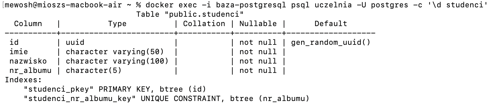

Rys. 26 - Poprawnie utworzona tabela `studenci` w bazie `uczelnia`.

---

##### Ćwiczenie 3 — Eksploracja kontenera

**Opis:** Uruchomiono kontener `python:3.11-slim`, sprawdzono wersję Pythona wewnątrz kontenera, zainstalowano bibliotekę `requests` i wykonano prosty skrypt pobierający losowy fakt o kotach.

**Użyte polecenia:**

```zsh
docker run -it python:3.11-slim bash
 
python --version

pip install requests

python

import requests
response = requests.get('https://catfact.ninja/fact')
print(response.json()['fact'])
```

**Wynik działania:**

```zsh
mewosh@mioszs-macbook-air ~ % docker run -it python:3.11-slim bash
Unable to find image 'python:3.11-slim' locally
3.11-slim: Pulling from library/python
7ca0c331ecfd: Pull complete 
9eb0fb93ee08: Pull complete 
73a63ac3ec4a: Pull complete 
56f7c999317d: Download complete 
58b126dd1754: Download complete 
Digest: sha256:e88e9763f943ec1834f992a4b51e0f24500486803e8bc534e5767af9ea65f6ce
Status: Downloaded newer image for python:3.11-slim
root@57d383094528:/#
```

```zsh
root@57d383094528:/# python --version
Python 3.11.17
```

```zsh
root@57d383094528:/# pip install requests
Collecting requests
  Downloading requests-2.34.2-py3-none-any.whl.metadata (4.8 kB)
Collecting charset_normalizer<4,>=2 (from requests)
  Downloading charset_normalizer-3.5.2-cp311-cp311-manylinux2014_aarch64.manylinux_2_17_aarch64.manylinux_2_28_aarch64.whl.metadata (46 kB)
     ━━━━━━━━━━━━━━━━━━━━━━━━━━━━━━━━━━━━━━━━ 46.4/46.4 kB 156.6 kB/s eta 0:00:00
Collecting idna<4,>=2.5 (from requests)
  Downloading idna-3.20-py3-none-any.whl.metadata (7.2 kB)
Collecting urllib3<3,>=1.26 (from requests)
  Downloading urllib3-2.8.0-py3-none-any.whl.metadata (7.4 kB)
Collecting certifi>=2023.5.7 (from requests)
  Downloading certifi-2026.10.19-py3-none-any.whl.metadata (2.5 kB)
Downloading requests-2.34.2-py3-none-any.whl (73 kB)
   ━━━━━━━━━━━━━━━━━━━━━━━━━━━━━━━━━━━━━━━━ 73.1/73.1 kB 654.0 kB/s eta 0:00:00
Downloading certifi-2026.10.19-py3-none-any.whl (136 kB)
   ━━━━━━━━━━━━━━━━━━━━━━━━━━━━━━━━━━━━━━━━ 136.5/136.5 kB 637.2 kB/s eta 0:00:00
Downloading charset_normalizer-3.5.2-cp311-cp311-manylinux2014_aarch64.manylinux_2_17_aarch64.manylinux_2_28_aarch64.whl (259 kB)
   ━━━━━━━━━━━━━━━━━━━━━━━━━━━━━━━━━━━━━━━━ 259.3/259.3 kB 421.0 kB/s eta 0:00:00
Downloading idna-3.20-py3-none-any.whl (69 kB)
   ━━━━━━━━━━━━━━━━━━━━━━━━━━━━━━━━━━━━━━━━ 69.6/69.6 kB 513.6 kB/s eta 0:00:00
Downloading urllib3-2.8.0-py3-none-any.whl (135 kB)
   ━━━━━━━━━━━━━━━━━━━━━━━━━━━━━━━━━━━━━━━━ 135.7/135.7 kB 660.7 kB/s eta 0:00:00
Installing collected packages: urllib3, idna, charset_normalizer, certifi, requests
Successfully installed certifi-2026.10.19 charset_normalizer-3.5.2 idna-3.20 requests-2.34.2 urllib3-2.8.0
WARNING: Running pip as the 'root' user can result in broken permissions and conflicting behaviour with the system package manager. It is recommended to use a virtual environment instead: https://pip.pypa.io/warnings/venv

[notice] A new release of pip is available: 24.0 -> 26.2.1
[notice] To update, run: pip install --upgrade pip
```

```zsh
root@57d383094528:/# python
Python 3.11.17 (main, Oct  6 2026, 02:08:45) [GCC 14.2.0] on linux
Type "help", "copyright", "credits" or "license" for more information.
>>>
```

```zsh
>>> import requests
>>> response = requests.get('https://catfact.ninja/fact')
>>> print(response.json()['fact'])
Baking chocolate is the most dangerous chocolate to your cat.
>>> 
```

**Screenshot:**

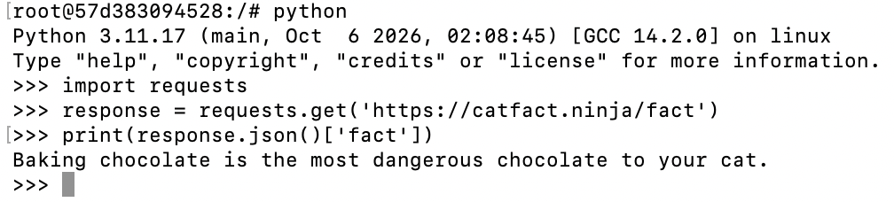

Rys. 27 - Wynik prostego skryptu Python korzystającego z biblioteki `requests` - pobranie losowego faktu o kotach.

---

##### Ćwiczenie 4 — Porównanie obrazów

**Opis:** Pobrano 3 obrazy Pythona: `python:3.11`, `python:3.11-slim` i `python:3.11-alpine` a następnie porównano ich rozmiar i zawartość.

**Użyte polecenia:**

```zsh
docker pull python:3.11
docker pull python:3.11-slim
docker pull python:3.11-alpine

docker images python \
  --filter "reference=python:3.11*" \
  --format "table {{.Repository}}:{{.Tag}}\t{{.ID}}\t{{.Size}}"

for img in python:3.11 python:3.11-slim python:3.11-alpine; do
  echo "=== Obraz: $img ==="
  docker run --rm "$img" sh -c '
    echo "Python:    $(python --version 2>&1)"
    echo "Libc:      $(ldd --version 2>&1 | head -n 1)"
    echo "Pakiety:   $(which apt-get apk 2>/dev/null)"
    echo "Narzędzia: gcc=$(which gcc 2>/dev/null || echo brak), curl=$(which curl 2>/dev/null || echo brak)"
  '
  echo ""
done
```

**Wynik działania:**

```zsh
mewosh@mioszs-macbook-air ~ % docker pull python:3.11
3.11: Pulling from library/python
6cc82442b8d0: Pull complete 
a7f73cdbf7c7: Pull complete 
21752e08707a: Pull complete 
df9831efb49c: Pull complete 
86f385aa2c76: Pull complete 
a6b55ba8dd17: Pull complete 
604b0f476193: Pull complete 
26149b5dcf02: Download complete 
1e81fab18ceb: Download complete 
Digest: sha256:50cfccc707e8721201ee018bfd7f6a85d8eacf49c4f9f75833a2aba09a10411f
Status: Downloaded newer image for python:3.11
docker.io/library/python:3.11
```

```zsh
mewosh@mioszs-macbook-air ~ % docker pull python:3.11-slim
3.11-slim: Pulling from library/python
Digest: sha256:e88e9763f943ec1834f992a4b51e0f24500486803e8bc534e5767af9ea65f6ce
Status: Image is up to date for python:3.11-slim
docker.io/library/python:3.11-slim
```

```zsh
mewosh@mioszs-macbook-air ~ % docker pull python:3.11-alpine
3.11-alpine: Pulling from library/python
487d5e9ee293: Pull complete 
a697faad4c01: Pull complete 
d7c700d6750a: Pull complete 
07c44dceeea9: Download complete 
c7a58aa77327: Download complete 
Digest: sha256:d9368b3a5ac59afea7b5d4f2e2aea0941dbf9fdee9c369c5bec00b98244bc929
Status: Downloaded newer image for python:3.11-alpine
docker.io/library/python:3.11-alpine
```

```zsh
mewosh@mioszs-macbook-air ~ % docker images python \
  --filter "reference=python:3.11*" \
  --format "table {{.Repository}}:{{.Tag}}\t{{.ID}}\t{{.Size}}"
REPOSITORY:TAG       IMAGE ID       SIZE
python:3.11          50cfccc707e8   1.62GB
python:3.11-slim     e88e9763f943   215MB
python:3.11-alpine   d9368b3a5ac5   98.4MB
```

```zsh
mewosh@mioszs-macbook-air ~ % for img in python:3.11 python:3.11-slim python:3.11-alpine; do
  echo "=== Obraz: $img ==="
  docker run --rm "$img" sh -c '
    echo "Python:    $(python --version 2>&1)"
    echo "Libc:      $(ldd --version 2>&1 | head -n 1)"
    echo "Pakiety:   $(which apt-get apk 2>/dev/null)"
    echo "Narzędzia: gcc=$(which gcc 2>/dev/null || echo brak), curl=$(which curl 2>/dev/null || echo brak)"
  '
  echo ""
done
=== Obraz: python:3.11 ===
Python:    Python 3.11.17
Libc:      ldd (Debian GLIBC 2.41-12+deb13u4) 2.41
Pakiety:   /usr/bin/apt-get
Narzędzia: gcc=/usr/bin/gcc, curl=/usr/bin/curl

=== Obraz: python:3.11-slim ===
Python:    Python 3.11.17
Libc:      ldd (Debian GLIBC 2.41-12+deb13u4) 2.41
Pakiety:   /usr/bin/apt-get
Narzędzia: gcc=brak, curl=brak

=== Obraz: python:3.11-alpine ===
Python:    Python 3.11.17
Libc:      musl libc (aarch64)
Pakiety:   /sbin/apk
Narzędzia: gcc=brak, curl=brak
```

**Screenshot:**

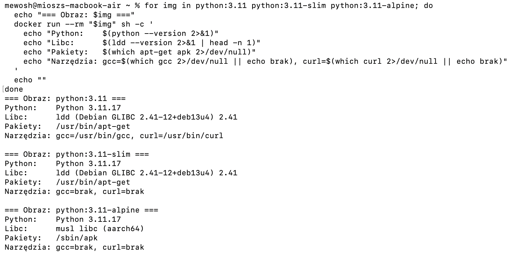

Rys. 28 - Porównanie obrazów Pythona - widoczne różnice w bibliotece libc (bibliotece standardowej C), narzędziu do pobierania pakietów (różnice w używanych systemach operacyjnych) i w liczbie zainstalowanych narzędzi.

---

#### 4. Pliki konfiguracyjne

##### Dockerfile

```dockerfile
# -brak-
```

##### docker-compose.yaml

```yaml
# -brak-
```

##### Inne pliki

```
# -brak-
```

---

#### 5. Napotkane problemy i ich rozwiązania

| Problem | Rozwiązanie |
|---------|-------------|
| Polecenie `docker version` zakończone wynikiem: <br/>  `failed to connect to the docker API at unix:///Users/mewosh/.docker/run/docker.sock; check if the path is correct and if the daemon is running: dial unix /Users/mewosh/.docker/run/docker.sock: connect: no such file or directory` | Daemon Dockera nie był uruchomiony (usługa Dockera nie uruchamia się automatycznie w systemie macOS) - należało uruchomić usługę, np. poprzez uruchomienie programu Docker Desktop. |
| Polecenie `docker image inspect ubuntu:22.04` zakończone wynikiem: <br/> `[]` <br/> `Error response from daemon: {"message":"No such image: ubuntu:22.04"}` | Aby uzyskać informacje o obrazie należy podać ID obrazu lub sprecyzować platformę sprzętową obrazu. Dzieje się tak, ponieważ Docker Desktop od wersji 4.34 korzysta z nowego magazynu `containerd snapshotter`. W tym trybie obrazy są dzielone na przestrzenie nazw (namespaces) i platformy sprzętowe przez co Docker nie potrafi znaleźć obrazu bez podania informacji o przestrzeni nazw lub platformie sprzętowej. Informacja o wykorzystywaniu `containerd snapshotter` widnieje w wyniku polecenia `docker info` użytego w ćwiczeniu 1.1: <br/> `Storage Driver: overlayfs` <br/> `  driver-type: io.containerd.snapshotter.v1` |

---

#### 6. Wnioski

Kontenery Dockera zapewniają lekkie, odizolowane środowisko uruchomieniowe. Działają one tak długo, jak długo aktywny jest ich proces główny. Przykład kontenera `hello-world` pokazał, że po wypisaniu komunikatu proces zakończył się, a kontener przeszedł w stan `Exited`.

Analiza i porównanie różnych obrazów bazowych (np. Ubuntu vs Alpine) wykazały drastyczne różnice w ich rozmiarze. Obrazy oparte na dystrybucji Alpine Linux są znacznie mniejsze (często poniżej kilkunastu MB) ze względu na odchudzone biblioteki bazowe i brak zbędnych pakietów narzędziowych.   

Domyślnie sieć kontenera jest odizolowana od hosta. Aby usługa (np. serwer HTTP nginx) była dostępna z zewnątrz, konieczne było jawne zmapowanie portów.

W ramach laboratorium nie napotkano większych problemów. Wszystkie ćwiczenia były bardzo zbliżone pod względem poziomu trudności.

Najciekawszy był proces interakcji z kontenerami za pomocą sesji terminala wewnątrz kontenera.

---

#### 7. Bibliografia / źródła

- [Docker Documentation](https://docs.docker.com/)
- [Postgres 18 Documentation](https://www.postgresql.org/docs/18/index.html)
