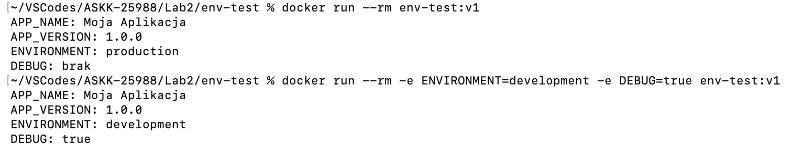
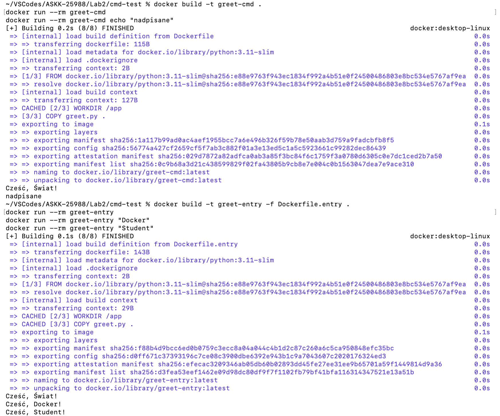

### Sprawozdanie z laboratorium nr 2

**Przedmiot:** Aplikacje w środowisku kontenerowym  

**Temat:** Budowanie obrazów z Dockerfile

**Data wykonania:** 

**Autor:** Miłosz Samotyjak

**Numer indeksu:** 25988

**Grupa:** 235IC A1

---

#### 1. Cel laboratorium

Nauka tworzenia własnych obrazów Docker za pomocą Dockerfile — od prostych do zaawansowanych, z wykorzystaniem multi-stage builds.

---

#### 2. Wstęp teoretyczny

[Opcjonalnie — krótkie wprowadzenie teoretyczne dotyczące omawianych technologii/narzędzi, np. czym jest Docker, wolumeny, sieci itp.]

---

#### 3. Przebieg ćwiczeń

##### Ćwiczenie 1.1 — Prosty obraz z Pythonem

**Opis:** Stworzono prosty skrypt Python wraz z plikiem Dockerfile i uruchomiono go z kontenera.

**Użyte polecenia:**

```zsh
mkdir -p hello-python && cd hello-python

docker build -t hello-python:v1 .
docker run --rm hello-python:v1
```

**Wynik działania:**

```zsh
mewosh@mioszs-macbook-air Lab2 % mkdir -p hello-python && cd hello-python
mewosh@mioszs-macbook-air hello-python % 
```

```zsh
mewosh@mioszs-macbook-air hello-python % docker build -t hello-python:v1 .
docker run --rm hello-python:v1
[+] Building 0.3s (8/8) FINISHED                                                                     docker:desktop-linux
 => [internal] load build definition from Dockerfile                                                                 0.0s
 => => transferring dockerfile: 111B                                                                                 0.0s
 => [internal] load metadata for docker.io/library/python:3.11-slim                                                  0.0s
 => [internal] load .dockerignore                                                                                    0.0s
 => => transferring context: 2B                                                                                      0.0s
 => [1/3] FROM docker.io/library/python:3.11-slim@sha256:e88e9763f943ec1834f992a4b51e0f24500486803e8bc534e5767af9ea  0.0s
 => => resolve docker.io/library/python:3.11-slim@sha256:e88e9763f943ec1834f992a4b51e0f24500486803e8bc534e5767af9ea  0.0s
 => [internal] load build context                                                                                    0.0s
 => => transferring context: 340B                                                                                    0.0s
 => [2/3] WORKDIR /app                                                                                               0.0s
 => [3/3] COPY app.py .                                                                                              0.0s
 => exporting to image                                                                                               0.1s
 => => exporting layers                                                                                              0.0s
 => => exporting manifest sha256:bb314cfad2fea239eefccdc66b654b62d045bcd6cd9f0d1933d911c595e591a6                    0.0s
 => => exporting config sha256:c96ad95ae27471968b557eea5139ce6ecfbbca6d164b007ad43f4e05c5a18dbd                      0.0s
 => => exporting attestation manifest sha256:92c94d199c1acc505dc54c4bf60c7a2c25f78935d1d1f57487e97ba6e299a003        0.0s
 => => exporting manifest list sha256:4a169700acc1f9b0ea47a3f4df81f0debcb88297d37e3388ad63c603f023ac85               0.0s
 => => naming to docker.io/library/hello-python:v1                                                                   0.0s
 => => unpacking to docker.io/library/hello-python:v1                                                                0.0s
========================================
Witaj z kontenera Docker!
Python: 3.11.17
System: Linux 6.12.54-linuxkit
Hostname: 986283ef809e
Użytkownik: nieznany
========================================
```

**Screenshot:**


Rys. 1 - Wynik budowania i uruchomienia obrazu Python.

---

##### Ćwiczenie 1.2 — Analiza warstw

**Opis:** Wyświetlono historię warstw utworzonego kontenera Python i sprawdzono rozmiar obrazu. Polecenie `docker history hello-python:v1` zastępiono poleceniem `docker history 4a169700acc1` ze względu na problem opisany już w laboratorium 1, czyli zmianę funkcjonowania mechanizmu przechowywania obrazów (obecnie `containerd`) wymagającą podania ID obrazu lub nazwy obrazu wraz z jego platformą sprzętową, aby został on znaleziony.

**Użyte polecenia:**

```zsh
# Historia warstw
docker history 4a169700acc1

# Rozmiar obrazu
docker images hello-python
```

**Wynik działania:**

```zsh
~/VSCodes/ASKK-25988/Lab2/hello-python % docker history 4a169700acc1
IMAGE          CREATED          CREATED BY                                      SIZE      COMMENT
4a169700acc1   18 minutes ago   CMD ["python" "app.py"]                         0B        buildkit.dockerfile.v0
<missing>      18 minutes ago   COPY app.py . # buildkit                        12.3kB    buildkit.dockerfile.v0
<missing>      18 minutes ago   WORKDIR /app                                    8.19kB    buildkit.dockerfile.v0
<missing>      3 weeks ago      CMD ["python3"]                                 0B        buildkit.dockerfile.v0
<missing>      3 weeks ago      RUN /bin/sh -c set -eux;  for src in idle3 p…   16.4kB    buildkit.dockerfile.v0
<missing>      3 weeks ago      RUN /bin/sh -c set -eux;   savedAptMark="$(a…   52.1MB    buildkit.dockerfile.v0
<missing>      3 weeks ago      ENV PYTHON_SHA256=bfb74ad39efae27cda510f134a…   0B        buildkit.dockerfile.v0
<missing>      3 weeks ago      ENV PYTHON_VERSION=3.11.17                      0B        buildkit.dockerfile.v0
<missing>      3 weeks ago      ENV GPG_KEY=A035C8C19219BA821ECEA86B64E628F8…   0B        buildkit.dockerfile.v0
<missing>      3 weeks ago      RUN /bin/sh -c set -eux;  apt-get update;  a…   4.99MB    buildkit.dockerfile.v0
<missing>      3 weeks ago      ENV LANG=C.UTF-8                                0B        buildkit.dockerfile.v0
<missing>      3 weeks ago      ENV PATH=/usr/local/bin:/usr/local/sbin:/usr…   0B        buildkit.dockerfile.v0
<missing>      3 weeks ago      # debian.sh --arch 'arm64' out/ 'trixie' '@1…   110MB     debuerreotype 0.17
```

```zsh
~/VSCodes/ASKK-25988/Lab2/hello-python % docker images hello-python
                                                                                                      i Info →   U  In Use
IMAGE             ID             DISK USAGE   CONTENT SIZE   EXTRA
hello-python:v1   4a169700acc1        213MB         45.9MB  
```

---

##### Ćwiczenie 1.3 — Obraz z zależnościami

**Opis:** Utworzono obraz aplikacji Flask z 2 prostymi endpointami i zależnościami. Zmieniono port hosta z 5000 na 5001, ponieważ port 5000 jest zarezerwowany dla jednej z usług systemu macOS.

**Użyte polecenia:**

```zsh
docker build -t flask-app:v1 .
docker run -d --name flask-test -p 5001:5000 flask-app:v1
curl http://localhost:5001
curl http://localhost:5001/health
```

**Wynik działania:**

```zsh
~/VSCodes/ASKK-25988/Lab2/hello-python % docker build -t flask-app:v1 .
[+] Building 5.2s (10/10) FINISHED                                                                   docker:desktop-linux
 => [internal] load build definition from Dockerfile                                                                 0.0s
 => => transferring dockerfile: 195B                                                                                 0.0s
 => [internal] load metadata for docker.io/library/python:3.11-slim                                                  0.0s
 => [internal] load .dockerignore                                                                                    0.0s
 => => transferring context: 2B                                                                                      0.0s
 => [1/5] FROM docker.io/library/python:3.11-slim@sha256:e88e9763f943ec1834f992a4b51e0f24500486803e8bc534e5767af9ea  0.0s
 => => resolve docker.io/library/python:3.11-slim@sha256:e88e9763f943ec1834f992a4b51e0f24500486803e8bc534e5767af9ea  0.0s
 => [internal] load build context                                                                                    0.0s
 => => transferring context: 662B                                                                                    0.0s
 => CACHED [2/5] WORKDIR /app                                                                                        0.0s
 => [3/5] COPY requirements.txt .                                                                                    0.0s
 => [4/5] RUN pip install --no-cache-dir -r requirements.txt                                                         4.4s
 => [5/5] COPY . .                                                                                                   0.0s 
 => exporting to image                                                                                               0.7s 
 => => exporting layers                                                                                              0.5s 
 => => exporting manifest sha256:bbfffa79f3d303e137627e2c3c73d0868c1f3cfc17fab52a4c57e7fc5601e6c5                    0.0s 
 => => exporting config sha256:21d597f79d2b0f74e73c70b6861907e5c7ab9318194c3770f31879b61140ff69                      0.0s 
 => => exporting attestation manifest sha256:1f54723c4a66090f230a44671d07a34973f4e948fc280f554c7cf9fc5cc2a5bc        0.0s 
 => => exporting manifest list sha256:b5456745e1afab3f003202b6bfbaeeb270625ae733debcb40d4d0ff7ba204075               0.0s
 => => naming to docker.io/library/flask-app:v1                                                                      0.0s
 => => unpacking to docker.io/library/flask-app:v1                                                                   0.1s
```

```zsh
~/VSCodes/ASKK-25988/Lab2/hello-python % docker run -d --name flask-test -p 5001:5000 flask-app:v1
04640b1c0d6628de1a6255d7f3f212542411f8e089a739d32dda13988862aa31
```

```zsh
~/VSCodes/ASKK-25988/Lab2/hello-python % curl http://localhost:5001
<h1>Witaj z kontenera 04640b1c0d66!</h1><p>Flask działa w Dockerze.</p>% 
```

```zsh
~/VSCodes/ASKK-25988/Lab2/hello-python % curl http://localhost:5001/health
{"status":"ok"}
```

**Screenshot:**


Rys. 2 - Aplikacja Flask działająca w kontenerze.

---

##### Ćwiczenie 2.1 — WORKDIR, COPY, ADD

**Opis:** Przetestowano tworzenie struktury katalogów w systemie plików obrazu Docker i kopiowanie katalogów (wraz z rozpakowaniem archiwum) między hostem i obrazem.

**Użyte polecenia:**

```zsh
mkdir -p ~/VSCodes/ASKK-25988/Lab2/workdir-test && cd ~/VSCodes/ASKK-25988/Lab2/workdir-test

mkdir -p src config
echo "print('Hello from src')" > src/main.py
echo "DEBUG=true" > config/app.conf
echo "Dane testowe" > data.txt
tar czf archive.tar.gz data.txt

docker build -t workdir-test .
docker run --rm workdir-test
```

**Wynik działania:**

```zsh
~/VSCodes/ASKK-25988/Lab2/hello-python % mkdir -p ~/VSCodes/ASKK-25988/Lab2/workdir-test && cd ~/VSCodes/ASKK-25988/Lab2/workdir-test
~/VSCodes/ASKK-25988/Lab2/workdir-test % 
```

```zsh
~/VSCodes/ASKK-25988/Lab2/workdir-test % mkdir -p src config
echo "print('Hello from src')" > src/main.py
echo "DEBUG=true" > config/app.conf
echo "Dane testowe" > data.txt
tar czf archive.tar.gz data.txt
~/VSCodes/ASKK-25988/Lab2/workdir-test % 
```

```zsh
~/VSCodes/ASKK-25988/Lab2/workdir-test % docker build -t workdir-test .
[+] Building 0.4s (11/11) FINISHED                                                                   docker:desktop-linux
 => [internal] load build definition from Dockerfile                                                                 0.0s
 => => transferring dockerfile: 376B                                                                                 0.0s
 => [internal] load metadata for docker.io/library/python:3.11-slim                                                  0.0s
 => [internal] load .dockerignore                                                                                    0.0s
 => => transferring context: 2B                                                                                      0.0s
 => [1/6] FROM docker.io/library/python:3.11-slim@sha256:e88e9763f943ec1834f992a4b51e0f24500486803e8bc534e5767af9ea  0.0s
 => => resolve docker.io/library/python:3.11-slim@sha256:e88e9763f943ec1834f992a4b51e0f24500486803e8bc534e5767af9ea  0.0s
 => [internal] load build context                                                                                    0.0s
 => => transferring context: 343B                                                                                    0.0s
 => CACHED [2/6] WORKDIR /app                                                                                        0.0s
 => [3/6] COPY src/ ./src/                                                                                           0.0s
 => [4/6] COPY config/app.conf ./config/                                                                             0.0s
 => [5/6] ADD archive.tar.gz ./extracted/                                                                            0.0s
 => [6/6] RUN ls -la /app/ && ls -la /app/extracted/                                                                 0.1s
 => exporting to image                                                                                               0.1s
 => => exporting layers                                                                                              0.0s
 => => exporting manifest sha256:e7f4bf5feb645ba82d0488cf4fffe1250c39e3c435c4323c5cfd2ab930c59b37                    0.0s
 => => exporting config sha256:f72877b25c2a4f4e7a8b886b75dc6a64681f0f06e41071bba1ac9db5285c1fa6                      0.0s
 => => exporting attestation manifest sha256:00eabf42068246679fc701fd27e6db77bc00fc3d11256bba3f5f2fdcb05df96d        0.0s
 => => exporting manifest list sha256:2a7bde38b51d34d0ef922b0c748c0d25f5c1754bfdccaf8d033ac8e37b431c84               0.0s
 => => naming to docker.io/library/workdir-test:latest                                                               0.0s
 => => unpacking to docker.io/library/workdir-test:latest                                                            0.0s
```

```zsh
~/VSCodes/ASKK-25988/Lab2/workdir-test % docker run --rm workdir-test
Hello from src
```

---

##### Ćwiczenie 2.2 — ENV i ARG

**Opis:** Stworzono prosty skrypt Python odczytujący wartość zmiennych środowiskowych oraz plik Dockerfile, któremu przekazano dodatkowe argumenty do budowania, a także przekazano mu wartości zmiennych środowiskowych przy jego uruchamianiu. Na koniec porównano wartości zmiennych środowiskowych odczytanych skryptem Python między dwoma wywołaniami polecania `docker run`.

**Użyte polecenia:**

```zsh
mkdir -p ~/VSCodes/ASKK-25988/Lab2/env-test && cd ~/VSCodes/ASKK-25988/Lab2/env-test

# Budowanie z argumentami
docker build --build-arg BUILD_DATE=$(date +%Y-%m-%d) -t env-test:v1 .

# Uruchomienie z domyślnymi ENV
docker run --rm env-test:v1

# Nadpisanie ENV z CLI
docker run --rm -e ENVIRONMENT=development -e DEBUG=true env-test:v1
```

**Wynik działania:**

```zsh
~/VSCodes/ASKK-25988/Lab2/workdir-test % mkdir -p ~/VSCodes/ASKK-25988/Lab2/env-test && cd ~/VSCodes/ASKK-25988/Lab2/env-test
~/VSCodes/ASKK-25988/Lab2/env-test % 
```

```zsh
~/VSCodes/ASKK-25988/Lab2/env-test % docker build --build-arg BUILD_DATE=$(date +%Y-%m-%d) -t env-test:v1 .
[+] Building 0.2s (8/8) FINISHED                                                                     docker:desktop-linux
 => [internal] load build definition from Dockerfile                                                                 0.0s
 => => transferring dockerfile: 412B                                                                                 0.0s
 => [internal] load metadata for docker.io/library/python:3.11-slim                                                  0.0s
 => [internal] load .dockerignore                                                                                    0.0s
 => => transferring context: 2B                                                                                      0.0s
 => [1/3] FROM docker.io/library/python:3.11-slim@sha256:e88e9763f943ec1834f992a4b51e0f24500486803e8bc534e5767af9ea  0.0s
 => => resolve docker.io/library/python:3.11-slim@sha256:e88e9763f943ec1834f992a4b51e0f24500486803e8bc534e5767af9ea  0.0s
 => [internal] load build context                                                                                    0.0s
 => => transferring context: 259B                                                                                    0.0s
 => CACHED [2/3] WORKDIR /app                                                                                        0.0s
 => [3/3] COPY app.py .                                                                                              0.0s
 => exporting to image                                                                                               0.1s
 => => exporting layers                                                                                              0.0s
 => => exporting manifest sha256:6c98521b7d34bc91ed109abbb6d635f3d4399af3d95f0bab2493f5e6fc5e92b6                    0.0s
 => => exporting config sha256:94e0d17bc313a8389cd8f8da4cdf329acd9ca7027899488367f73538c5bee9c7                      0.0s
 => => exporting attestation manifest sha256:fb91dfb83769aef5402bfdcfccb450e4bff0fa0a3f4f0d737793be05ad5de409        0.0s
 => => exporting manifest list sha256:ffdd58f6173990e729ac5c0aace0e941888eff68580f987269689a374e1faf9a               0.0s
 => => naming to docker.io/library/env-test:v1                                                                       0.0s
 => => unpacking to docker.io/library/env-test:v1                                                                    0.0s
```

```zsh
~/VSCodes/ASKK-25988/Lab2/env-test % docker run --rm env-test:v1
APP_NAME: Moja Aplikacja
APP_VERSION: 1.0.0
ENVIRONMENT: production
DEBUG: brak
```

```zsh
APP_NAME: Moja Aplikacja
APP_VERSION: 1.0.0
ENVIRONMENT: development
DEBUG: true
```

**Screenshot:**



Rys. 3 - Różnica między domyślnymi a nadpisanymi zmiennymi - inna wartość zmiennej ENVIRONMENT (`production` vs `development`) oraz inna wartość zmiennej DEBUG (`brak` vs `true`).

---

##### Ćwiczenie 2.3 — CMD vs ENTRYPOINT

**Opis:** Porównano polecenia Dockera: CMD i ENTRYPOINT. CMD służy do zdefiniowania domyślnej komendy lub listy argumentów, które można całkowicie nadpisać argumentami podanymi po poleceniu `docker run`. ENTRYPOINT natomiast definiuje główny punkt uruchomieniowy, który ma zostać uruchomiony przez kontener bez możliwości jego nadpisania (o ile jawnie nie zostanie podana flaga `--entrypoint`). Poleceń ENTRYPOINT i CMD często używa się razem - ENTRYPOINT jako główny punkt uruchomieniowy a CMD jako domyślna lista argumentów.

**Użyte polecenia:**

```zsh
mkdir -p ~/VSCodes/ASKK-25988/Lab2/cmd-test && cd ~/VSCodes/ASKK-25988/Lab2/cmd-test

docker build -t greet-cmd .
docker run --rm greet-cmd                    # Cześć, Świat!
docker run --rm greet-cmd echo "nadpisane"   # echo nadpisane (CMD nadpisany!)

docker build -t greet-entry -f Dockerfile.entry .
docker run --rm greet-entry              # Cześć, Świat!
docker run --rm greet-entry "Docker"     # Cześć, Docker!
docker run --rm greet-entry "Student"    # Cześć, Student!
```

**Wynik działania:**

```zsh
~/VSCodes/ASKK-25988/Lab2/env-test % mkdir -p ~/VSCodes/ASKK-25988/Lab2/cmd-test && cd ~/VSCodes/ASKK-25988/Lab2/cmd-test
~/VSCodes/ASKK-25988/Lab2/cmd-test %  
```

```zsh
~/VSCodes/ASKK-25988/Lab2/cmd-test % docker build -t greet-cmd .
docker run --rm greet-cmd                                   
docker run --rm greet-cmd echo "nadpisane"                                 
[+] Building 0.2s (8/8) FINISHED                                                                     docker:desktop-linux
 => [internal] load build definition from Dockerfile                                                                 0.0s
 => => transferring dockerfile: 115B                                                                                 0.0s
 => [internal] load metadata for docker.io/library/python:3.11-slim                                                  0.0s
 => [internal] load .dockerignore                                                                                    0.0s
 => => transferring context: 2B                                                                                      0.0s
 => [1/3] FROM docker.io/library/python:3.11-slim@sha256:e88e9763f943ec1834f992a4b51e0f24500486803e8bc534e5767af9ea  0.0s
 => => resolve docker.io/library/python:3.11-slim@sha256:e88e9763f943ec1834f992a4b51e0f24500486803e8bc534e5767af9ea  0.0s
 => [internal] load build context                                                                                    0.0s
 => => transferring context: 127B                                                                                    0.0s
 => CACHED [2/3] WORKDIR /app                                                                                        0.0s
 => [3/3] COPY greet.py .                                                                                            0.0s
 => exporting to image                                                                                               0.1s
 => => exporting layers                                                                                              0.0s
 => => exporting manifest sha256:1a117b99ad0ac4aef1955bcc7a6e496b326f59b78e50aab3d759a9fadcbfb8f5                    0.0s
 => => exporting config sha256:56774a427cf2659cf5f7ab3c882f01a3e13ed5c1a5c5923661c99282dec86439                      0.0s
 => => exporting attestation manifest sha256:029d7872a82adfca0ab3a85f3bc84f6c1759f3a0780d6305c0e7dc1ced2b7a50        0.0s
 => => exporting manifest list sha256:0c9b68a3d21c438599829f02fa43805b9cb8e7e004c0b1563047dea7e9ace310               0.0s
 => => naming to docker.io/library/greet-cmd:latest                                                                  0.0s
 => => unpacking to docker.io/library/greet-cmd:latest                                                               0.0s
Cześć, Świat!
nadpisane
```

```zsh
~/VSCodes/ASKK-25988/Lab2/cmd-test % docker build -t greet-entry -f Dockerfile.entry .
docker run --rm greet-entry                             
docker run --rm greet-entry "Docker"                     
docker run --rm greet-entry "Student"                     
[+] Building 0.1s (8/8) FINISHED                                                                     docker:desktop-linux
 => [internal] load build definition from Dockerfile.entry                                                           0.0s
 => => transferring dockerfile: 143B                                                                                 0.0s
 => [internal] load metadata for docker.io/library/python:3.11-slim                                                  0.0s
 => [internal] load .dockerignore                                                                                    0.0s
 => => transferring context: 2B                                                                                      0.0s
 => [1/3] FROM docker.io/library/python:3.11-slim@sha256:e88e9763f943ec1834f992a4b51e0f24500486803e8bc534e5767af9ea  0.0s
 => => resolve docker.io/library/python:3.11-slim@sha256:e88e9763f943ec1834f992a4b51e0f24500486803e8bc534e5767af9ea  0.0s
 => [internal] load build context                                                                                    0.0s
 => => transferring context: 29B                                                                                     0.0s
 => CACHED [2/3] WORKDIR /app                                                                                        0.0s
 => CACHED [3/3] COPY greet.py .                                                                                     0.0s
 => exporting to image                                                                                               0.1s
 => => exporting layers                                                                                              0.0s
 => => exporting manifest sha256:f88b4d9bcc6ed0b0759c3ecc8a04a044c4b1d2c87c260a6c5ca950848efc35bc                    0.0s
 => => exporting config sha256:d0ff671c37393196c7ce08c3900dbe6392e943b1c9a7043607c2020176324ed3                      0.0s
 => => exporting attestation manifest sha256:efecac3209346ab05db60b02893dd45fe27ee31ee9b65701a59f1449814d9a36        0.0s
 => => exporting manifest list sha256:d3fea53eef1462e09d98dc80df9f7f1102fb79bf41bfa116314347521e13a51b               0.0s
 => => naming to docker.io/library/greet-entry:latest                                                                0.0s
 => => unpacking to docker.io/library/greet-entry:latest                                                             0.0s
Cześć, Świat!
Cześć, Docker!
Cześć, Student!
```

**Screenshot:**



Rys. 4 - Porównanie zachowania CMD vs ENTRYPOINT (nadpisanie domyślnego polecenia vs przekazanie dodatkowych argumentów).

---

##### Ćwiczenie 2.4 — USER — użytkownik nie-root

**Opis:** Utworzono użytkownika i grupę w obrazie Docker i uruchomiono kontener jako nowo utworzony użytkownik. Porównano takie uruchomienie kontenera z uruchomieniem oryginalnego obrazu Python - w 1 przypadku kontener uruchomił się jako użytkownik `appuser`, natomiast w 2 jako `root`.

**Użyte polecenia:**

```zsh
mkdir -p ~/VSCodes/ASKK-25988/Lab2/user-test && cd ~/VSCodes/ASKK-25988/Lab2/user-test

echo "" > app.py
docker build -t user-test .
docker run --rm user-test
# Porównaj z:
docker run --rm python:3.11-slim python -c "import os; print(f'UID: {os.getuid()}')"
```

**Wynik działania:**

```zsh
~/VSCodes/ASKK-25988/Lab2/cmd-test % mkdir -p ~/VSCodes/ASKK-25988/Lab2/user-test && cd ~/VSCodes/ASKK-25988/Lab2/user-test
~/VSCodes/ASKK-25988/Lab2/user-test %
```

```zsh
~/VSCodes/ASKK-25988/Lab2/user-test % echo "" > app.py
docker build -t user-test .
docker run --rm user-test
[+] Building 0.4s (9/9) FINISHED                                                                     docker:desktop-linux
 => [internal] load build definition from Dockerfile                                                                 0.0s
 => => transferring dockerfile: 354B                                                                                 0.0s
 => [internal] load metadata for docker.io/library/python:3.11-slim                                                  0.0s
 => [internal] load .dockerignore                                                                                    0.0s
 => => transferring context: 2B                                                                                      0.0s
 => CACHED [1/4] FROM docker.io/library/python:3.11-slim@sha256:e88e9763f943ec1834f992a4b51e0f24500486803e8bc534e57  0.0s
 => => resolve docker.io/library/python:3.11-slim@sha256:e88e9763f943ec1834f992a4b51e0f24500486803e8bc534e5767af9ea  0.0s
 => [internal] load build context                                                                                    0.0s
 => => transferring context: 34B                                                                                     0.0s
 => [2/4] RUN groupadd -r appuser && useradd -r -g appuser -d /app appuser                                           0.1s
 => [3/4] WORKDIR /app                                                                                               0.0s
 => [4/4] COPY --chown=appuser:appuser app.py .                                                                      0.0s
 => exporting to image                                                                                               0.1s
 => => exporting layers                                                                                              0.0s
 => => exporting manifest sha256:51d0c56209bc0e1806f76bd1b5ac9000ec4eff4d8c0bb6e93a858809b1861f7b                    0.0s
 => => exporting config sha256:a3c2eb71715addd73f8b83846a4cfb6ec6cc0c0047b7ff90fca0a8888c1dfd2e                      0.0s
 => => exporting attestation manifest sha256:fd5456c9bdf1c1a9844f7e7089b25a5f2955cc3146ee83d254b34bf594e1c095        0.0s
 => => exporting manifest list sha256:2d4c57bd17f8ec52c15d9634686b9367f1db9476f697e8e0f0d45cbdbb01b727               0.0s
 => => naming to docker.io/library/user-test:latest                                                                  0.0s
 => => unpacking to docker.io/library/user-test:latest                                                               0.0s
UID: 999, User: appuser
```

```zsh
~/VSCodes/ASKK-25988/Lab2/user-test % docker run --rm python:3.11-slim python -c "import os; print(f'UID: {os.getuid()}')" 
UID: 0
```

---

##### Ćwiczenie 3.1 — Wpływ .dockerignore

**Opis:** Utworzono prostą strukturę katalogów wraz z plikiem Dockerfile i porównano wpływ pliku .dockerignore na rozmiar kontekstu.

**Użyte polecenia:**

```zsh
mkdir -p ~/VSCodes/ASKK-25988/Lab2/ignore-test && cd ~/VSCodes/ASKK-25988/Lab2/ignore-test

# Utwórz pliki
echo "print('app')" > app.py
mkdir -p node_modules .git __pycache__
dd if=/dev/zero of=node_modules/big-file bs=1M count=50 2>/dev/null
echo "secret" > .env

docker build -t ignore-test:without .
# Zwróć uwagę na "Sending build context to docker daemon"

docker build -t ignore-test:with .
# Porównaj rozmiar kontekstu
```

**Wynik działania:**

```zsh
~/VSCodes/ASKK-25988/Lab2/user-test % mkdir -p ~/VSCodes/ASKK-25988/Lab2/ignore-test && cd ~/VSCodes/ASKK-25988/Lab2/ignore-test
~/VSCodes/ASKK-25988/Lab2/ignore-test % 
```

```zsh
~/VSCodes/ASKK-25988/Lab2/ignore-test % echo "print('app')" > app.py
mkdir -p node_modules .git __pycache__
dd if=/dev/zero of=node_modules/big-file bs=1M count=50 2>/dev/null
echo "secret" > .env
~/VSCodes/ASKK-25988/Lab2/ignore-test % 
```

```zsh
~/VSCodes/ASKK-25988/Lab2/ignore-test % docker build -t ignore-test:without .
[+] Building 0.2s (8/8) FINISHED                                                                     docker:desktop-linux
 => [internal] load build definition from Dockerfile                                                                 0.0s
 => => transferring dockerfile: 111B                                                                                 0.0s
 => [internal] load metadata for docker.io/library/python:3.11-slim                                                  0.0s
 => [internal] load .dockerignore                                                                                    0.0s
 => => transferring context: 2B                                                                                      0.0s
 => [1/3] FROM docker.io/library/python:3.11-slim@sha256:e88e9763f943ec1834f992a4b51e0f24500486803e8bc534e5767af9ea  0.0s
 => => resolve docker.io/library/python:3.11-slim@sha256:e88e9763f943ec1834f992a4b51e0f24500486803e8bc534e5767af9ea  0.0s
 => [internal] load build context                                                                                    0.0s
 => => transferring context: 46B                                                                                     0.0s
 => [2/3] WORKDIR /app                                                                                               0.0s
 => [3/3] COPY app.py .                                                                                              0.0s
 => exporting to image                                                                                               0.1s
 => => exporting layers                                                                                              0.0s
 => => exporting manifest sha256:757a436f35aa9158f6d32cf6be7c607b3b7ab75fee273a8fff4f4053596782b0                    0.0s
 => => exporting config sha256:b2f47150ef83be2d60160592e676352df26f9bc316f151124dfe32cba2b0f86d                      0.0s
 => => exporting attestation manifest sha256:4541808378e8d53185558f5db82f026ef3105ad2a0535162894257da2bbe854e        0.0s
 => => exporting manifest list sha256:2b699f8886b812916ae9b0dd220caffe36542fc0e161e7be2c53a26921fff9a9               0.0s
 => => naming to docker.io/library/ignore-test:without                                                               0.0s
 => => unpacking to docker.io/library/ignore-test:without                                                            0.0s
```

```zsh
~/VSCodes/ASKK-25988/Lab2/ignore-test % docker build -t ignore-test:with .
[+] Building 0.1s (8/8) FINISHED                                                                     docker:desktop-linux
 => [internal] load build definition from Dockerfile                                                                 0.0s
 => => transferring dockerfile: 111B                                                                                 0.0s
 => [internal] load metadata for docker.io/library/python:3.11-slim                                                  0.0s
 => [internal] load .dockerignore                                                                                    0.0s
 => => transferring context: 95B                                                                                     0.0s
 => [1/3] FROM docker.io/library/python:3.11-slim@sha256:e88e9763f943ec1834f992a4b51e0f24500486803e8bc534e5767af9ea  0.0s
 => => resolve docker.io/library/python:3.11-slim@sha256:e88e9763f943ec1834f992a4b51e0f24500486803e8bc534e5767af9ea  0.0s
 => [internal] load build context                                                                                    0.0s
 => => transferring context: 27B                                                                                     0.0s
 => CACHED [2/3] WORKDIR /app                                                                                        0.0s
 => CACHED [3/3] COPY app.py .                                                                                       0.0s
 => exporting to image                                                                                               0.0s
 => => exporting layers                                                                                              0.0s
 => => exporting manifest sha256:757a436f35aa9158f6d32cf6be7c607b3b7ab75fee273a8fff4f4053596782b0                    0.0s
 => => exporting config sha256:b2f47150ef83be2d60160592e676352df26f9bc316f151124dfe32cba2b0f86d                      0.0s
 => => exporting attestation manifest sha256:d8543695546ce2c62a7f2d885e092547d16b868df5b2d6e76b759797e7dca2bb        0.0s
 => => exporting manifest list sha256:c2d987908879352dfed40723b9e683d844ee40386f79f449066e92a781d651bd               0.0s
 => => naming to docker.io/library/ignore-test:with                                                                  0.0s
 => => unpacking to docker.io/library/ignore-test:with                                                               0.0s
```

**Screenshot:**


Rys. 5 - Porównanie rozmiaru kontekstu z i bez `.dockerignore` - bez pliku `.dockerignore` `transferring context` zaraz po wczytaniu pliku `.dockerignore` ma wartość 2B a po dodaniu pliku `.dockerignore` 95B, natomiast kontekst samego buildu w 1 przypadku ma 46MB a w drugim jest mniejszy i wynosi 27B.

---

##### Ćwiczenie 4.1 — Multi-stage dla aplikacji Go

**Opis:** Utworzony prosty serwer HTTP za pomocą języka Go i porównano rozmiar obrazu dla single- i multi-stage buildów.

**Użyte polecenia:**

```zsh
mkdir -p ~/VSCodes/ASKK-25988/Lab2/go-multistage && cd ~/VSCodes/ASKK-25988/Lab2/go-multistage

docker build -t go-app:single -f Dockerfile.single .
docker build -t go-app:multi -f Dockerfile.multi .

# Porównaj rozmiary!
docker images go-app
```

**Wynik działania:**

```zsh
~/VSCodes/ASKK-25988/Lab2/ignore-test % mkdir -p ~/VSCodes/ASKK-25988/Lab2/go-multistage && cd ~/VSCodes/ASKK-25988/Lab2/go-multistage
~/VSCodes/ASKK-25988/Lab2/go-multistage % 
```

```zsh
~/VSCodes/ASKK-25988/Lab2/go-multistage % docker build -t go-app:single -f Dockerfile.single .
[+] Building 40.1s (9/9) FINISHED                                                                    docker:desktop-linux
 => [internal] load build definition from Dockerfile.single                                                          0.0s
 => => transferring dockerfile: 137B                                                                                 0.0s
 => [internal] load metadata for docker.io/library/golang:1.22                                                       2.1s
 => [internal] load .dockerignore                                                                                    0.0s
 => => transferring context: 2B                                                                                      0.0s
 => [1/4] FROM docker.io/library/golang:1.22@sha256:1cf6c45ba39db9fd6db16922041d074a63c935556a05c5ccb62d181034df7f  31.3s
 => => resolve docker.io/library/golang:1.22@sha256:1cf6c45ba39db9fd6db16922041d074a63c935556a05c5ccb62d181034df7f0  0.0s
 => => sha256:57dbbf9ce594cc754a73fd4187ffcab90bc86d0666530017aa2cd0361f85d84c 126B / 126B                           0.2s
 => => sha256:90fc70e12d60da9fe07466871c454610a4e5c1031087182e69b164f64aacd1c4 66.29MB / 66.29MB                    26.7s
 => => sha256:5ac3f7121b9240f61d416dba8be2c96da4ffe9fe1f25831725071946bb7fc54f 86.38MB / 86.38MB                    28.8s
 => => sha256:c9d3572a68af0b860060b7ea84adfa8406fa20cfd1337c947dfb661aa965eee7 64.36MB / 64.36MB                    23.7s
 => => sha256:193c44006e77abbadfdd7be72b4ab6d7a5c08640ef575970f722b798ee7800ac 23.60MB / 23.60MB                    10.1s
 => => sha256:106abeaee908db66722312b3379ae398e2bcc5b2fdad0cc248509efa14a819ff 48.31MB / 48.31MB                     9.3s
 => => extracting sha256:106abeaee908db66722312b3379ae398e2bcc5b2fdad0cc248509efa14a819ff                            0.6s
 => => extracting sha256:193c44006e77abbadfdd7be72b4ab6d7a5c08640ef575970f722b798ee7800ac                            0.2s
 => => extracting sha256:c9d3572a68af0b860060b7ea84adfa8406fa20cfd1337c947dfb661aa965eee7                            0.8s
 => => extracting sha256:5ac3f7121b9240f61d416dba8be2c96da4ffe9fe1f25831725071946bb7fc54f                            0.9s
 => => extracting sha256:90fc70e12d60da9fe07466871c454610a4e5c1031087182e69b164f64aacd1c4                            1.5s
 => => extracting sha256:57dbbf9ce594cc754a73fd4187ffcab90bc86d0666530017aa2cd0361f85d84c                            0.0s
 => => extracting sha256:4f4fb700ef54461cfa02571ae0db9a0dc1e0cdb5577484a6d75e68dc38e8acc1                            0.0s
 => [internal] load build context                                                                                    0.0s
 => => transferring context: 829B                                                                                    0.0s
 => [2/4] WORKDIR /app                                                                                               0.6s
 => [3/4] COPY . .                                                                                                   0.0s
 => [4/4] RUN go build -o server .                                                                                   4.1s
 => exporting to image                                                                                               1.8s
 => => exporting layers                                                                                              1.5s
 => => exporting manifest sha256:9a7db2086b9e207e5f1cd58bf7a01566d57c9d345fc6b65ea84ea11557408de3                    0.0s
 => => exporting config sha256:c1ef7477af7cbfcd7b7faa6529e88a1e1d884a5f0dc1944a16f00bdade754192                      0.0s
 => => exporting attestation manifest sha256:db626a6a5b297f2c27f09f64d4366085f0f82ec6e5035a6d7240913152e81298        0.0s
 => => exporting manifest list sha256:538cd2b569c5cd677db8dee05bc5535f280b3d539189dbf20fc3fa6c8165fe37               0.0s
 => => naming to docker.io/library/go-app:single                                                                     0.0s
 => => unpacking to docker.io/library/go-app:single                                                                  0.2s
```

```zsh
~/VSCodes/ASKK-25988/Lab2/go-multistage % docker build -t go-app:multi -f Dockerfile.multi .
[+] Building 5.0s (11/11) FINISHED                                                                   docker:desktop-linux
 => [internal] load build definition from Dockerfile.multi                                                           0.0s
 => => transferring dockerfile: 286B                                                                                 0.0s
 => [internal] load metadata for docker.io/library/golang:1.22                                                       0.6s
 => [internal] load .dockerignore                                                                                    0.0s
 => => transferring context: 2B                                                                                      0.0s
 => [builder 1/5] FROM docker.io/library/golang:1.22@sha256:1cf6c45ba39db9fd6db16922041d074a63c935556a05c5ccb62d181  0.0s
 => => resolve docker.io/library/golang:1.22@sha256:1cf6c45ba39db9fd6db16922041d074a63c935556a05c5ccb62d181034df7f0  0.0s
 => [internal] load build context                                                                                    0.0s
 => => transferring context: 54B                                                                                     0.0s
 => CACHED [builder 2/5] WORKDIR /app                                                                                0.0s
 => [builder 3/5] COPY go.mod .                                                                                      0.1s
 => [builder 4/5] COPY main.go .                                                                                     0.0s
 => [builder 5/5] RUN CGO_ENABLED=0 GOOS=linux go build -o server .                                                  3.9s
 => [stage-1 1/1] COPY --from=builder /app/server /server                                                            0.0s
 => exporting to image                                                                                               0.3s
 => => exporting layers                                                                                              0.2s
 => => exporting manifest sha256:3c86746c58cd91be56f18f193b1376be4214110ef12da3c1dbe4895b8528730c                    0.0s
 => => exporting config sha256:f50f6d956878e70839af3047ddd619ed10569132982483d10c15cefbc1ecc8b6                      0.0s
 => => exporting attestation manifest sha256:ff7e7a837dd3e4b4eccc8a4c2222fabf3524c32f8cf6210dfd9ed351a891fc20        0.0s
 => => exporting manifest list sha256:dea0ad62fc9af0fbbddc561ae2ba989218a2b8e8a675302f972560245d02364e               0.0s
 => => naming to docker.io/library/go-app:multi                                                                      0.0s
 => => unpacking to docker.io/library/go-app:multi                                                                   0.0s
```

```zsh
~/VSCodes/ASKK-25988/Lab2/go-multistage % docker images go-app
                                                                                                      i Info →   U  In Use
IMAGE           ID             DISK USAGE   CONTENT SIZE   EXTRA
go-app:multi    dea0ad62fc9a       10.5MB         3.79MB        
go-app:single   538cd2b569c5        1.3GB          308MB        
```

**Screenshot:**


Rys. 6 - Porównanie rozmiarów obrazów single vs multi-stage. Widoczny ogromny wpływ buildów multi-stage na rozmiar obrazu - zmniejszył się on o ponad 1GB.

---

##### Ćwiczenie 4.2 — Multi-stage dla Node.js

**Opis:** 

**Użyte polecenia:**

```zsh
mkdir -p ~/VSCodes/ASKK-25988/Lab2/node-multistage && cd ~/VSCodes/ASKK-25988/Lab2/node-multistage

npm install

docker build -t node-app:v1 .
docker run -d --name node-test -p 3000:3000 node-app:v1
curl http://localhost:3000
```

**Wynik działania:**

```zsh
~/VSCodes/ASKK-25988/Lab2/go-multistage % mkdir -p ~/VSCodes/ASKK-25988/Lab2/node-multistage && cd ~/VSCodes/ASKK-25988/Lab2/node-multistage
~/VSCodes/ASKK-25988/Lab2/node-multistage % 
```

```zsh
~/VSCodes/ASKK-25988/Lab2/node-multistage % npm install

added 68 packages, and audited 69 packages in 4s

18 packages are looking for funding
  run `npm fund` for details

found 0 vulnerabilities
```

```zsh
~/VSCodes/ASKK-25988/Lab2/node-multistage % docker build -t node-app:v1 .
[+] Building 2.8s (13/13) FINISHED                                                                   docker:desktop-linux
 => [internal] load build definition from Dockerfile                                                                 0.0s
 => => transferring dockerfile: 385B                                                                                 0.0s
 => [internal] load metadata for docker.io/library/node:20-alpine                                                    1.1s
 => [internal] load .dockerignore                                                                                    0.0s
 => => transferring context: 2B                                                                                      0.0s
 => [internal] load build context                                                                                    0.1s
 => => transferring context: 2.47MB                                                                                  0.1s
 => [builder 1/4] FROM docker.io/library/node:20-alpine@sha256:fb4cd12c85ee03686f6af5362a0b0d56d50c58a04632e6c0fb83  0.0s
 => => resolve docker.io/library/node:20-alpine@sha256:fb4cd12c85ee03686f6af5362a0b0d56d50c58a04632e6c0fb8363f60937  0.0s
 => CACHED [stage-1 2/5] RUN addgroup -S app && adduser -S -G app app                                                0.0s
 => CACHED [stage-1 3/5] WORKDIR /app                                                                                0.0s
 => CACHED [builder 2/4] WORKDIR /app                                                                                0.0s
 => [builder 3/4] COPY package*.json ./                                                                              0.0s
 => [builder 4/4] RUN npm ci --omit=dev                                                                              1.1s
 => [stage-1 4/5] COPY --from=builder /app/node_modules ./node_modules                                               0.0s
 => [stage-1 5/5] COPY --chown=app:app . .                                                                           0.1s
 => exporting to image                                                                                               0.2s 
 => => exporting layers                                                                                              0.1s
 => => exporting manifest sha256:cfbb78af3c5ba7ce5f65016ffd9841412b2a88400ca97f8f7f355f4d5e47fdfa                    0.0s
 => => exporting config sha256:e47ff7d850f915d2ff6c02d8000672460559b4e38e57cadccc64882194b47dd9                      0.0s
 => => exporting attestation manifest sha256:f89c34978d84273077e2f63967f18e90d43b33754c5767a3e0099eddff72597b        0.0s
 => => exporting manifest list sha256:f87d36f027e0b7572632ce2bfcf37ecf8e0e5ef76145dc3f0e7a788567ff82ef               0.0s
 => => naming to docker.io/library/node-app:v1                                                                       0.0s
 => => unpacking to docker.io/library/node-app:v1                                                                    0.1s
```

```zsh
~/VSCodes/ASKK-25988/Lab2/node-multistage % docker run -d --name node-test -p 3000:3000 node-app:v1
2a68c66b8609dae9767612315e586582a1649e544b29445abde8053956daf8ba
```

```zsh
~/VSCodes/ASKK-25988/Lab2/node-multistage % curl http://localhost:3000
Hello from Node.js v20.20.2!%     
```

---

#### 4. Pliki konfiguracyjne

##### Dockerfile

```dockerfile
# [WKLEJ TUTAJ ZAWARTOŚĆ PLIKU Dockerfile]
```

##### docker-compose.yaml

```yaml
# [WKLEJ TUTAJ ZAWARTOŚĆ PLIKU docker-compose.yaml]
```

##### Inne pliki

```
# [WKLEJ TUTAJ ZAWARTOŚĆ INNYCH ISTOTNYCH PLIKÓW, NP. .env, nginx.conf ITP.]
```

---

#### 5. Napotkane problemy i ich rozwiązania

| Problem | Rozwiązanie |
|---------|-------------|
| Krok Dockerfile `RUN npm ci --only=production` w ćwiczeniu 4.2 zakończony błędem <br/> `=> ERROR [builder 4/4] RUN npm ci --only=production 0.4s` <br/> `=> [stage-1 3/5] WORKDIR /app 0.0s` <br/> `------` <br/> `> [builder 4/4] RUN npm ci --only=production:` <br/> ``0.202 npm warn config only Use `--omit=dev` to omit dev dependencies from the install.`` <br/> `0.376 npm error code EUSAGE` <br/> `0.376 npm error` <br/> ``0.376 npm error The `npm ci` command can only install with an existing package-lock.json or`` <br/> `0.376 npm error npm-shrinkwrap.json with lockfileVersion >= 1. Run an install with npm@5 or` <br/> `0.376 npm error later to generate a package-lock.json file, then try again.` | Wygenerowano plik `package-lock.json` na lokalnej maszynie poleceniem `npm install` i poprawiono plik `Dockerfile` aby polecenie `npm ci` korzystało z nowej konwencji `--omit=dev` zamiast przestarzałej `--only=production`  |
| [OPIS PROBLEMU 2] | [JAK ZOSTAŁ ROZWIĄZANY] |

---

#### 6. Wnioski

[Podsumowanie — czego się nauczyłeś/aś, jakie wnioski wynikają z przeprowadzonych ćwiczeń, co było najtrudniejsze, co najciekawsze.]

---

#### 7. Bibliografia / źródła

- [Docker Documentation](https://docs.docker.com/)
- [INNE WYKORZYSTANE ŹRÓDŁA]