### Sprawozdanie z laboratorium nr 3

**Przedmiot:** Aplikacje w środowisku kontenerowym  

**Temat:** Wolumeny i trwałość danych

**Data wykonania:** 12.11.2026

**Autor:** Miłosz Samotyjak

**Numer indeksu:** 25988

**Grupa:** 235IC A1

---

#### 1. Cel laboratorium

Praktyczne poznanie mechanizmów trwałego przechowywania danych w Docker: volumes, bind mounts, tmpfs. Praca z bazami danych i backup wolumenów.

---

#### 2. Wstęp teoretyczny

**Wolumeny Dockera**

Mechanizm służący do trwałego przechowywania danych generowanych i używanych przez kontenery. Domyślnie dane wewnątrz kontenera są powiązane z jego cyklem życia - jeśli zostanie on usunięty to usunięte zostaną również zapisane w nim pliki. Wolumeny istnieją poza cyklem życia kontenera a więc usunięcie kontenera nie usuwa wolumenów. Wolumeny działają szybciej niż zwykła warstwa zapisu kontenera i są łatwe do przenoszenia lub bezpiecznego backupu. Ten sam wolumen może być podłączony do kilku kontenerów jednocześnie. 

**tmpfs**

(ang. temporary file system) - mechanizm montowania pamięci tymczasowej, która jest przechowywana wyłącznie w pamięci RAM hosta lub w przestrzeni swap, a nie na dysku fizycznym. Dane umieszczone w tmpfs znikają natychmiast po zatrzymaniu lub usunięciu kontenera. Operacje odczytu i zapisu odbywają się z prędkością pamięci RAM, co czyni to rozwiązanie bardzo szybkim. Jednym z zastosowań tmpfs jest dostarczenie danych wrażliwych np. kluczy szyfrujących lub tokenów sesji, które nie powinny trafić na dysk, ani do warstwy zapisywalnej kontenera.

**Backup**

Proces tworzenia kopii zapasowej danych w celu zabezpieczenia ich przed utratą, która może nastąpić na skutek awarii sprzętu, błędu ludzkiego, ataku złośliwego oprogramowania lub zdarzeń losowych. Kopia pozwala przywrócić system lub dane do stanu z konkretnego momentu w przeszłości.

---

#### 3. Przebieg ćwiczeń

##### Ćwiczenie 1.1 — Tworzenie i zarządzanie wolumenami

**Opis:** Utworzono wolumen o nazwie `moje-dane`, wylistowano wszystkie dostępne wolumeny i zajrzano do szczegółów nowo utworzonego kontenera.

**Użyte polecenia:**

```zsh
# Utwórz wolumen
docker volume create moje-dane

# Lista wolumenów
docker volume ls

# Szczegóły wolumenu
docker volume inspect moje-dane
```

**Wynik działania:**

```zsh
~/VSCodes/ASKK-25988/Lab3 % docker volume create moje-dane
moje-dane
```

```zsh
~/VSCodes/ASKK-25988/Lab3 % docker volume ls
DRIVER    VOLUME NAME
local     86a43e00f515b172534031e13c62e83cbcb6dc48de66ac198863d7088c7f7e90
local     1853ee0f008ffba0531978c5c4dc0c23f9fe066e6188799f0b438265aa7185fc
local     act-Backend-tests-build-ac362f16af3a70c8ab44df492bb1ea1e34e3a064bb94ada01c613f52c88a087a
local     act-Backend-tests-build-ac362f16af3a70c8ab44df492bb1ea1e34e3a064bb94ada01c613f52c88a087a-env
local     act-toolcache
local     esporthub_postgres_vol
local     isilab2_mssql_vol
local     isilab4_mssql_vol
local     isilab5_mssql_vol
local     isilab5_postgres_vol
local     moje-dane
local     pgdata
local     polchan_mssql_vol
local     projekt-elegancki_db_data
```

```zsh
~/VSCodes/ASKK-25988/Lab3 % docker volume inspect moje-dane
[
    {
        "CreatedAt": "2026-11-09T19:50:56Z",
        "Driver": "local",
        "Labels": null,
        "Mountpoint": "/var/lib/docker/volumes/moje-dane/_data",
        "Name": "moje-dane",
        "Options": null,
        "Scope": "local"
    }
]
```

**Screenshot:**

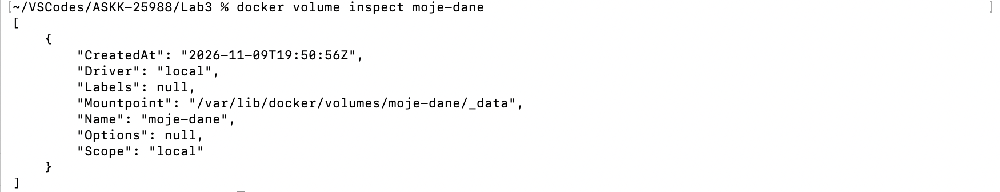

Rys. 1 - Wynik `docker volume inspect`.

---

##### Ćwiczenie 1.2 — Użycie wolumenu z kontenerem

**Opis:** Uruchomiono kontener z obrazem ubuntu i zamontowanym wolumenem utworzonym w ćwiczeniu 1.1 a następnie zapisano dane do pliku tekstowego w wolumenie. Na koniec uruchomiono nowy kontener próbujący odczytać wcześniej zapisany tekst. Zawartość wcześniej utworzonego pliku została poprawnie zwrócona, co oznacza, że dane przetrwały w wolumenie.

**Użyte polecenia:**

```zsh
# Zapisz dane w wolumenie
# Uwaga: zewnętrzne apostrofy — w cudzysłowie "..." znak ! uruchamia rozwijanie historii basha
docker run --rm -v moje-dane:/data ubuntu bash -c 'echo "Dane trwałe!" > /data/plik.txt && date >> /data/plik.txt'

# Odczytaj dane z innego kontenera
docker run --rm -v moje-dane:/data ubuntu cat /data/plik.txt

# Dane przetrwały! Kontener został usunięty (--rm), ale dane zostały.
```

**Wynik działania:**

```zsh
~/VSCodes/ASKK-25988/Lab3 % docker run --rm -v moje-dane:/data ubuntu bash -c 'echo "Dane trwałe!" > /data/plik.txt && date >> /data/plik.txt'
Unable to find image 'ubuntu:latest' locally
latest: Pulling from library/ubuntu
6f01cc7d6fb3: Pull complete 
afa7f7d582de: Pull complete 
d597c14cfeb9: Download complete 
Digest: sha256:6a06111c3b0a8600feadb270aec771dc239bf407b25625f93f44ab00e11f4d3c
Status: Downloaded newer image for ubuntu:latest
```

```zsh
~/VSCodes/ASKK-25988/Lab3 % docker run --rm -v moje-dane:/data ubuntu cat /data/plik.txt
Dane trwałe!
Mon Nov  9 19:55:53 UTC 2026
```

---

##### Ćwiczenie 1.3 — Efemeryczność bez wolumenu

**Opis:** Utworzono kontener bez wolumenu i sprawdzono trwałość danych w przypadku zamontowania i niezamontowania wolumenu. Z zamontowanym wolumenem dane przetrwały mimo usunięcia kontenera, natomiast bez wolumenu dane przetrwały restart kontenera, natomiast jego usunięcia i utworzenia na nowo identycznego kontenera już nie.

**Użyte polecenia:**

```zsh
# Bez wolumenu — dane giną
# sleep infinity utrzymuje kontener przy życiu, aby można było użyć docker exec
docker run -d --name temp ubuntu bash -c "echo 'Dane tymczasowe' > /tmp/dane.txt && sleep infinity"
docker exec temp cat /tmp/dane.txt  # OK — kontener istnieje

docker stop temp && docker rm temp   # (lub: docker rm -f temp)
# Dane zniknęły bezpowrotnie!
```

**Wynik działania:**

```zsh
~/VSCodes/ASKK-25988/Lab3 % docker run -d --name temp ubuntu bash -c "echo 'Dane tymczasowe' > /tmp/dane.txt && sleep infinity"
c50becfc8e44faa405076cc72598e859eaafe69a355033374cecad338983813e
```

```zsh
~/VSCodes/ASKK-25988/Lab3 % docker exec temp cat /tmp/dane.txt
Dane tymczasowe
```

```zsh
~/VSCodes/ASKK-25988/Lab3 % docker stop temp && docker rm temp
temp
temp
```

**Screenshot:**


Rys. 2 - Demonstracja trwałości danych z wolumenem vs bez. W pierwszym przypadku dane przetrwały na wolumenie mimo tego, że kontener, z którego zostały utworzone został wcześniej usunięty. W drugim przypadku dane przetrwały restart kontenera ale jego usunięcia i próby utworzenia nowego identycznego kontenera już nie.

---

##### Ćwiczenie 1.4 — Wolumen tylko do odczytu

**Opis:** Zapisano dane w wolumenie, zamontowano wolumen w trybie tylko do odczytu i pokazano, że próba zapisu na takim wolumenie zakończy się błędem.

**Użyte polecenia:**

```zsh
# Zapisz dane
docker run --rm -v moje-dane:/data ubuntu bash -c "echo 'Ważne dane' > /data/important.txt"

# Zamontuj jako read-only
docker run --rm -v moje-dane:/data:ro ubuntu bash -c "cat /data/important.txt"

# Próba zapisu — błąd!
docker run --rm -v moje-dane:/data:ro ubuntu bash -c "echo 'test' > /data/nowy.txt"
```

**Wynik działania:**

```zsh
~/VSCodes/ASKK-25988/Lab3 % docker run --rm -v moje-dane:/data ubuntu bash -c "echo 'Ważne dane' > /data/important.txt"
~/VSCodes/ASKK-25988/Lab3 %
```

```zsh
~/VSCodes/ASKK-25988/Lab3 % docker run --rm -v moje-dane:/data:ro ubuntu bash -c "cat /data/important.txt"
Ważne dane
```

```zsh
~/VSCodes/ASKK-25988/Lab3 % docker run --rm -v moje-dane:/data:ro ubuntu bash -c "echo 'test' > /data/nowy.txt"
bash: line 1: /data/nowy.txt: Read-only file system
```

---

##### Ćwiczenie 2.1 — Montowanie katalogu z hosta

**Opis:** Zamontowano katalog z komputera hosta kontenerowi serwującemu serwer nginx i pokazano, że serwer prawidłowo udostępnia stronę internetową utworzoną w pliku `index.html`.

**Użyte polecenia:**

```zsh
mkdir -p ~/VSCodes/ASKK-25988/Lab3/web-content
echo '<h1>Strona z hosta!</h1>' > ~/VSCodes/ASKK-25988/Lab3/web-content/index.html

# Zamontuj katalog z hosta do kontenera Nginx
docker run -d --name web \
  -p 8080:80 \
  -v ~/VSCodes/ASKK-25988/Lab3/web-content:/usr/share/nginx/html:ro \
  nginx:alpine

curl http://localhost:8080
```

**Wynik działania:**

```zsh
~/VSCodes/ASKK-25988/Lab3 % mkdir -p ~/VSCodes/ASKK-25988/Lab3/web-content
~/VSCodes/ASKK-25988/Lab3 % 
```

```zsh
~/VSCodes/ASKK-25988/Lab3 % echo '<h1>Strona z hosta!</h1>' > ~/VSCodes/ASKK-25988/Lab3/web-content/index.html
~/VSCodes/ASKK-25988/Lab3 %
```

```zsh
~/VSCodes/ASKK-25988/Lab3 % docker run -d --name web \
  -p 8080:80 \
  -v ~/VSCodes/ASKK-25988/Lab3/web-content:/usr/share/nginx/html:ro \
  nginx:alpine
e869a4b9ca31881c2f40415cbbe5447248758b32d4ee7d8b46db831995c2bad2
```

```zsh
~/VSCodes/ASKK-25988/Lab3 % curl http://localhost:8080
<h1>Strona z hosta!</h1>
```

**Screenshot:**


Rys. 3 - Strona serwowana z zamontowanego katalogu.

---

##### Ćwiczenie 2.2 — Hot-reload z bind mount

**Opis:** Zmieniono zawartość wcześniej utworzonego pliku `index.html` znajdującego się w zamontowanym wolumenie i pokazano, że aktualizacja wolumenu jest natychmiast widoczna bez konieczności restartowania kontenera.

**Użyte polecenia:**

```zsh
# Zmień plik na hoście
echo '<h1>Zaktualizowana strona!</h1><p>Zmiana widoczna natychmiast.</p>' > ~/VSCodes/ASKK-25988/Lab3/web-content/index.html

# Sprawdź — zmiana widoczna bez restartu kontenera!
curl http://localhost:8080

docker stop web && docker rm web
```

**Wynik działania:**

```zsh
~/VSCodes/ASKK-25988/Lab3 % echo '<h1>Zaktualizowana strona!</h1><p>Zmiana widoczna natychmiast.</p>' > ~/VSCodes/ASKK-25988/Lab3/web-content/index.html
~/VSCodes/ASKK-25988/Lab3 %
```

```zsh
~/VSCodes/ASKK-25988/Lab3 % curl http://localhost:8080
<h1>Zaktualizowana strona!</h1><p>Zmiana widoczna natychmiast.</p>
```

```zsh
~/VSCodes/ASKK-25988/Lab3 % docker stop web && docker rm web
web
web
```

---

##### Ćwiczenie 2.3 — Bind mount dla development

**Opis:** Utworzono prostą aplikację Flask i pokazano, że w momencie, gdy jest ona uruchomiona w trybie debugowania i zmieniony zostanie jej kod to zmiany zostaną nałożone automatycznie bez konieczności restartowania kontenera.

**Użyte polecenia:**

```zsh
mkdir -p ~/VSCodes/ASKK-25988/Lab3/python-dev && cd ~/VSCodes/ASKK-25988/Lab3/python-dev

cat > app.py << 'EOF'
from flask import Flask
app = Flask(__name__)

@app.route('/')
def hello():
    return "<h1>Wersja 1 — development</h1>"

if __name__ == '__main__':
    app.run(host='0.0.0.0', port=5000, debug=True)
EOF

cat > requirements.txt << 'EOF'
flask==3.0.0
EOF

cat > Dockerfile << 'EOF'
FROM python:3.11-slim
WORKDIR /app
COPY requirements.txt .
RUN pip install --no-cache-dir -r requirements.txt
COPY . .
CMD ["python", "app.py"]
EOF

docker build -t dev-app .
docker run -d --name dev \
  -p 5001:5000 \
  -v $(pwd)/app.py:/app/app.py \
  dev-app

curl http://localhost:5001

# Zmień app.py na hoście (np. "Wersja 2")
# Uwaga: przy bind mount pojedynczego pliku NIE używaj `sed -i` ani edytorów zapisujących
# nowy plik — tworzą nowy i-węzeł, a kontener nadal widzi stary plik.
# Nadpisz zawartość istniejącego pliku:
sed 's/Wersja 1/Wersja 2/' app.py > app.tmp && cat app.tmp > app.py && rm app.tmp
# (alternatywa: montuj cały katalog, np. -v $(pwd):/app)

# Flask z debug=True automatycznie przeładuje!
sleep 2 && curl http://localhost:5001

docker stop dev && docker rm dev
```

**Wynik działania:**

```zsh
~/VSCodes/ASKK-25988/Lab3 % mkdir -p ~/VSCodes/ASKK-25988/Lab3/python-dev && cd ~/VSCodes/ASKK-25988/Lab3/python-dev
~/VSCodes/ASKK-25988/Lab3/python-dev % 
```

```zsh
~/VSCodes/ASKK-25988/Lab3/python-dev % cat > app.py << 'EOF'
from flask import Flask
app = Flask(__name__)

@app.route('/')
def hello():
    return "<h1>Wersja 1 — development</h1>"

if __name__ == '__main__':
    app.run(host='0.0.0.0', port=5000, debug=True)
EOF

cat > requirements.txt << 'EOF'
flask==3.0.0
EOF

cat > Dockerfile << 'EOF'
FROM python:3.11-slim
WORKDIR /app
COPY requirements.txt .
RUN pip install --no-cache-dir -r requirements.txt
COPY . .
CMD ["python", "app.py"]
EOF
~/VSCodes/ASKK-25988/Lab3/python-dev % 
```

```zsh
~/VSCodes/ASKK-25988/Lab3/python-dev % docker build -t dev-app .
[+] Building 0.3s (10/10) FINISHED                                                                   docker:desktop-linux
 => [internal] load build definition from Dockerfile                                                                 0.0s
 => => transferring dockerfile: 183B                                                                                 0.0s
 => [internal] load metadata for docker.io/library/python:3.11-slim                                                  0.0s
 => [internal] load .dockerignore                                                                                    0.0s
 => => transferring context: 2B                                                                                      0.0s
 => [1/5] FROM docker.io/library/python:3.11-slim@sha256:e88e9763f943ec1834f992a4b51e0f24500486803e8bc534e5767af9ea  0.0s
 => => resolve docker.io/library/python:3.11-slim@sha256:e88e9763f943ec1834f992a4b51e0f24500486803e8bc534e5767af9ea  0.0s
 => [internal] load build context                                                                                    0.0s
 => => transferring context: 480B                                                                                    0.0s
 => CACHED [2/5] WORKDIR /app                                                                                        0.0s
 => CACHED [3/5] COPY requirements.txt .                                                                             0.0s
 => CACHED [4/5] RUN pip install --no-cache-dir -r requirements.txt                                                  0.0s
 => [5/5] COPY . .                                                                                                   0.0s
 => exporting to image                                                                                               0.1s
 => => exporting layers                                                                                              0.0s
 => => exporting manifest sha256:2cc053ae66c6dcb8bffe67d6b8a7fc85bc8ed7b02e60bf170f5841d6e495da4b                    0.0s
 => => exporting config sha256:292ae5cfc3ba2feb0c00e1001688ffd23cc0929b1a6c5bb2dbe0a0fb06e9f267                      0.0s
 => => exporting attestation manifest sha256:cd8e7483a102cd81869017415d02beda3d8d712e3dc49442ace4d4cdb11c2442        0.0s
 => => exporting manifest list sha256:3004eed0c63273ff5ef4bb34f21f1ccc95822f42e163780988343a5c5e35d93a               0.0s
 => => naming to docker.io/library/dev-app:latest                                                                    0.0s
 => => unpacking to docker.io/library/dev-app:latest                                                                 0.0s
```

```zsh
~/VSCodes/ASKK-25988/Lab3/python-dev % docker run -d --name dev \
  -p 5001:5000 \
  -v $(pwd)/app.py:/app/app.py \
  dev-app
3dc2b9e730e9de841298d6b09e99777bd320c717d9acac7012036529c6e3442e
```

```zsh
~/VSCodes/ASKK-25988/Lab3/python-dev % curl http://localhost:5001
<h1>Wersja 1 — development</h1>%
```

```zsh
~/VSCodes/ASKK-25988/Lab3/python-dev % sed 's/Wersja 1/Wersja 2/' app.py > app.tmp && cat app.tmp > app.py && rm app.tmp
~/VSCodes/ASKK-25988/Lab3/python-dev %
```

```zsh
~/VSCodes/ASKK-25988/Lab3/python-dev % sleep 2 && curl http://localhost:5001
<h1>Wersja 2 — development</h1>%   
```

```zsh
~/VSCodes/ASKK-25988/Lab3/python-dev % docker stop dev && docker rm dev
dev
dev
```

**Screenshot:**

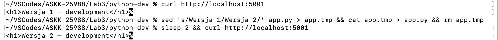

Rys. 4 - Hot-reload — zmiana kodu widoczna bez restartu.

---

##### Ćwiczenie 3.1 — PostgreSQL z trwałymi danymi

**Opis:** Utworzono kontener PostgreSQL z zamontowanym wolumenem i z 2 tabelami wypełnionymi danymi a następnie pokazano, że dane te przetrwają usunięcie kontenera.

**Użyte polecenia:**

```zsh
# Utwórz wolumen
docker volume create pgdata1

# Uruchom PostgreSQL
docker run -d --name postgres \
  -e POSTGRES_PASSWORD=secret \
  -e POSTGRES_DB=studenci \
  -v pgdata1:/var/lib/postgresql/data \
  -p 5432:5432 \
  postgres:16-alpine

# Poczekaj na inicjalizację
sleep 5

# Utwórz tabelę i dodaj dane
docker exec -it postgres psql -U postgres -d studenci -c "
CREATE TABLE studenci (
    id SERIAL PRIMARY KEY,
    imie VARCHAR(50),
    nazwisko VARCHAR(50),
    nr_indeksu VARCHAR(10)
);
INSERT INTO studenci (imie, nazwisko, nr_indeksu) VALUES
    ('Jan', 'Kowalski', '123456'),
    ('Anna', 'Nowak', '654321');
SELECT * FROM studenci;
"
```

```zsh
# Zatrzymaj i usuń kontener
docker stop postgres && docker rm postgres

# Uruchom nowy kontener z tym samym wolumenem
docker run -d --name postgres-new \
  -e POSTGRES_PASSWORD=secret \
  -v pgdata1:/var/lib/postgresql/data \
  -p 5432:5432 \
  postgres:16-alpine

sleep 3

# Dane przetrwały!
docker exec -it postgres-new psql -U postgres -d studenci -c "SELECT * FROM studenci;"
```

**Wynik działania:**

```zsh
~/VSCodes/ASKK-25988/Lab3/python-dev % docker volume create pgdata1
pgdata1
```

```zsh
~/VSCodes/ASKK-25988/Lab3/python-dev % docker run -d --name postgres \
  -e POSTGRES_PASSWORD=secret \
  -e POSTGRES_DB=studenci \
  -v pgdata1:/var/lib/postgresql/data \
  -p 5432:5432 \
  postgres:16-alpine
Unable to find image 'postgres:16-alpine' locally
16-alpine: Pulling from library/postgres
183351605181: Pull complete 
b90627b8f429: Pull complete 
426c361672cc: Pull complete 
564e21d853ad: Pull complete 
f8fb8a00265d: Pull complete 
3cec7a2c578f: Pull complete 
82263ad88433: Pull complete 
80649b351453: Pull complete 
9c37259cdb63: Pull complete 
ef6a52aae75a: Pull complete 
87f4620f68e9: Pull complete 
5cf33c31b69d: Download complete 
484b4da841fb: Download complete 
Digest: sha256:aa6cb33cf4c19c765cefcf48d96176258800870a9a1e930ad126200f9d825139
Status: Downloaded newer image for postgres:16-alpine
dfd476cea096d5afa4e42797905b464409582031fc36f135948e5e43acb5627a
```

```zsh
~/VSCodes/ASKK-25988/Lab3/python-dev % docker exec -it postgres psql -U postgres -d studenci -c "
CREATE TABLE studenci (
    id SERIAL PRIMARY KEY,
    imie VARCHAR(50),
    nazwisko VARCHAR(50),
    nr_indeksu VARCHAR(10)
);
INSERT INTO studenci (imie, nazwisko, nr_indeksu) VALUES
    ('Jan', 'Kowalski', '123456'),
    ('Anna', 'Nowak', '654321');
SELECT * FROM studenci;
"
CREATE TABLE
INSERT 0 2
 id | imie | nazwisko | nr_indeksu 
----+------+----------+------------
  1 | Jan  | Kowalski | 123456
  2 | Anna | Nowak    | 654321
(2 rows)
```

```zsh
~/VSCodes/ASKK-25988/Lab3/python-dev % docker stop postgres && docker rm postgres
postgres
postgres
```

```zsh
~/VSCodes/ASKK-25988/Lab3/python-dev % docker run -d --name postgres-new \
  -e POSTGRES_PASSWORD=secret \
  -v pgdata1:/var/lib/postgresql/data \
  -p 5432:5432 \
  postgres:16-alpine
add5d6dbeca9be54b528459858877a90398f3e6833959a1e708c2762892a9a98
```

```zsh
~/VSCodes/ASKK-25988/Lab3/python-dev % docker exec -it postgres-new psql -U postgres -d studenci -c "SELECT * FROM studenci;"
 id | imie | nazwisko | nr_indeksu 
----+------+----------+------------
  1 | Jan  | Kowalski | 123456
  2 | Anna | Nowak    | 654321
(2 rows)
```

**Screenshot:**

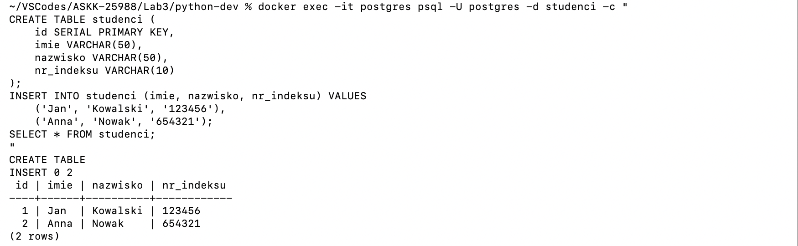

Rys. 5 - Tabela studenci w PostgreSQL.

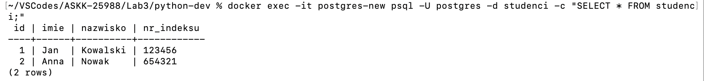

Rys. 6 - Dane zachowane po usunięciu i ponownym uruchomieniu kontenera.

---

##### Ćwiczenie 3.2 — MySQL z wolumenem

**Opis:** Utworzono kontener MySQL z zamontowanym wolumenem i trwale zapisano dane w tabeli `produkty`.

**Użyte polecenia:**

```zsh
docker volume create mysqldata

docker run -d --name mysql \
  -e MYSQL_ROOT_PASSWORD=secret \
  -e MYSQL_DATABASE=sklep \
  -v mysqldata:/var/lib/mysql \
  -p 3306:3306 \
  mysql:8

sleep 15  # MySQL potrzebuje więcej czasu na inicjalizację

docker exec -it mysql mysql -u root -psecret -e "
USE sklep;
CREATE TABLE produkty (id INT AUTO_INCREMENT PRIMARY KEY, nazwa VARCHAR(100), cena DECIMAL(10,2));
INSERT INTO produkty (nazwa, cena) VALUES ('Laptop', 3999.99), ('Mysz', 49.99);
SELECT * FROM produkty;
"
```

**Wynik działania:**

```zsh
~/VSCodes/ASKK-25988/Lab3/python-dev % docker volume create mysqldata
mysqldata
```

```zsh
~/VSCodes/ASKK-25988/Lab3/python-dev % docker run -d --name mysql \
  -e MYSQL_ROOT_PASSWORD=secret \
  -e MYSQL_DATABASE=sklep \
  -v mysqldata:/var/lib/mysql \
  -p 3306:3306 \
  mysql:8
94c7aee4a4a9149b6583623ec563bfe4a67cc8f423b72acd906c410f5486a409
```

```zsh
~/VSCodes/ASKK-25988/Lab3/python-dev % docker exec -it mysql mysql -u root -psecret -e "
USE sklep;
CREATE TABLE produkty (id INT AUTO_INCREMENT PRIMARY KEY, nazwa VARCHAR(100), cena DECIMAL(10,2));
INSERT INTO produkty (nazwa, cena) VALUES ('Laptop', 3999.99), ('Mysz', 49.99);
SELECT * FROM produkty;
"
mysql: [Warning] Using a password on the command line interface can be insecure.
+----+--------+---------+
| id | nazwa  | cena    |
+----+--------+---------+
|  1 | Laptop | 3999.99 |
|  2 | Mysz   |   49.99 |
+----+--------+---------+
```

---

##### Ćwiczenie 3.3 — MongoDB z wolumenem

**Opis:** Utworzono kontener MongoDB z zamontowanym wolumenem. Następnie wewnątrz bazy MongoDB utworzono dokument i odczytano jego zawartość.

**Użyte polecenia:**

```zsh
docker volume create mongodata

docker run -d --name mongo \
  -e MONGO_INITDB_ROOT_USERNAME=admin \
  -e MONGO_INITDB_ROOT_PASSWORD=secret \
  -v mongodata:/data/db \
  -p 27017:27017 \
  mongo:7

sleep 5

docker exec -it mongo mongosh -u admin -p secret --eval "
const db = db.getSiblingDB('testdb');
db.users.insertMany([
    {name: 'Jan', age: 25},
    {name: 'Anna', age: 30}
]);
db.users.find();
"
```

**Wynik działania:**

```zsh
~/VSCodes/ASKK-25988/Lab3/python-dev % docker volume create mongodata
mongodata
```

```zsh
~/VSCodes/ASKK-25988/Lab3/python-dev % docker run -d --name mongo \
  -e MONGO_INITDB_ROOT_USERNAME=admin \
  -e MONGO_INITDB_ROOT_PASSWORD=secret \
  -v mongodata:/data/db \
  -p 27017:27017 \
  mongo:7
Unable to find image 'mongo:7' locally
7: Pulling from library/mongo
235f996274b7: Pull complete 
771eed73ee82: Pull complete 
53ff66f996f2: Pull complete 
6cf8446071d2: Pull complete 
5a2f494adbe3: Pull complete 
bb371a8e9e66: Pull complete 
468debf69ee9: Pull complete 
17fe8025a9eb: Pull complete 
3002c75f5580: Download complete 
123428bb562c: Download complete 
Digest: sha256:8bb4442761a63a8dda452744082cdac9644b429807eb977b42324a63cef59ca4
Status: Downloaded newer image for mongo:7
c8be95e8141de1d419aa5dcc46545e01a71a6aa419c932a570eb9ea97be1fcd0
```

```zsh
~/VSCodes/ASKK-25988/Lab3/python-dev % docker exec -it mongo mongosh -u admin -p secret --eval "
const db = db.getSiblingDB('testdb');
db.users.insertMany([
    {name: 'Jan', age: 25},
    {name: 'Anna', age: 30}
]);
db.users.find();
"
[
  { _id: ObjectId('6af237bcd8b8a92bf5e64976'), name: 'Jan', age: 25 },
  { _id: ObjectId('6af237bcd8b8a92bf5e64977'), name: 'Anna', age: 30 }
]
```

---

##### Ćwiczenie 4.1 — Writer-Reader pattern

**Opis:** Stworzono kontener z zamontowanym wolumenem, który zapisywał logi w pliku znajdującym się na wolumenie a następnie w drugim kontenerze odczytywano logi z wcześniej utworzonego pliku, pokazując tym samym, że wolumeny mogą być współdzielone między kontenerami.

**Użyte polecenia:**

```zsh
docker volume create shared-logs

# Writer — generuje logi
docker run -d --name writer \
  -v shared-logs:/logs \
  ubuntu bash -c "while true; do echo \"\$(date): Log entry\" >> /logs/app.log; sleep 3; done"

# Reader — odczytuje logi
docker run --rm -v shared-logs:/logs:ro ubuntu tail -5 /logs/app.log

# Śledzenie na żywo
docker run --rm -v shared-logs:/logs:ro ubuntu tail -f /logs/app.log
# Ctrl+C po kilku wpisach

docker stop writer && docker rm writer
```

**Wynik działania:**

```zsh
~/VSCodes/ASKK-25988/Lab3/python-dev % docker volume create shared-logs
shared-logs
```

```zsh
~/VSCodes/ASKK-25988/Lab3/python-dev % docker run -d --name writer \
  -v shared-logs:/logs \
  ubuntu bash -c "while true; do echo \"\$(date): Log entry\" >> /logs/app.log; sleep 3; done"
f5487d8ddf3c59f9de40b0e36803375de447e2474d3bbb47203487f6e95dd305
```

```zsh
~/VSCodes/ASKK-25988/Lab3/python-dev % docker run --rm -v shared-logs:/logs:ro ubuntu tail -5 /logs/app.log
Mon Nov  9 21:20:54 UTC 2026: Log entry
Mon Nov  9 21:20:57 UTC 2026: Log entry
Mon Nov  9 21:21:00 UTC 2026: Log entry
Mon Nov  9 21:21:03 UTC 2026: Log entry
Mon Nov  9 21:21:06 UTC 2026: Log entry
```

```zsh
~/VSCodes/ASKK-25988/Lab3/python-dev % docker run --rm -v shared-logs:/logs:ro ubuntu tail -f /logs/app.log
Mon Nov  9 21:20:51 UTC 2026: Log entry
Mon Nov  9 21:20:54 UTC 2026: Log entry
Mon Nov  9 21:20:57 UTC 2026: Log entry
Mon Nov  9 21:21:00 UTC 2026: Log entry
Mon Nov  9 21:21:03 UTC 2026: Log entry
Mon Nov  9 21:21:06 UTC 2026: Log entry
Mon Nov  9 21:21:09 UTC 2026: Log entry
Mon Nov  9 21:21:12 UTC 2026: Log entry
Mon Nov  9 21:21:15 UTC 2026: Log entry
Mon Nov  9 21:21:18 UTC 2026: Log entry
Mon Nov  9 21:21:21 UTC 2026: Log entry
Mon Nov  9 21:21:24 UTC 2026: Log entry
^CMon Nov  9 21:21:27 UTC 2026: Log entry
^CMon Nov  9 21:21:30 UTC 2026: Log entry
Mon Nov  9 21:21:33 UTC 2026: Log entry
^C
got 3 SIGTERM/SIGINTs, forcefully exiting
```

```zsh
~/VSCodes/ASKK-25988/Lab3/python-dev % docker stop writer && docker rm writer
writer
writer
```

**Screenshot:**

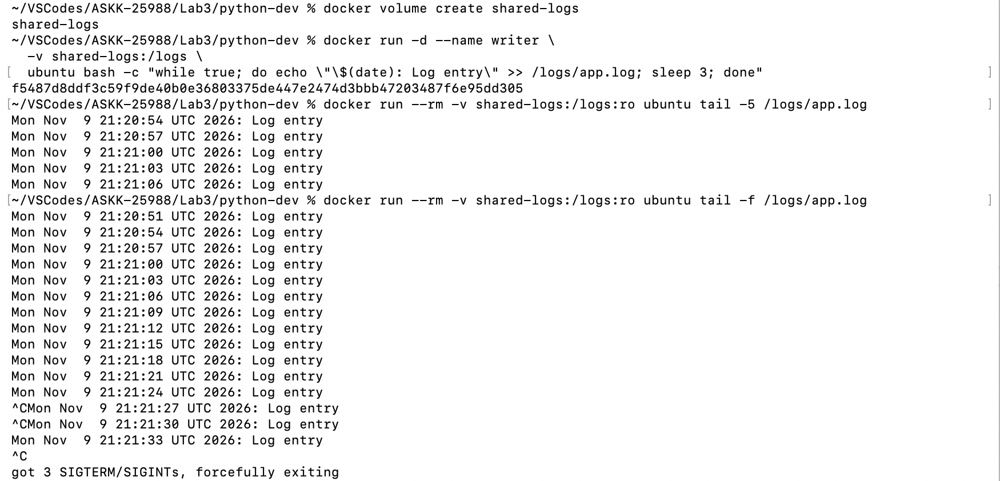

Rys. 7 - Współdzielenie danych między kontenerami.

---

##### Ćwiczenie 5.1 — Backup wolumenu

**Opis:** Utworzono backup wolumenu i upewniono się, że nie jest pusty.

**Użyte polecenia:**

```zsh
# Upewnij się, że wolumen pgdata ma dane
docker exec -it postgres-new psql -U postgres -d studenci -c "SELECT * FROM studenci;"

# Backup do pliku tar
docker run --rm \
  -v pgdata1:/source:ro \
  -v $(pwd):/backup \
  ubuntu tar czf /backup/pgdata1-backup.tar.gz -C /source .

ls -lh pgdata1-backup.tar.gz
```

**Wynik działania:**

```zsh
~/VSCodes/ASKK-25988/Lab3/python-dev % docker exec -it postgres-new psql -U postgres -d studenci -c "SELECT * FROM studenci;"
 id | imie | nazwisko | nr_indeksu 
----+------+----------+------------
  1 | Jan  | Kowalski | 123456
  2 | Anna | Nowak    | 654321
(2 rows)
```

```zsh
~/VSCodes/ASKK-25988/Lab3/python-dev % docker run --rm \
  -v pgdata1:/source:ro \
  -v $(pwd):/backup \
  ubuntu tar czf /backup/pgdata1-backup.tar.gz -C /source .
~/VSCodes/ASKK-25988/Lab3/python-dev % 
```

```zsh
~/VSCodes/ASKK-25988/Lab3/python-dev % ls -lh pgdata1-backup.tar.gz
-rw-r--r--  1 mewosh  staff   6.5M Nov 10 15:19 pgdata1-backup.tar.gz
```

---

##### Ćwiczenie 5.2 — Restore wolumenu

**Opis:** Wykorzystano backup utworzony w ćwiczeniu 5.1 do odtworzenia danych zapisanych w backupie na nowym wolumenie a następnie sprawdzono czy nowy wolumen zawiera te dane (tabelę `studenci`).

**Użyte polecenia:**

```zsh
# Utwórz nowy wolumen
docker volume create pgdata-restored

# Restore z backupu
docker run --rm \
  -v pgdata-restored:/target \
  -v $(pwd):/backup:ro \
  ubuntu tar xzf /backup/pgdata1-backup.tar.gz -C /target

# Uruchom PostgreSQL z przywróconym wolumenem
docker stop postgres-new && docker rm postgres-new

docker run -d --name postgres-restored \
  -e POSTGRES_PASSWORD=secret \
  -v pgdata-restored:/var/lib/postgresql/data \
  -p 5432:5432 \
  postgres:16-alpine

sleep 3
docker exec -it postgres-restored psql -U postgres -d studenci -c "SELECT * FROM studenci;"
```

**Wynik działania:**

```zsh
~/VSCodes/ASKK-25988/Lab3/python-dev % docker volume create pgdata-restored
pgdata-restored
```

```zsh
~/VSCodes/ASKK-25988/Lab3/python-dev % docker run --rm \
  -v pgdata-restored:/target \
  -v $(pwd):/backup:ro \
  ubuntu tar xzf /backup/pgdata1-backup.tar.gz -C /target
~/VSCodes/ASKK-25988/Lab3/python-dev % 
```

```zsh
~/VSCodes/ASKK-25988/Lab3/python-dev % docker stop postgres-new && docker rm postgres-new
postgres-new
postgres-new
```

```zsh
~/VSCodes/ASKK-25988/Lab3/python-dev % docker run -d --name postgres-restored \
  -e POSTGRES_PASSWORD=secret \
  -v pgdata-restored:/var/lib/postgresql/data \
  -p 5432:5432 \
  postgres:16-alpine
f1106d492da2a5b0414ff73af3a1a85dfc1168e6336100e0c888179b613adbbb
```

```zsh
~/VSCodes/ASKK-25988/Lab3/python-dev % docker exec -it postgres-restored psql -U postgres -d studenci -c "SELECT * FROM studenci;"
 id | imie | nazwisko | nr_indeksu 
----+------+----------+------------
  1 | Jan  | Kowalski | 123456
  2 | Anna | Nowak    | 654321
(2 rows)
```

**Screenshot:**

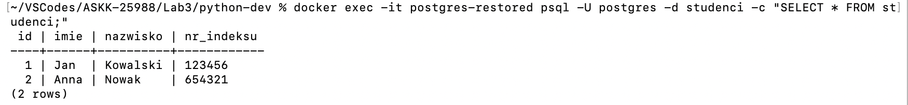

Rys. 8 - Dane przywrócone z backupu.

---

##### Ćwiczenie 5.3 — Backup bazy danych (pg_dump)

**Opis:** Stworzona dumpa (kopię) bazy danych PostgreSQL, zapisano go w pliku `.sql` a następnie na podstawie dumpa stworzono identyczną kopię bazy danych i pokazano, że zawiera ona te same dane, co poprzednia baza.

**Użyte polecenia:**

```zsh
# Backup logiczny (pg_dump)
docker exec postgres-restored pg_dump -U postgres studenci > studenci_backup.sql

cat studenci_backup.sql

# Restore do nowej bazy
docker exec -i postgres-restored psql -U postgres -c "CREATE DATABASE studenci_copy;"
docker exec -i postgres-restored psql -U postgres studenci_copy < studenci_backup.sql
docker exec postgres-restored psql -U postgres -d studenci_copy -c "SELECT * FROM studenci;"
```

**Wynik działania:**

```zsh
~/VSCodes/ASKK-25988/Lab3/python-dev % docker exec postgres-restored pg_dump -U postgres studenci > studenci_backup.sql
~/VSCodes/ASKK-25988/Lab3/python-dev % 
```

```zsh
~/VSCodes/ASKK-25988/Lab3/python-dev % cat studenci_backup.sql
--
-- PostgreSQL database dump
--

\restrict 67JuliIjbkhMgsMYpWT9Rzjrwy5Oa5NbGhygvc3rGi7p4usPeoqSmtNuKVgCVcR

-- Dumped from database version 16.15
-- Dumped by pg_dump version 16.15

SET statement_timeout = 0;
SET lock_timeout = 0;
SET idle_in_transaction_session_timeout = 0;
SET client_encoding = 'UTF8';
SET standard_conforming_strings = on;
SELECT pg_catalog.set_config('search_path', '', false);
SET check_function_bodies = false;
SET xmloption = content;
SET client_min_messages = warning;
SET row_security = off;

SET default_tablespace = '';

SET default_table_access_method = heap;

--
-- Name: studenci; Type: TABLE; Schema: public; Owner: postgres
--

CREATE TABLE public.studenci (
    id integer NOT NULL,
    imie character varying(50),
    nazwisko character varying(50),
    nr_indeksu character varying(10)
);


ALTER TABLE public.studenci OWNER TO postgres;

--
-- Name: studenci_id_seq; Type: SEQUENCE; Schema: public; Owner: postgres
--

CREATE SEQUENCE public.studenci_id_seq
    AS integer
    START WITH 1
    INCREMENT BY 1
    NO MINVALUE
    NO MAXVALUE
    CACHE 1;


ALTER SEQUENCE public.studenci_id_seq OWNER TO postgres;

--
-- Name: studenci_id_seq; Type: SEQUENCE OWNED BY; Schema: public; Owner: postgres
--

ALTER SEQUENCE public.studenci_id_seq OWNED BY public.studenci.id;


--
-- Name: studenci id; Type: DEFAULT; Schema: public; Owner: postgres
--

ALTER TABLE ONLY public.studenci ALTER COLUMN id SET DEFAULT nextval('public.studenci_id_seq'::regclass);


--
-- Data for Name: studenci; Type: TABLE DATA; Schema: public; Owner: postgres
--

COPY public.studenci (id, imie, nazwisko, nr_indeksu) FROM stdin;
1	Jan	Kowalski	123456
2	Anna	Nowak	654321
\.


--
-- Name: studenci_id_seq; Type: SEQUENCE SET; Schema: public; Owner: postgres
--

SELECT pg_catalog.setval('public.studenci_id_seq', 2, true);


--
-- Name: studenci studenci_pkey; Type: CONSTRAINT; Schema: public; Owner: postgres
--

ALTER TABLE ONLY public.studenci
    ADD CONSTRAINT studenci_pkey PRIMARY KEY (id);


--
-- PostgreSQL database dump complete
--

\unrestrict 67JuliIjbkhMgsMYpWT9Rzjrwy5Oa5NbGhygvc3rGi7p4usPeoqSmtNuKVgCVcR
```

```zsh
~/VSCodes/ASKK-25988/Lab3/python-dev % docker exec -i postgres-restored psql -U postgres -c "CREATE DATABASE studenci_copy;"
CREATE DATABASE
```

```zsh
~/VSCodes/ASKK-25988/Lab3/python-dev % docker exec -i postgres-restored psql -U postgres studenci_copy < studenci_backup.sql
SET
SET
SET
SET
SET
 set_config 
------------
 
(1 row)

SET
SET
SET
SET
SET
SET
CREATE TABLE
ALTER TABLE
CREATE SEQUENCE
ALTER SEQUENCE
ALTER SEQUENCE
ALTER TABLE
COPY 2
 setval 
--------
      2
(1 row)

ALTER TABLE
```

```zsh
~/VSCodes/ASKK-25988/Lab3/python-dev % docker exec postgres-restored psql -U postgres -d studenci_copy -c "SELECT * FROM studenci;"
 id | imie | nazwisko | nr_indeksu 
----+------+----------+------------
  1 | Jan  | Kowalski | 123456
  2 | Anna | Nowak    | 654321
(2 rows)
```

---

##### Ćwiczenie 6.1 — Dane w pamięci RAM

**Opis:** Uruchomiono kontener, który zapisuje dane w pamięci RAM wykorzystując mechanizm tmpfs o nadanym rozmiarze 100 MB.

**Użyte polecenia:**

```zsh
# tmpfs — dane w RAM
docker run --rm \
  --tmpfs /tmp:size=100m \
  ubuntu bash -c "
    echo 'Dane wrażliwe: hasło123' > /tmp/secret.txt
    cat /tmp/secret.txt
    df -h /tmp
  "

# Po zakończeniu kontenera dane znikają z RAM
```

**Wynik działania:**

```zsh
~/VSCodes/ASKK-25988/Lab3/python-dev % docker run --rm \ 
  --tmpfs /tmp:size=100m \
  ubuntu bash -c "
    echo 'Dane wrażliwe: hasło123' > /tmp/secret.txt
    cat /tmp/secret.txt
    df -h /tmp
  "
Dane wrażliwe: hasło123
Filesystem      Size  Used Avail Use% Mounted on
tmpfs           100M  4.0K  100M   1% /tmp
```

---

##### Ćwiczenie 6.2 — Porównanie wydajności

**Opis:** Porównano wydajność zapisu w tmpfs (RAM) vs na wolumenie (dysku). Pamięć RAM powinna być znacznie szybsza od dysku, mimo to zaobserwowano odwrotne wyniki, ponadto wolumen wypadł jeszcze lepiej gdy polecenia uruchomiono ponownie. Problem jest spowodowany używaniem systemu macOS i Docker Desktop (na Windowsie problem również powinien występować). W środowisku Docker Desktop na macOS kontener nie działa natywnie na jądrze macOS, lecz wewnątrz ukrytej maszyny wirtualnej Linuxa. Zapis do tmpfs wymaga dynamicznej alokacji stron pamięci RAM wewnątrz maszyny wirtualnej oraz ciągłej synchronizacji stref pamięci z hiperwizorem macOS. Z kolei wolumen zapisuje dane do wirtualnego pliku dyskowego VM i intensywnie wykorzystuje mechanizm Page Cache Linuxa. Dzięki temu operacje zapisu na wolumenie są buforowane w pamięci podręcznej maszyny wirtualnej i natychmiast wracają jako zakończone sukcesem. W efekcie zapis na wolumenie korzysta z agresywnego buforowania I/O, podczas gdy tmpfs ponosi bezpośrednie koszty wirtualizacji pamięci RAM. O słabą wydajność podejrzewano również pamięć swap, która była w wysokim użyciu a z racji tego, że procesy maszyn wirtualnych są jednymi z pierwszych procesów, które do niej trafiają, było całkiem możliwe że tmpfs również trafił do pamięci swap. Jednakże po restarcie macOS i całkowitym wyczyszczeniu pamięci swap, tmpfs nieznacznie wygrał tylko pierwszy test wydajnościowy, natomiast od drugiego i kolejnego testu ponownie zaczął wygrywać wolumen.

**Użyte polecenia:**

```zsh
# Zapis na tmpfs (RAM)
docker run --rm --tmpfs /data:size=100m ubuntu bash -c "
  time dd if=/dev/zero of=/data/testfile bs=1M count=50 2>&1
"

# Zapis na volume (dysk)
docker run --rm -v test-perf:/data ubuntu bash -c "
  time dd if=/dev/zero of=/data/testfile bs=1M count=50 2>&1
"

docker volume rm test-perf
```

**Wynik działania:**

```zsh
~/VSCodes/ASKK-25988/Lab3/python-dev % docker run --rm --tmpfs /data:size=100m ubuntu bash -c "
  time dd if=/dev/zero of=/data/testfile bs=1M count=50 2>&1
"
50+0 records in
50+0 records out
52428800 bytes (52 MB, 50 MiB) copied, 0.0304755 s, 1.7 GB/s

real	0m0.034s
user	0m0.003s
sys	0m0.030s
```

```zsh
~/VSCodes/ASKK-25988/Lab3/python-dev % docker run --rm --tmpfs /data:size=100m ubuntu bash -c "
  time dd if=/dev/zero of=/data/testfile bs=1M count=50 2>&1
"                 
50+0 records in
50+0 records out
52428800 bytes (52 MB, 50 MiB) copied, 0.0312055 s, 1.7 GB/s

real	0m0.034s
user	0m0.001s
sys	0m0.026s
```

```zsh
~/VSCodes/ASKK-25988/Lab3/python-dev % docker run --rm --tmpfs /data:size=100m ubuntu bash -c "
  time dd if=/dev/zero of=/data/testfile bs=1M count=50 2>&1
"
50+0 records in
50+0 records out
52428800 bytes (52 MB, 50 MiB) copied, 0.0309775 s, 1.7 GB/s

real	0m0.035s
user	0m0.001s
sys	0m0.034s
```

```zsh
~/VSCodes/ASKK-25988/Lab3/python-dev % docker run --rm -v test-perf:/data ubuntu bash -c "
  time dd if=/dev/zero of=/data/testfile bs=1M count=50 2>&1
"
50+0 records in
50+0 records out
52428800 bytes (52 MB, 50 MiB) copied, 0.0222887 s, 2.4 GB/s

real	0m0.029s
user	0m0.003s
sys	0m0.025s
```

```zsh
~/VSCodes/ASKK-25988/Lab3/python-dev % docker run --rm -v test-perf:/data ubuntu bash -c "     
  time dd if=/dev/zero of=/data/testfile bs=1M count=50 2>&1
"
50+0 records in
50+0 records out
52428800 bytes (52 MB, 50 MiB) copied, 0.0132584 s, 4.0 GB/s

real	0m0.020s
user	0m0.000s
sys	0m0.022s
```

```zsh
~/VSCodes/ASKK-25988/Lab3/python-dev % docker run --rm -v test-perf:/data ubuntu bash -c "
  time dd if=/dev/zero of=/data/testfile bs=1M count=50 2>&1
"
50+0 records in
50+0 records out
52428800 bytes (52 MB, 50 MiB) copied, 0.0132575 s, 4.0 GB/s

real	0m0.018s
user	0m0.001s
sys	0m0.017s
```

```zsh
~/VSCodes/ASKK-25988/Lab3/python-dev % docker volume rm test-perf
test-perf
```

---

##### Ćwiczenie 7.1 — Czyszczenie

**Opis:** Usunięto nieużywane wolumeny i sprawdzono, czy zostały usunięte.

**Użyte polecenia:**

```zsh
# Lista wolumenów
docker volume ls

# Zatrzymaj i usuń kontenery
docker stop $(docker ps -q) 2>/dev/null
docker rm $(docker ps -aq) 2>/dev/null

# Usuń nieużywane wolumeny
# Od Docker 23 samo `prune` usuwa tylko wolumeny anonimowe — `-a` usuwa też nazwane
docker volume prune -a -f

# Sprawdź
docker volume ls
docker system df
```

**Wynik działania:**

```zsh
~/VSCodes/ASKK-25988/Lab3/python-dev % docker volume ls
DRIVER    VOLUME NAME
local     5cdb68c92322591ba117923b649f290fbabd02ff5f8cbd948acfacd7e08cf2fd
local     86a43e00f515b172534031e13c62e83cbcb6dc48de66ac198863d7088c7f7e90
local     1853ee0f008ffba0531978c5c4dc0c23f9fe066e6188799f0b438265aa7185fc
local     act-Backend-tests-build-ac362f16af3a70c8ab44df492bb1ea1e34e3a064bb94ada01c613f52c88a087a
local     act-Backend-tests-build-ac362f16af3a70c8ab44df492bb1ea1e34e3a064bb94ada01c613f52c88a087a-env
local     act-toolcache
local     esporthub_postgres_vol
local     isilab2_mssql_vol
local     isilab4_mssql_vol
local     isilab5_mssql_vol
local     isilab5_postgres_vol
local     moje-dane
local     mongodata
local     mysqldata
local     pgdata
local     pgdata1
local     pgdata-restored
local     polchan_mssql_vol
local     projekt-elegancki_db_data
local     shared-logs
```

```zsh
~/VSCodes/ASKK-25988/Lab3/python-dev % docker stop $(docker ps -q) 2>/dev/null
~/VSCodes/ASKK-25988/Lab3/python-dev % 
```

```zsh
~/VSCodes/ASKK-25988/Lab3/python-dev % docker rm $(docker ps -aq) 2>/dev/null
f1106d492da2
c8be95e8141d
94c7aee4a4a9
31c73ee45055
0c7373b1ffa7
de8ef3af532d
2a68c66b8609
5d1e640fce1a
```

```zsh
~/VSCodes/ASKK-25988/Lab3/python-dev % docker volume prune -a -f
Deleted Volumes:
act-Backend-tests-build-ac362f16af3a70c8ab44df492bb1ea1e34e3a064bb94ada01c613f52c88a087a
act-toolcache
esporthub_postgres_vol
mysqldata
pgdata
pgdata-restored
pgdata1
polchan_mssql_vol
isilab2_mssql_vol
moje-dane
mongodata
86a43e00f515b172534031e13c62e83cbcb6dc48de66ac198863d7088c7f7e90
isilab5_postgres_vol
shared-logs
1853ee0f008ffba0531978c5c4dc0c23f9fe066e6188799f0b438265aa7185fc
5cdb68c92322591ba117923b649f290fbabd02ff5f8cbd948acfacd7e08cf2fd
act-Backend-tests-build-ac362f16af3a70c8ab44df492bb1ea1e34e3a064bb94ada01c613f52c88a087a-env
isilab4_mssql_vol
isilab5_mssql_vol
projekt-elegancki_db_data

Total reclaimed space: 2.261GB
```

```zsh
~/VSCodes/ASKK-25988/Lab3/python-dev % docker volume ls
DRIVER    VOLUME NAME
```

```zsh
~/VSCodes/ASKK-25988/Lab3/python-dev % docker system df
TYPE            TOTAL     ACTIVE    SIZE      RECLAIMABLE
Images          49        0         23.39GB   593.5MB (2%)
Containers      0         0         0B        0B
Local Volumes   0         0         0B        0B
Build Cache     110       0         2.37GB    282.5MB
```

**Screenshot:**

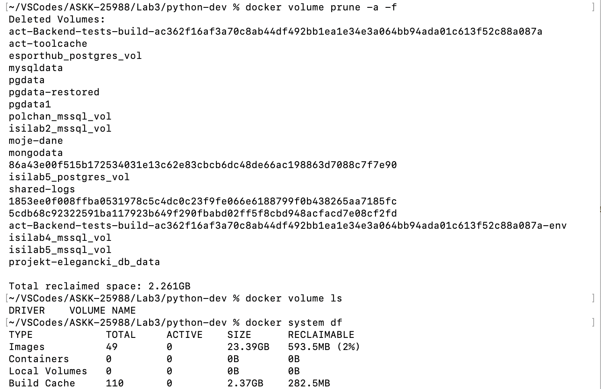

Rys. 9 - Wynik czyszczenia wolumenów.

---

##### Zadania do samodzielnego wykonania

##### Zadanie 1 — Redis z trwałymi danymi

**Opis:** Uruchomiono kontener Redis z zamontowanym wolumenem i z wartością flagi `-appendonly yes`, która używa wbudowanego systemu AOF (Append Only File) do zapisywania wyników komend `SET`, `HSET` i `DEL` na dysku. Następnie usunięto kontener, utworzono nowy kontener z tym samym wolumenem i zweryfikowano, że dane przetrwały usunięcie kontenera.

**Użyte polecenia:**

```zsh
# utworzenie wolumenu
docker volume create redis_data

# uruchomienie kontenera redis z zamontowanym wolumenem i flagą --appendonly yes
docker run -d --name kontener-redis -v redis_data:/data redis redis-server --appendonly yes

# dodanie kilku kluczy
docker exec -it kontener-redis redis-cli SET uzytkownik:1 "Jan Kowalski"
docker exec -it kontener-redis redis-cli SET uzytkownik:2 "Anna Nowak"
docker exec -it kontener-redis redis-cli SET status "aktywny"

# odczytanie kluczy
docker exec -it kontener-redis redis-cli KEYS "*"

# zatrzymanie i usunięcie kontenera
docker stop kontener-redis && docker rm kontener-redis

# uruchomienie nowego kontenera redis z poprzednio utworzonym wolumenem
docker run -d --name nowy-kontener-redis -v redis_data:/data redis redis-server --appendonly yes

# odczyt wartości kluczy i weryfikacja czy dane przetrwały usunięcie kontenera
docker exec -it nowy-kontener-redis redis-cli GET uzytkownik:1
docker exec -it nowy-kontener-redis redis-cli GET uzytkownik:2
docker exec -it nowy-kontener-redis redis-cli GET status
```

**Wynik działania:**

```zsh
~/VSCodes/ASKK-25988/Lab3 % docker volume create redis_data
redis_data
```

```zsh
~/VSCodes/ASKK-25988/Lab3 % docker run -d --name kontener-redis -v redis_data:/data redis redis-server --appendonly yes
Unable to find image 'redis:latest' locally
latest: Pulling from library/redis
1a903db3ee72: Pull complete 
8fad13c1f241: Pull complete 
a473fb6d5527: Pull complete 
4f4fb700ef54: Pull complete 
acd43e9bebc3: Pull complete 
491035d04227: Pull complete 
f8f9bd1f23ad: Pull complete 
397a493967e6: Download complete 
981ac2639630: Download complete 
Digest: sha256:1f88291b4c57bdf249f02eb085a8669889b2d2954e91d4de5118a5da6b78dd53
Status: Downloaded newer image for redis:latest
7a155929442bfdda3cfc57d074bffc27e53a6365e0983af8b6f7444d64d43d2b
```

```zsh
~/VSCodes/ASKK-25988/Lab3 % docker exec -it kontener-redis redis-cli SET uzytkownik:1 "Jan Kowalski"
docker exec -it kontener-redis redis-cli SET uzytkownik:2 "Anna Nowak"
docker exec -it kontener-redis redis-cli SET status "aktywny"
OK
OK
OK
```

```zsh
~/VSCodes/ASKK-25988/Lab3 % docker exec -it kontener-redis redis-cli KEYS "*"
1) "status"
2) "uzytkownik:1"
3) "uzytkownik:2"
```

```zsh
~/VSCodes/ASKK-25988/Lab3 % docker stop kontener-redis && docker rm kontener-redis
kontener-redis
kontener-redis
```

```zsh
~/VSCodes/ASKK-25988/Lab3 % docker run -d --name nowy-kontener-redis -v redis_data:/data redis redis-server --appendonly yes
fef0067ca690ceb1f5e3d9cf2e3863b9823a56dd48d7c061322d30cb01be3c8f
```

```zsh
~/VSCodes/ASKK-25988/Lab3 % docker exec -it nowy-kontener-redis redis-cli GET uzytkownik:1
docker exec -it nowy-kontener-redis redis-cli GET uzytkownik:2
docker exec -it nowy-kontener-redis redis-cli GET status
"Jan Kowalski"
"Anna Nowak"
"aktywny"
```

**Screenshot:**

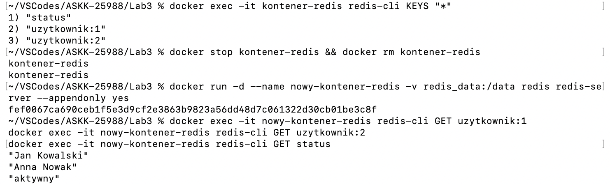

Rys. 10 - Dane przetrwały usunięcie kontenera Redis.

---

##### Zadanie 2 — Serwer plików

**Opis:** Uruchomiono serwer nginx serwujący pliki z katalogu na komputerze hosta, sprawdzono, czy w przeglądarce wyświetlana jest nowo utworzona strona powitalna `index.html`, następnie stworzono nową stronę `about.html` na katalogu hosta i sprawdzono czy jest ona od razu dostępna w przeglądarce bez konieczności restartu kontenera.

**Użyte polecenia:**

```zsh
mkdir -p ~/VSCodes/ASKK-25988/Lab3/nginx-html && cd ~/VSCodes/ASKK-25988/Lab3/nginx-html

echo "<h1>Strona testowa z hosta</h1>" > index.html

docker run -d \
  --name serwer-nginx \
  -p 8080:80 \
  -v ~/VSCodes/ASKK-25988/Lab3/nginx-html:/usr/share/nginx/html:ro \
  nginx:alpine

echo "<h2>Strona about</h2>" > ~/VSCodes/ASKK-25988/Lab3/nginx-html/about.html
```

**Wynik działania:**

```zsh
~/VSCodes/ASKK-25988/Lab3 % mkdir -p ~/VSCodes/ASKK-25988/Lab3/nginx-html && cd ~/VSCodes/ASKK-25988/Lab3/nginx-html
~/VSCodes/ASKK-25988/Lab3/nginx-html %
```

```zsh
~/VSCodes/ASKK-25988/Lab3/nginx-html % echo "<h1>Strona testowa z hosta</h1>" > index.html
~/VSCodes/ASKK-25988/Lab3/nginx-html %
```

```zsh
~/VSCodes/ASKK-25988/Lab3/nginx-html % docker run -d \
  --name serwer-nginx \
  -p 8080:80 \
  -v ~/VSCodes/ASKK-25988/Lab3/nginx-html:/usr/share/nginx/html:ro \
  nginx:alpine
b8c233242a6d24e14213f5efdde5218f0b8731221b5c431df4c9c17736d8d4df
```

```zsh
~/VSCodes/ASKK-25988/Lab3/nginx-html % echo "<h2>Strona about</h2>" > ~/VSCodes/ASKK-25988/Lab3/nginx-html/about.html
~/VSCodes/ASKK-25988/Lab3/nginx-html %
```

**Screenshot:**

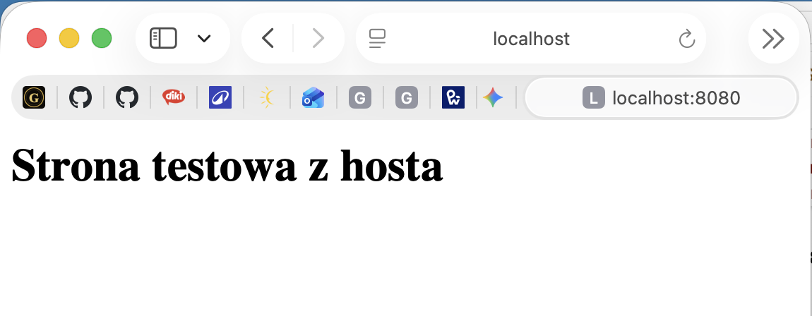

Rys. 11 - Strona `index.html` widoczna w przeglądarce po starcie kontenera.

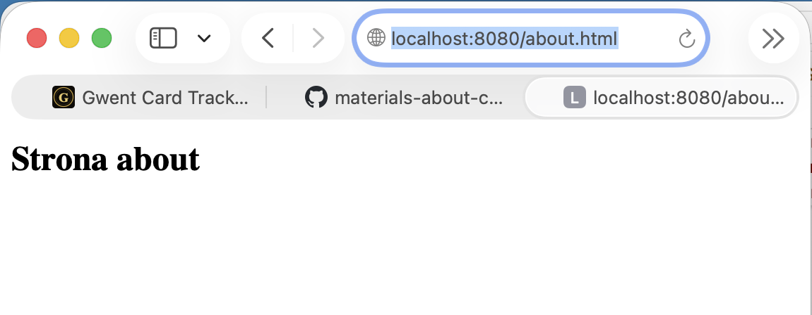

Rys. 12 - Nowo utworzona na hoście strona `about.html` widoczna od razu w przeglądarce bez konieczności restartu kontenera.

---

##### Zadanie 3 — Automatyczny backup

**Opis:** Utworzono skrypt bash wykonujący automatyczny backup wolumenu bazy danych i sprawdzono, czy backup został prawidłowo utworzony. Proces można byłoby dodatkowo zautomatyzować dodając chron joba, wykonującego skrypt w określonych interwałach np. co godzinę razem z przekierowaniem wyjścia terminala do dodatkowego pliku logu, na wypadek gdyby skrypt wygenerował błędy:

```zsh
crontab -e

0 * * * * ~/VSCodes/ASKK-25988/Lab3/backup/backup_volume.sh pgdata ~/VSCodes/ASKK-25988/Lab3/backup/volume_backups >> /var/log/docker_backup.log 2>&1
```

**Użyte polecenia:**

```zsh
mkdir -p ~/VSCodes/ASKK-25988/Lab3/backup && cd ~/VSCodes/ASKK-25988/Lab3/backup

docker volume create pgdata

docker run -d --name postgres \
  -e POSTGRES_PASSWORD=secret \
  -e POSTGRES_DB=studenci \
  -v pgdata:/var/lib/postgresql/data \
  -p 5432:5432 \
  postgres:16-alpine

cat << 'EOF' > backup_volume.sh
#!/usr/bin/env bash

# Skrypt do automatycznego backupu wolumenu Docker
# Użycie: ./backup_volume.sh <nazwa_wolumenu> [katalog_docelowy]

set -euo pipefail

# 1. Walidacja parametrów wejściowych
VOLUME_NAME="${1:-}"
BACKUP_DIR="${2:-./backups}"

if [ -z "$VOLUME_NAME" ]; then
    echo "Błąd: Nie podano nazwy wolumenu."
    echo "Użycie: $0 <nazwa_wolumenu> [katalog_docelowy]"
    exit 1
fi

# 2. Sprawdzenie, czy wolumen istnieje
if ! docker volume inspect "$VOLUME_NAME" >/dev/null 2>&1; then
    echo "Błąd: Wolumen '$VOLUME_NAME' nie istnieje."
    exit 1
fi

# 3. Przygotowanie ścieżki i nazwy pliku backupu
TIMESTAMP=$(date +"%Y%m%d_%H%M%S")
BACKUP_FILENAME="${VOLUME_NAME}_${TIMESTAMP}.tar.gz"

mkdir -p "$BACKUP_DIR"
# Pobranie pełnej ścieżki do podmontowania w kontenerze pomocniczym
ABS_BACKUP_DIR=$(cd "$BACKUP_DIR" && pwd)

echo "-> Rozpoczynanie backupu wolumenu '$VOLUME_NAME'..."

# 4. Wykonanie backupu za pomocą tymczasowego kontenera Alpine
docker run --rm \
    -v "$VOLUME_NAME":/volume:ro \
    -v "$ABS_BACKUP_DIR":/backup \
    alpine \
    tar -czf "/backup/$BACKUP_FILENAME" -C /volume .

echo "-> Kopia zapasowa została pomyślnie utworzona:"
echo "   Plik: $ABS_BACKUP_DIR/$BACKUP_FILENAME"
EOF

chmod +x backup_volume.sh

./backup_volume.sh pgdata ./volume_backups

ls -l volume_backups
```

**Wynik działania:**

```zsh
~/VSCodes/ASKK-25988/Lab3/nginx-html % mkdir -p ~/VSCodes/ASKK-25988/Lab3/backup && cd ~/VSCodes/ASKK-25988/Lab3/backup
~/VSCodes/ASKK-25988/Lab3/backup % 
```

```zsh
~/VSCodes/ASKK-25988/Lab3/backup % docker volume create pgdata
pgdata
```

```zsh
~/VSCodes/ASKK-25988/Lab3/backup % docker run -d --name postgres \
  -e POSTGRES_PASSWORD=secret \
  -e POSTGRES_DB=studenci \
  -v pgdata:/var/lib/postgresql/data \
  -p 5432:5432 \
  postgres:16-alpine
cfd15086be94bdf51e9971e3c2b07cafdcd0efc04e9a3851a1adf76ac6b3dfd4
```

```zsh
~/VSCodes/ASKK-25988/Lab3/backup % >....                                                               
if [ -z "$VOLUME_NAME" ]; then
    echo "Błąd: Nie podano nazwy wolumenu."
    echo "Użycie: $0 <nazwa_wolumenu> [katalog_docelowy]"
    exit 1
fi

# 2. Sprawdzenie, czy wolumen istnieje
if ! docker volume inspect "$VOLUME_NAME" >/dev/null 2>&1; then
    echo "Błąd: Wolumen '$VOLUME_NAME' nie istnieje."
    exit 1
fi

# 3. Przygotowanie ścieżki i nazwy pliku backupu
TIMESTAMP=$(date +"%Y%m%d_%H%M%S")
BACKUP_FILENAME="${VOLUME_NAME}_${TIMESTAMP}.tar.gz"

mkdir -p "$BACKUP_DIR"
# Pobranie pełnej ścieżki do podmontowania w kontenerze pomocniczym
ABS_BACKUP_DIR=$(cd "$BACKUP_DIR" && pwd)

echo "-> Rozpoczynanie backupu wolumenu '$VOLUME_NAME'..."

# 4. Wykonanie backupu za pomocą tymczasowego kontenera Alpine
docker run --rm \
    -v "$VOLUME_NAME":/volume:ro \
    -v "$ABS_BACKUP_DIR":/backup \
    alpine \
    tar -czf "/backup/$BACKUP_FILENAME" -C /volume .

echo "-> Kopia zapasowa została pomyślnie utworzona:"
echo "   Plik: $ABS_BACKUP_DIR/$BACKUP_FILENAME"
EOF
~/VSCodes/ASKK-25988/Lab3/backup % 
```

```zsh
~/VSCodes/ASKK-25988/Lab3/backup % chmod +x backup_volume.sh
~/VSCodes/ASKK-25988/Lab3/backup % 
```

```zsh
~/VSCodes/ASKK-25988/Lab3/backup % ./backup_volume.sh pgdata ./volume_backups
-> Rozpoczynanie backupu wolumenu 'pgdata'...
Unable to find image 'alpine:latest' locally
latest: Pulling from library/alpine
a1c67c46f05a: Download complete 
417332e4182f: Download complete 
Digest: sha256:f59abe656b692d901e184be3445e084786602108599d2a51d229c0f5a48c71bf
Status: Downloaded newer image for alpine:latest
-> Kopia zapasowa została pomyślnie utworzona:
   Plik: /Users/mewosh/VSCodes/ASKK-25988/Lab3/backup/volume_backups/pgdata_20261110_195935.tar.gz
```

```zsh
~/VSCodes/ASKK-25988/Lab3/backup % ls -l volume_backups
total 13096
-rw-r--r--  1 mewosh  staff  6703710 Nov 10 19:59 pgdata_20261110_195935.tar.gz
```

**Screenshot:**

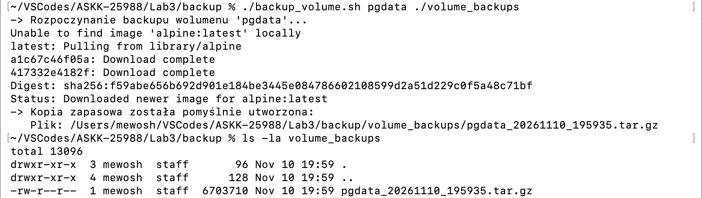

Rys. 13 - Wynik wykonania skryptu - został utworzony backup w folderze `volume_backups`.

---

#### 4. Pliki konfiguracyjne

##### Dockerfile

```dockerfile
# - brak -
```

##### docker-compose.yaml

```yaml
# - brak -
```

##### Inne pliki

```
# - brak -
```

---

#### 5. Napotkane problemy i ich rozwiązania

| Problem | Rozwiązanie |
|---------|-------------|
| Polecenie:<br/>`echo "<h1>Strona z hosta!</h1>" > ~/VSCodes/ASKK-25988/Lab3/web-content/index.html` zakończone wynikiem:<br/>`zsh: event not found: </h1>` | Używany przeze mnie terminal Zsh interpertuje znak ! wewnątrz cudzysłowów "" jako trigger, który rozwija historię terminala a następnie próbuje on znaleźć event o nazwie '</h1>' co kończy się błędem. Rozwiązaniem było umieszczenie polecenia wewnątrz pojedynczych cudzysłowów '', które potraktują znak ! jako zwykły tekst. |
| Polecenie:<br/>`docker exec -it mongo mongosh -u admin -p secret --eval "`<br/>`use testdb;`<br/>`db.users.insertMany([`</br>`{name: 'Jan', age: 25},`<br/>`{name: 'Anna', age: 30}`<br/>`]);`<br/>`db.users.find().pretty();`<br/>`"`<br/>zwróciło tylko 1 wynik (efekt użycia polecenia `use testdb;`) zamiast wyniku wszystkich poleceń. | Gdy powłoka mongo (mongosh) zetknie się z pomocniczą komendą `use testdb;`, wykona ją, zwróci jej wynik i przestanie procesować kolejne polecenia. Aby uniknąć takiej sytuacji zamieniono `use testdb;` będącą pomocniczą komendą powłoki, na pełnoprawny skrypt JavaScript:<br/>`const db = db.getSiblingDB('testdb');`<br/>`db.users.insertMany([`<br/>`{name: 'Jan', age: 25},`<br/>`{name: 'Anna', age: 30}`<br/>`]);`<br/>`db.users.find();`<br/> aby umożliwić wykonanie wszystkich linijek kodu. Przy okazji usunięto przestarzałe wywołanie `pretty()`, ponieważ w nowych wersjach mongo zwracane wyniki są domyślnie formatowane w czytelny i przyjazny sposób. |

---

#### 6. Wnioski

Nauczyłem się tworzyć i zarządzać wolumenami Docker, używać bind mounts do development (hot-reload), konfigurować bazy danych z trwałymi wolumenami, współdzielić dane między kontenerami, wykonywać backup i restore wolumenów, używać tmpfs dla danych tymczasowych i czyścić nieużywane wolumeny. W trakcie laboratorium wykazano, że wolumeny, mimo efemeryczności kontenerów, pozwalają na trwałe przechowywanie danych, które przetrwają restart i usunięcie kontenera. Wykazano również, że wolumeny potrafią być szybsze od mechanizmu tmpfs w zależności od używanego systemu operacyjnego i liczby warstw wirtualizacji pamięci RAM. W trakcie laboratorium nie napotkano większych problemów a najciekawsza była obserwacja aktualizacji zawartości plików w czasie rzeczywistym podczas ich edycji na zamontowanym katalogu hosta.

---

#### 7. Bibliografia / źródła

- [Docker Documentation](https://docs.docker.com/)
