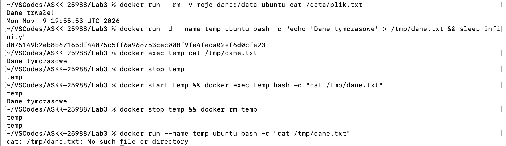
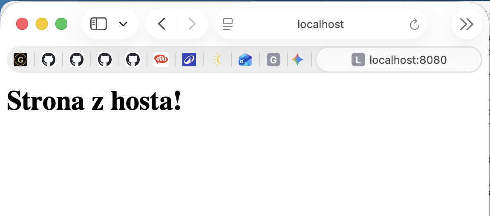

### Sprawozdanie z laboratorium nr 3

**Przedmiot:** Aplikacje w środowisku kontenerowym  

**Temat:** Wolumeny i trwałość danych

**Data wykonania:** 

**Autor:** Miłosz Samotyjak

**Numer indeksu:** 25988

**Grupa:** 235IC A1

---

#### 1. Cel laboratorium

Praktyczne poznanie mechanizmów trwałego przechowywania danych w Docker: volumes, bind mounts, tmpfs. Praca z bazami danych i backup wolumenów.

---

#### 2. Wstęp teoretyczny

Wolumeny

[Opcjonalnie — krótkie wprowadzenie teoretyczne dotyczące omawianych technologii/narzędzi, np. czym jest Docker, wolumeny, sieci itp.]

---

#### 3. Przebieg ćwiczeń

##### Ćwiczenie 1.1 — Tworzenie i zarządzanie wolumenami

**Opis:** Utworzono wolumen o nazwie `moje-dane`, wylistowano wszystkie dostępne wolumeny i zajrzano do szczegółów nowo utworzonego kontenera.

**Użyte polecenia:**

```zsh
# Utwórz wolumen
docker volume create moje-dane

# Lista wolumenów
docker volume ls

# Szczegóły wolumenu
docker volume inspect moje-dane
```

**Wynik działania:**

```zsh
~/VSCodes/ASKK-25988/Lab3 % docker volume create moje-dane
moje-dane
```

```zsh
~/VSCodes/ASKK-25988/Lab3 % docker volume ls
DRIVER    VOLUME NAME
local     86a43e00f515b172534031e13c62e83cbcb6dc48de66ac198863d7088c7f7e90
local     1853ee0f008ffba0531978c5c4dc0c23f9fe066e6188799f0b438265aa7185fc
local     act-Backend-tests-build-ac362f16af3a70c8ab44df492bb1ea1e34e3a064bb94ada01c613f52c88a087a
local     act-Backend-tests-build-ac362f16af3a70c8ab44df492bb1ea1e34e3a064bb94ada01c613f52c88a087a-env
local     act-toolcache
local     esporthub_postgres_vol
local     isilab2_mssql_vol
local     isilab4_mssql_vol
local     isilab5_mssql_vol
local     isilab5_postgres_vol
local     moje-dane
local     pgdata
local     polchan_mssql_vol
local     projekt-elegancki_db_data
```

```zsh
~/VSCodes/ASKK-25988/Lab3 % docker volume inspect moje-dane
[
    {
        "CreatedAt": "2026-11-09T19:50:56Z",
        "Driver": "local",
        "Labels": null,
        "Mountpoint": "/var/lib/docker/volumes/moje-dane/_data",
        "Name": "moje-dane",
        "Options": null,
        "Scope": "local"
    }
]
```

**Screenshot:**


Rys. 1 - Wynik `docker volume inspect`.

---

##### Ćwiczenie 1.2 — Użycie wolumenu z kontenerem

**Opis:** Uruchomiono kontener z obrazem ubuntu i podpiętym wolumenem utworzonym w ćwiczeniu 1.1 a następnie zapisano dane do pliku tekstowego w wolumenie. Na koniec uruchomiono nowy kontener próbujący odczytać wcześniej zapisany tekst i poprawnie została zwrócona zawartość wcześniej utworzonego pliku, co oznacza, że dane przetrwały w wolumenie.

**Użyte polecenia:**

```zsh
# Zapisz dane w wolumenie
# Uwaga: zewnętrzne apostrofy — w cudzysłowie "..." znak ! uruchamia rozwijanie historii basha
docker run --rm -v moje-dane:/data ubuntu bash -c 'echo "Dane trwałe!" > /data/plik.txt && date >> /data/plik.txt'

# Odczytaj dane z innego kontenera
docker run --rm -v moje-dane:/data ubuntu cat /data/plik.txt

# Dane przetrwały! Kontener został usunięty (--rm), ale dane zostały.
```

**Wynik działania:**

```zsh
~/VSCodes/ASKK-25988/Lab3 % docker run --rm -v moje-dane:/data ubuntu bash -c 'echo "Dane trwałe!" > /data/plik.txt && date >> /data/plik.txt'
Unable to find image 'ubuntu:latest' locally
latest: Pulling from library/ubuntu
6f01cc7d6fb3: Pull complete 
afa7f7d582de: Pull complete 
d597c14cfeb9: Download complete 
Digest: sha256:6a06111c3b0a8600feadb270aec771dc239bf407b25625f93f44ab00e11f4d3c
Status: Downloaded newer image for ubuntu:latest
```

```zsh
~/VSCodes/ASKK-25988/Lab3 % docker run --rm -v moje-dane:/data ubuntu cat /data/plik.txt
Dane trwałe!
Mon Nov  9 19:55:53 UTC 2026
```

---

##### Ćwiczenie 1.3 — Efemeryczność bez wolumenu

**Opis:** Utworzono kontener bez wolumenu i sprawdzono trwałość danych w przypadku podpięcia i niepodpięcia kontenera. Z podpiętym wolumenem dane przetrwały mimo usunięcia kontenera, natomiast bez wolumenu dane przetrwały restart kontenera, natomiast jego usunięcia i utworzenia na nowo identycznego kontenera już nie.

**Użyte polecenia:**

```zsh
# Bez wolumenu — dane giną
# sleep infinity utrzymuje kontener przy życiu, aby można było użyć docker exec
docker run -d --name temp ubuntu bash -c "echo 'Dane tymczasowe' > /tmp/dane.txt && sleep infinity"
docker exec temp cat /tmp/dane.txt  # OK — kontener istnieje

docker stop temp && docker rm temp   # (lub: docker rm -f temp)
# Dane zniknęły bezpowrotnie!
```

**Wynik działania:**

```zsh
~/VSCodes/ASKK-25988/Lab3 % docker run -d --name temp ubuntu bash -c "echo 'Dane tymczasowe' > /tmp/dane.txt && sleep infinity"
c50becfc8e44faa405076cc72598e859eaafe69a355033374cecad338983813e
```

```zsh
~/VSCodes/ASKK-25988/Lab3 % docker exec temp cat /tmp/dane.txt
Dane tymczasowe
```

```zsh
~/VSCodes/ASKK-25988/Lab3 % docker stop temp && docker rm temp
temp
temp
```

**Screenshot:**



Rys. 2 - Demonstracja trwałości danych z wolumenem vs bez. W pierwszym przypadku dane przetrwały na wolumenie mimo tego, że kontener, z którego zostały utworzone został wcześniej usunięty. W drugim przypadku dane przetrwały restart kontenera ale jego usunięcia i próby utworzenia nowego identycznego kontenera już nie.

---

##### Ćwiczenie 1.4 — Wolumen tylko do odczytu

**Opis:** Zapisano dane w wolumenie, zamontowano wolumen w trybie tylko do odczytu i pokazano, że próba zapisu na takim wolumenie zakończy się błędem.

**Użyte polecenia:**

```zsh
# Zapisz dane
docker run --rm -v moje-dane:/data ubuntu bash -c "echo 'Ważne dane' > /data/important.txt"

# Zamontuj jako read-only
docker run --rm -v moje-dane:/data:ro ubuntu bash -c "cat /data/important.txt"

# Próba zapisu — błąd!
docker run --rm -v moje-dane:/data:ro ubuntu bash -c "echo 'test' > /data/nowy.txt"
```

**Wynik działania:**

```zsh
~/VSCodes/ASKK-25988/Lab3 % docker run --rm -v moje-dane:/data ubuntu bash -c "echo 'Ważne dane' > /data/important.txt"
~/VSCodes/ASKK-25988/Lab3 %
```

```zsh
~/VSCodes/ASKK-25988/Lab3 % docker run --rm -v moje-dane:/data:ro ubuntu bash -c "cat /data/important.txt"
Ważne dane
```

```zsh
~/VSCodes/ASKK-25988/Lab3 % docker run --rm -v moje-dane:/data:ro ubuntu bash -c "echo 'test' > /data/nowy.txt"
bash: line 1: /data/nowy.txt: Read-only file system
```

---

##### Ćwiczenie 2.1 — Montowanie katalogu z hosta

**Opis:** Zamontowano katalog z komputera hosta kontenerowi serwującemu serwer nginx i pokazano, że serwer prawidłowo udostępnia stronę utworzoną w pliku `index.html`.

**Użyte polecenia:**

```zsh
mkdir -p ~/VSCodes/ASKK-25988/Lab3/web-content
echo '<h1>Strona z hosta!</h1>' > ~/VSCodes/ASKK-25988/Lab3/web-content/index.html

# Zamontuj katalog z hosta do kontenera Nginx
docker run -d --name web \
  -p 8080:80 \
  -v ~/VSCodes/ASKK-25988/Lab3/web-content:/usr/share/nginx/html:ro \
  nginx:alpine

curl http://localhost:8080
```

**Wynik działania:**

```zsh
~/VSCodes/ASKK-25988/Lab3 % mkdir -p ~/VSCodes/ASKK-25988/Lab3/web-content
~/VSCodes/ASKK-25988/Lab3 % 
```

```zsh
~/VSCodes/ASKK-25988/Lab3 % echo '<h1>Strona z hosta!</h1>' > ~/VSCodes/ASKK-25988/Lab3/web-content/index.html
~/VSCodes/ASKK-25988/Lab3 %
```

```zsh
~/VSCodes/ASKK-25988/Lab3 % docker run -d --name web \
  -p 8080:80 \
  -v ~/VSCodes/ASKK-25988/Lab3/web-content:/usr/share/nginx/html:ro \
  nginx:alpine
e869a4b9ca31881c2f40415cbbe5447248758b32d4ee7d8b46db831995c2bad2
```

```zsh
~/VSCodes/ASKK-25988/Lab3 % curl http://localhost:8080
<h1>Strona z hosta!</h1>
```

**Screenshot:**



Rys. 3 - Strona serwowana z zamontowanego katalogu.

---

##### Ćwiczenie 2.2 — Hot-reload z bind mount

**Opis:** Zmieniono zawartość wcześniej utworzonego pliku `index.html` znajdującego się w zamontowanym wolumenie i pokazano, że aktualizacja wolumenu jest natychmiast widoczna bez konieczności restartowania kontenera.

**Użyte polecenia:**

```zsh
# Zmień plik na hoście
echo '<h1>Zaktualizowana strona!</h1><p>Zmiana widoczna natychmiast.</p>' > ~/VSCodes/ASKK-25988/Lab3/web-content/index.html

# Sprawdź — zmiana widoczna bez restartu kontenera!
curl http://localhost:8080

docker stop web && docker rm web
```

**Wynik działania:**

```zsh
~/VSCodes/ASKK-25988/Lab3 % echo '<h1>Zaktualizowana strona!</h1><p>Zmiana widoczna natychmiast.</p>' > ~/VSCodes/ASKK-25988/Lab3/web-content/index.html
~/VSCodes/ASKK-25988/Lab3 %
```

```zsh
~/VSCodes/ASKK-25988/Lab3 % curl http://localhost:8080
<h1>Zaktualizowana strona!</h1><p>Zmiana widoczna natychmiast.</p>
```

```zsh
~/VSCodes/ASKK-25988/Lab3 % docker stop web && docker rm web
web
web
```

---

##### Ćwiczenie 2.3 — Bind mount dla development

**Opis:** Utworzono prostą aplikację Flask i pokazano, że w momencie, gdy jest ona uruchomiona w trybie debugowania i zmieniony zostanie jej kod to zmiany zostaną nałożone automatycznie bez konieczności restartowania kontenera.

**Użyte polecenia:**

```zsh
mkdir -p ~/VSCodes/ASKK-25988/Lab3/python-dev && cd ~/VSCodes/ASKK-25988/Lab3/python-dev

cat > app.py << 'EOF'
from flask import Flask
app = Flask(__name__)

@app.route('/')
def hello():
    return "<h1>Wersja 1 — development</h1>"

if __name__ == '__main__':
    app.run(host='0.0.0.0', port=5000, debug=True)
EOF

cat > requirements.txt << 'EOF'
flask==3.0.0
EOF

cat > Dockerfile << 'EOF'
FROM python:3.11-slim
WORKDIR /app
COPY requirements.txt .
RUN pip install --no-cache-dir -r requirements.txt
COPY . .
CMD ["python", "app.py"]
EOF

docker build -t dev-app .
docker run -d --name dev \
  -p 5001:5000 \
  -v $(pwd)/app.py:/app/app.py \
  dev-app

curl http://localhost:5001

# Zmień app.py na hoście (np. "Wersja 2")
# Uwaga: przy bind mount pojedynczego pliku NIE używaj `sed -i` ani edytorów zapisujących
# nowy plik — tworzą nowy i-węzeł, a kontener nadal widzi stary plik.
# Nadpisz zawartość istniejącego pliku:
sed 's/Wersja 1/Wersja 2/' app.py > app.tmp && cat app.tmp > app.py && rm app.tmp
# (alternatywa: montuj cały katalog, np. -v $(pwd):/app)

# Flask z debug=True automatycznie przeładuje!
sleep 2 && curl http://localhost:5001

docker stop dev && docker rm dev
```

**Wynik działania:**

```zsh
~/VSCodes/ASKK-25988/Lab3 % mkdir -p ~/VSCodes/ASKK-25988/Lab3/python-dev && cd ~/VSCodes/ASKK-25988/Lab3/python-dev
~/VSCodes/ASKK-25988/Lab3/python-dev % 
```

```zsh
~/VSCodes/ASKK-25988/Lab3/python-dev % cat > app.py << 'EOF'
from flask import Flask
app = Flask(__name__)

@app.route('/')
def hello():
    return "<h1>Wersja 1 — development</h1>"

if __name__ == '__main__':
    app.run(host='0.0.0.0', port=5000, debug=True)
EOF

cat > requirements.txt << 'EOF'
flask==3.0.0
EOF

cat > Dockerfile << 'EOF'
FROM python:3.11-slim
WORKDIR /app
COPY requirements.txt .
RUN pip install --no-cache-dir -r requirements.txt
COPY . .
CMD ["python", "app.py"]
EOF
~/VSCodes/ASKK-25988/Lab3/python-dev % 
```

```zsh
~/VSCodes/ASKK-25988/Lab3/python-dev % docker build -t dev-app .
[+] Building 0.3s (10/10) FINISHED                                                                   docker:desktop-linux
 => [internal] load build definition from Dockerfile                                                                 0.0s
 => => transferring dockerfile: 183B                                                                                 0.0s
 => [internal] load metadata for docker.io/library/python:3.11-slim                                                  0.0s
 => [internal] load .dockerignore                                                                                    0.0s
 => => transferring context: 2B                                                                                      0.0s
 => [1/5] FROM docker.io/library/python:3.11-slim@sha256:e88e9763f943ec1834f992a4b51e0f24500486803e8bc534e5767af9ea  0.0s
 => => resolve docker.io/library/python:3.11-slim@sha256:e88e9763f943ec1834f992a4b51e0f24500486803e8bc534e5767af9ea  0.0s
 => [internal] load build context                                                                                    0.0s
 => => transferring context: 480B                                                                                    0.0s
 => CACHED [2/5] WORKDIR /app                                                                                        0.0s
 => CACHED [3/5] COPY requirements.txt .                                                                             0.0s
 => CACHED [4/5] RUN pip install --no-cache-dir -r requirements.txt                                                  0.0s
 => [5/5] COPY . .                                                                                                   0.0s
 => exporting to image                                                                                               0.1s
 => => exporting layers                                                                                              0.0s
 => => exporting manifest sha256:2cc053ae66c6dcb8bffe67d6b8a7fc85bc8ed7b02e60bf170f5841d6e495da4b                    0.0s
 => => exporting config sha256:292ae5cfc3ba2feb0c00e1001688ffd23cc0929b1a6c5bb2dbe0a0fb06e9f267                      0.0s
 => => exporting attestation manifest sha256:cd8e7483a102cd81869017415d02beda3d8d712e3dc49442ace4d4cdb11c2442        0.0s
 => => exporting manifest list sha256:3004eed0c63273ff5ef4bb34f21f1ccc95822f42e163780988343a5c5e35d93a               0.0s
 => => naming to docker.io/library/dev-app:latest                                                                    0.0s
 => => unpacking to docker.io/library/dev-app:latest                                                                 0.0s
```

```zsh
~/VSCodes/ASKK-25988/Lab3/python-dev % docker run -d --name dev \
  -p 5001:5000 \
  -v $(pwd)/app.py:/app/app.py \
  dev-app
3dc2b9e730e9de841298d6b09e99777bd320c717d9acac7012036529c6e3442e
```

```zsh
~/VSCodes/ASKK-25988/Lab3/python-dev % curl http://localhost:5001
<h1>Wersja 1 — development</h1>%
```

```zsh
~/VSCodes/ASKK-25988/Lab3/python-dev % sed 's/Wersja 1/Wersja 2/' app.py > app.tmp && cat app.tmp > app.py && rm app.tmp
~/VSCodes/ASKK-25988/Lab3/python-dev %
```

```zsh
~/VSCodes/ASKK-25988/Lab3/python-dev % sleep 2 && curl http://localhost:5001
<h1>Wersja 2 — development</h1>%   
```

```zsh
~/VSCodes/ASKK-25988/Lab3/python-dev % docker stop dev && docker rm dev
dev
dev
```

**Screenshot:**


Rys. 4 - Hot-reload — zmiana kodu widoczna bez restartu.

---

##### Ćwiczenie 3.1 — PostgreSQL z trwałymi danymi

**Opis:** Utworzono kontener PostgreSQL z zamontowanym wolumenem i z 2 tabelami wypełnionymi danymi a następnie pokazano, że dane te przetrwają usunięcie kontenera.

**Użyte polecenia:**

```zsh
# Utwórz wolumen
docker volume create pgdata1

# Uruchom PostgreSQL
docker run -d --name postgres \
  -e POSTGRES_PASSWORD=secret \
  -e POSTGRES_DB=studenci \
  -v pgdata1:/var/lib/postgresql/data \
  -p 5432:5432 \
  postgres:16-alpine

# Poczekaj na inicjalizację
sleep 5

# Utwórz tabelę i dodaj dane
docker exec -it postgres psql -U postgres -d studenci -c "
CREATE TABLE studenci (
    id SERIAL PRIMARY KEY,
    imie VARCHAR(50),
    nazwisko VARCHAR(50),
    nr_indeksu VARCHAR(10)
);
INSERT INTO studenci (imie, nazwisko, nr_indeksu) VALUES
    ('Jan', 'Kowalski', '123456'),
    ('Anna', 'Nowak', '654321');
SELECT * FROM studenci;
"
```

```zsh
# Zatrzymaj i usuń kontener
docker stop postgres && docker rm postgres

# Uruchom nowy kontener z tym samym wolumenem
docker run -d --name postgres-new \
  -e POSTGRES_PASSWORD=secret \
  -v pgdata1:/var/lib/postgresql/data \
  -p 5432:5432 \
  postgres:16-alpine

sleep 3

# Dane przetrwały!
docker exec -it postgres-new psql -U postgres -d studenci -c "SELECT * FROM studenci;"
```

**Wynik działania:**

```zsh
~/VSCodes/ASKK-25988/Lab3/python-dev % docker volume create pgdata1
pgdata1
```

```zsh
~/VSCodes/ASKK-25988/Lab3/python-dev % docker run -d --name postgres \
  -e POSTGRES_PASSWORD=secret \
  -e POSTGRES_DB=studenci \
  -v pgdata1:/var/lib/postgresql/data \
  -p 5432:5432 \
  postgres:16-alpine
Unable to find image 'postgres:16-alpine' locally
16-alpine: Pulling from library/postgres
183351605181: Pull complete 
b90627b8f429: Pull complete 
426c361672cc: Pull complete 
564e21d853ad: Pull complete 
f8fb8a00265d: Pull complete 
3cec7a2c578f: Pull complete 
82263ad88433: Pull complete 
80649b351453: Pull complete 
9c37259cdb63: Pull complete 
ef6a52aae75a: Pull complete 
87f4620f68e9: Pull complete 
5cf33c31b69d: Download complete 
484b4da841fb: Download complete 
Digest: sha256:aa6cb33cf4c19c765cefcf48d96176258800870a9a1e930ad126200f9d825139
Status: Downloaded newer image for postgres:16-alpine
dfd476cea096d5afa4e42797905b464409582031fc36f135948e5e43acb5627a
```

```zsh
~/VSCodes/ASKK-25988/Lab3/python-dev % docker exec -it postgres psql -U postgres -d studenci -c "
CREATE TABLE studenci (
    id SERIAL PRIMARY KEY,
    imie VARCHAR(50),
    nazwisko VARCHAR(50),
    nr_indeksu VARCHAR(10)
);
INSERT INTO studenci (imie, nazwisko, nr_indeksu) VALUES
    ('Jan', 'Kowalski', '123456'),
    ('Anna', 'Nowak', '654321');
SELECT * FROM studenci;
"
CREATE TABLE
INSERT 0 2
 id | imie | nazwisko | nr_indeksu 
----+------+----------+------------
  1 | Jan  | Kowalski | 123456
  2 | Anna | Nowak    | 654321
(2 rows)
```

```zsh
~/VSCodes/ASKK-25988/Lab3/python-dev % docker stop postgres && docker rm postgres
postgres
postgres
```

```zsh
~/VSCodes/ASKK-25988/Lab3/python-dev % docker run -d --name postgres-new \
  -e POSTGRES_PASSWORD=secret \
  -v pgdata1:/var/lib/postgresql/data \
  -p 5432:5432 \
  postgres:16-alpine
add5d6dbeca9be54b528459858877a90398f3e6833959a1e708c2762892a9a98
```

```zsh
~/VSCodes/ASKK-25988/Lab3/python-dev % docker exec -it postgres-new psql -U postgres -d studenci -c "SELECT * FROM studenci;"
 id | imie | nazwisko | nr_indeksu 
----+------+----------+------------
  1 | Jan  | Kowalski | 123456
  2 | Anna | Nowak    | 654321
(2 rows)
```

**Screenshot:**


Rys. 5 - Tabela studenci w PostgreSQL.


Rys. 6 - Dane zachowane po usunięciu i ponownym uruchomieniu kontenera.

---

##### Ćwiczenie 3.2 — MySQL z wolumenem

**Opis:** Utworzono kontener MySQL z zamontowanym wolumenem i trwale zapisano dane w tabeli `produkty`.

**Użyte polecenia:**

```zsh
docker volume create mysqldata

docker run -d --name mysql \
  -e MYSQL_ROOT_PASSWORD=secret \
  -e MYSQL_DATABASE=sklep \
  -v mysqldata:/var/lib/mysql \
  -p 3306:3306 \
  mysql:8

sleep 15  # MySQL potrzebuje więcej czasu na inicjalizację

docker exec -it mysql mysql -u root -psecret -e "
USE sklep;
CREATE TABLE produkty (id INT AUTO_INCREMENT PRIMARY KEY, nazwa VARCHAR(100), cena DECIMAL(10,2));
INSERT INTO produkty (nazwa, cena) VALUES ('Laptop', 3999.99), ('Mysz', 49.99);
SELECT * FROM produkty;
"
```

**Wynik działania:**

```zsh
~/VSCodes/ASKK-25988/Lab3/python-dev % docker volume create mysqldata
mysqldata
```

```zsh
~/VSCodes/ASKK-25988/Lab3/python-dev % docker run -d --name mysql \
  -e MYSQL_ROOT_PASSWORD=secret \
  -e MYSQL_DATABASE=sklep \
  -v mysqldata:/var/lib/mysql \
  -p 3306:3306 \
  mysql:8
94c7aee4a4a9149b6583623ec563bfe4a67cc8f423b72acd906c410f5486a409
```

```zsh
~/VSCodes/ASKK-25988/Lab3/python-dev % docker exec -it mysql mysql -u root -psecret -e "
USE sklep;
CREATE TABLE produkty (id INT AUTO_INCREMENT PRIMARY KEY, nazwa VARCHAR(100), cena DECIMAL(10,2));
INSERT INTO produkty (nazwa, cena) VALUES ('Laptop', 3999.99), ('Mysz', 49.99);
SELECT * FROM produkty;
"
mysql: [Warning] Using a password on the command line interface can be insecure.
+----+--------+---------+
| id | nazwa  | cena    |
+----+--------+---------+
|  1 | Laptop | 3999.99 |
|  2 | Mysz   |   49.99 |
+----+--------+---------+
```

---

##### Ćwiczenie 3.3 — MongoDB z wolumenem

**Opis:** Utworzono kontener MongoDB z zamontowanym wolumenem i utworzono wewnątrz dokument a następnie odczytano jego zawartość.

**Użyte polecenia:**

```zsh
docker volume create mongodata

docker run -d --name mongo \
  -e MONGO_INITDB_ROOT_USERNAME=admin \
  -e MONGO_INITDB_ROOT_PASSWORD=secret \
  -v mongodata:/data/db \
  -p 27017:27017 \
  mongo:7

sleep 5

docker exec -it mongo mongosh -u admin -p secret --eval "
const db = db.getSiblingDB('testdb');
db.users.insertMany([
    {name: 'Jan', age: 25},
    {name: 'Anna', age: 30}
]);
db.users.find();
"
```

**Wynik działania:**

```zsh
~/VSCodes/ASKK-25988/Lab3/python-dev % docker volume create mongodata
mongodata
```

```zsh
~/VSCodes/ASKK-25988/Lab3/python-dev % docker run -d --name mongo \
  -e MONGO_INITDB_ROOT_USERNAME=admin \
  -e MONGO_INITDB_ROOT_PASSWORD=secret \
  -v mongodata:/data/db \
  -p 27017:27017 \
  mongo:7
Unable to find image 'mongo:7' locally
7: Pulling from library/mongo
235f996274b7: Pull complete 
771eed73ee82: Pull complete 
53ff66f996f2: Pull complete 
6cf8446071d2: Pull complete 
5a2f494adbe3: Pull complete 
bb371a8e9e66: Pull complete 
468debf69ee9: Pull complete 
17fe8025a9eb: Pull complete 
3002c75f5580: Download complete 
123428bb562c: Download complete 
Digest: sha256:8bb4442761a63a8dda452744082cdac9644b429807eb977b42324a63cef59ca4
Status: Downloaded newer image for mongo:7
c8be95e8141de1d419aa5dcc46545e01a71a6aa419c932a570eb9ea97be1fcd0
```

```zsh
~/VSCodes/ASKK-25988/Lab3/python-dev % docker exec -it mongo mongosh -u admin -p secret --eval "
const db = db.getSiblingDB('testdb');
db.users.insertMany([
    {name: 'Jan', age: 25},
    {name: 'Anna', age: 30}
]);
db.users.find();
"
[
  { _id: ObjectId('6af237bcd8b8a92bf5e64976'), name: 'Jan', age: 25 },
  { _id: ObjectId('6af237bcd8b8a92bf5e64977'), name: 'Anna', age: 30 }
]
```

---

##### Ćwiczenie 4.1 — Writer-Reader pattern

**Opis:** Stworzono kontener z zamontowanym wolumenem, który zapisywał logi w pliku znajdującym się na wolumenie a następnie w drugim kontenerze odczytywano logi z wcześniej utworzonego pliku, pokazując tym samym, że wolumeny mogą być współdzielone między kontenerami.

**Użyte polecenia:**

```zsh
docker volume create shared-logs

# Writer — generuje logi
docker run -d --name writer \
  -v shared-logs:/logs \
  ubuntu bash -c "while true; do echo \"\$(date): Log entry\" >> /logs/app.log; sleep 3; done"

# Reader — odczytuje logi
docker run --rm -v shared-logs:/logs:ro ubuntu tail -5 /logs/app.log

# Śledzenie na żywo
docker run --rm -v shared-logs:/logs:ro ubuntu tail -f /logs/app.log
# Ctrl+C po kilku wpisach

docker stop writer && docker rm writer
```

**Wynik działania:**

```zsh
~/VSCodes/ASKK-25988/Lab3/python-dev % docker volume create shared-logs
shared-logs
```

```zsh
~/VSCodes/ASKK-25988/Lab3/python-dev % docker run -d --name writer \
  -v shared-logs:/logs \
  ubuntu bash -c "while true; do echo \"\$(date): Log entry\" >> /logs/app.log; sleep 3; done"
f5487d8ddf3c59f9de40b0e36803375de447e2474d3bbb47203487f6e95dd305
```

```zsh
~/VSCodes/ASKK-25988/Lab3/python-dev % docker run --rm -v shared-logs:/logs:ro ubuntu tail -5 /logs/app.log
Mon Nov  9 21:20:54 UTC 2026: Log entry
Mon Nov  9 21:20:57 UTC 2026: Log entry
Mon Nov  9 21:21:00 UTC 2026: Log entry
Mon Nov  9 21:21:03 UTC 2026: Log entry
Mon Nov  9 21:21:06 UTC 2026: Log entry
```

```zsh
~/VSCodes/ASKK-25988/Lab3/python-dev % docker run --rm -v shared-logs:/logs:ro ubuntu tail -f /logs/app.log
Mon Nov  9 21:20:51 UTC 2026: Log entry
Mon Nov  9 21:20:54 UTC 2026: Log entry
Mon Nov  9 21:20:57 UTC 2026: Log entry
Mon Nov  9 21:21:00 UTC 2026: Log entry
Mon Nov  9 21:21:03 UTC 2026: Log entry
Mon Nov  9 21:21:06 UTC 2026: Log entry
Mon Nov  9 21:21:09 UTC 2026: Log entry
Mon Nov  9 21:21:12 UTC 2026: Log entry
Mon Nov  9 21:21:15 UTC 2026: Log entry
Mon Nov  9 21:21:18 UTC 2026: Log entry
Mon Nov  9 21:21:21 UTC 2026: Log entry
Mon Nov  9 21:21:24 UTC 2026: Log entry
^CMon Nov  9 21:21:27 UTC 2026: Log entry
^CMon Nov  9 21:21:30 UTC 2026: Log entry
Mon Nov  9 21:21:33 UTC 2026: Log entry
^C
got 3 SIGTERM/SIGINTs, forcefully exiting
```

```zsh
~/VSCodes/ASKK-25988/Lab3/python-dev % docker stop writer && docker rm writer
writer
writer
```

**Screenshot:**


Rys. 7 - Współdzielenie danych między kontenerami.

---

#### 4. Pliki konfiguracyjne

##### Dockerfile

```dockerfile
# [WKLEJ TUTAJ ZAWARTOŚĆ PLIKU Dockerfile]
```

##### docker-compose.yaml

```yaml
# [WKLEJ TUTAJ ZAWARTOŚĆ PLIKU docker-compose.yaml]
```

##### Inne pliki

```
# [WKLEJ TUTAJ ZAWARTOŚĆ INNYCH ISTOTNYCH PLIKÓW, NP. .env, nginx.conf ITP.]
```

---

#### 5. Napotkane problemy i ich rozwiązania

| Problem | Rozwiązanie |
|---------|-------------|
| [OPIS PROBLEMU 1] | [JAK ZOSTAŁ ROZWIĄZANY] |
| [OPIS PROBLEMU 2] | [JAK ZOSTAŁ ROZWIĄZANY] |

---

#### 6. Wnioski

[Podsumowanie — czego się nauczyłeś/aś, jakie wnioski wynikają z przeprowadzonych ćwiczeń, co było najtrudniejsze, co najciekawsze.]

---

#### 7. Bibliografia / źródła

- [Docker Documentation](https://docs.docker.com/)
- [INNE WYKORZYSTANE ŹRÓDŁA]