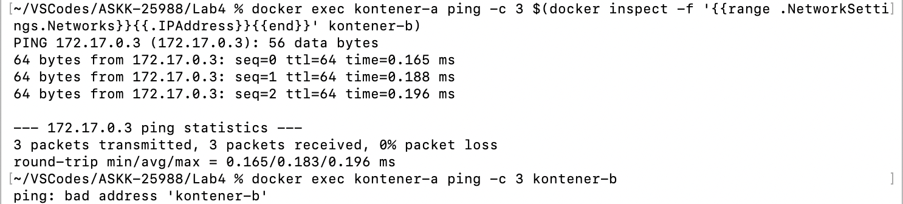
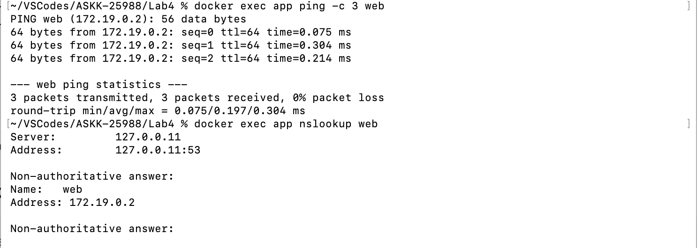
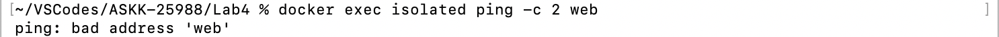
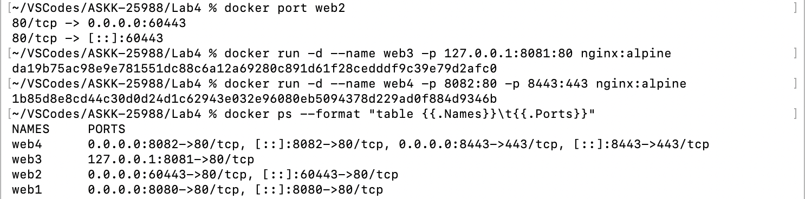
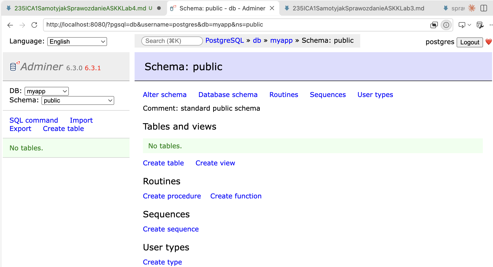
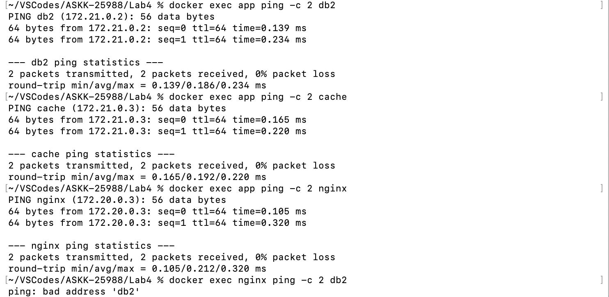
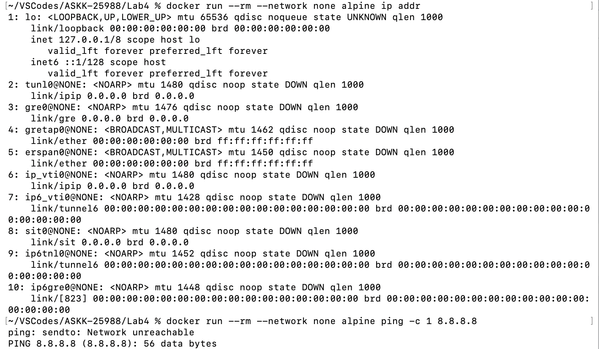
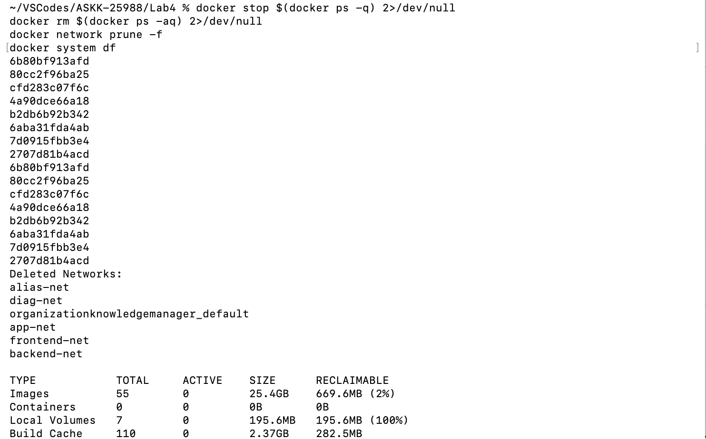

### Sprawozdanie z laboratorium nr 4

**Przedmiot:** Aplikacje w środowisku kontenerowym  

**Temat:** Sieci Docker

**Data wykonania:** 

**Autor:** Miłosz Samotyjak

**Numer indeksu:** 25988

**Grupa:** 235IC A1

---

#### 1. Cel laboratorium

Praktyczne poznanie sieci Docker: bridge, user-defined networks, DNS, mapowanie portów, komunikacja między kontenerami, izolacja sieciowa.

---

#### 2. Wstęp teoretyczny

sieci docker

---

#### 3. Przebieg ćwiczeń

##### Ćwiczenie 1.1 — Eksploracja domyślnej sieci

**Opis:** Uruchomiono 2 kontenery, sprawdzono ich adresy IP i spróbowano z kontenera-a spingować kontener-b po jego adresie IP i nazwie - w pierwszym przypadku polecenie ping zakończyło się sukcesem a w drugim nie. Dzieje się tak, ponieważ domyślna sieć bridge nie posiada wbudowanego serwera DNS. Rozwiązaniem tego problemu jest utworzenie własnej sieci przez użytkownika (`user-defined network`) lub skorzystanie z docker-compose, który automatycznie tworzy dedykowaną sieć bridge dla danego projektu.

**Użyte polecenia:**

```zsh
# Lista sieci
docker network ls

# Szczegóły domyślnej sieci bridge
docker network inspect bridge

# Uruchom dwa kontenery
docker run -d --name kontener-a alpine sleep 3600
docker run -d --name kontener-b alpine sleep 3600

# Sprawdź adresy IP
docker inspect -f '{{range .NetworkSettings.Networks}}{{.IPAddress}}{{end}}' kontener-a
docker inspect -f '{{range .NetworkSettings.Networks}}{{.IPAddress}}{{end}}' kontener-b

# Ping po IP — działa
docker exec kontener-a ping -c 3 $(docker inspect -f '{{range .NetworkSettings.Networks}}{{.IPAddress}}{{end}}' kontener-b)

# Ping po nazwie — NIE działa w domyślnej bridge!
docker exec kontener-a ping -c 3 kontener-b
```

**Wynik działania:**

```zsh
~/VSCodes/ASKK-25988/Lab4 % docker network ls
NETWORK ID     NAME                                   DRIVER    SCOPE
b285d09b24d6   bridge                                 bridge    local
6f111567309d   host                                   host      local
41058f9f1b57   none                                   null      local
b54b9111a0f1   organizationknowledgemanager_default   bridge    local
```

```zsh
~/VSCodes/ASKK-25988/Lab4 % docker network inspect bridge
[
    {
        "Name": "bridge",
        "Id": "b285d09b24d613d368f2a20459d2e2003962b12bba8b4eb9fc3d9141ad5c3dfb",
        "Created": "2026-11-22T13:40:43.58836525Z",
        "Scope": "local",
        "Driver": "bridge",
        "EnableIPv4": true,
        "EnableIPv6": false,
        "IPAM": {
            "Driver": "default",
            "Options": null,
            "Config": [
                {
                    "Subnet": "172.17.0.0/16",
                    "IPRange": "",
                    "Gateway": "172.17.0.1"
                }
            ]
        },
        "Internal": false,
        "Attachable": false,
        "Ingress": false,
        "ConfigFrom": {
            "Network": ""
        },
        "ConfigOnly": false,
        "Options": {
            "com.docker.network.bridge.default_bridge": "true",
            "com.docker.network.bridge.enable_icc": "true",
            "com.docker.network.bridge.enable_ip_masquerade": "true",
            "com.docker.network.bridge.host_binding_ipv4": "0.0.0.0",
            "com.docker.network.bridge.name": "docker0",
            "com.docker.network.driver.mtu": "65535"
        },
        "Labels": {},
        "Containers": {},
        "Status": {
            "IPAM": {
                "Subnets": {
                    "172.17.0.0/16": {
                        "IPsInUse": 3,
                        "DynamicIPsAvailable": 65533
                    }
                }
            }
        }
    }
]
```

```zsh
~/VSCodes/ASKK-25988/Lab4 % docker run -d --name kontener-a alpine sleep 3600
27d647530ca310afbaaa5875ddd775f7d66bf6c7f5f6a3702179dd317f9ee4c4
~/VSCodes/ASKK-25988/Lab4 % docker run -d --name kontener-b alpine sleep 3600
53ea7116de612d38c8dbc8f3b96b30a4ed32acdc62483845862f2927b51fc325
```

```zsh
~/VSCodes/ASKK-25988/Lab4 % docker inspect -f '{{range .NetworkSettings.Networks}}{{.IPAddress}}{{end}}' kontener-a
172.17.0.2
~/VSCodes/ASKK-25988/Lab4 % docker inspect -f '{{range .NetworkSettings.Networks}}{{.IPAddress}}{{end}}' kontener-b
172.17.0.3
```

```zsh
~/VSCodes/ASKK-25988/Lab4 % docker exec kontener-a ping -c 3 $(docker inspect -f '{{range .NetworkSettings.Networks}}{{.IPAddress}}{{end}}' kontener-b)
PING 172.17.0.3 (172.17.0.3): 56 data bytes
64 bytes from 172.17.0.3: seq=0 ttl=64 time=0.165 ms
64 bytes from 172.17.0.3: seq=1 ttl=64 time=0.188 ms
64 bytes from 172.17.0.3: seq=2 ttl=64 time=0.196 ms

--- 172.17.0.3 ping statistics ---
3 packets transmitted, 3 packets received, 0% packet loss
round-trip min/avg/max = 0.165/0.183/0.196 ms
```

```zsh
~/VSCodes/ASKK-25988/Lab4 % docker exec kontener-a ping -c 3 kontener-b
ping: bad address 'kontener-b'
```

**Screenshot:**



Rys. 1 - Ping po IP działa, po nazwie nie.

---

##### Ćwiczenie 1.2 — Interfejsy sieciowe w kontenerze

**Opis:** Sprawdzono wszystkie interfejsy sieciowe wewnątrz kontenera oraz przypisane do nich adresy IP, sprawdzono tablicę routingu kontenera i odczytano plik konfiguracyjny odpowiedzialny za rozwiązywanie nazw domenowych (DNS) wewnątrz kontenera.

**Użyte polecenia:**

```zsh
docker exec kontener-a ip addr
docker exec kontener-a ip route
docker exec kontener-a cat /etc/resolv.conf

docker stop kontener-a kontener-b && docker rm kontener-a kontener-b
```

**Wynik działania:**

```zsh
~/VSCodes/ASKK-25988/Lab4 % docker exec kontener-a ip addr
1: lo: <LOOPBACK,UP,LOWER_UP> mtu 65536 qdisc noqueue state UNKNOWN qlen 1000
    link/loopback 00:00:00:00:00:00 brd 00:00:00:00:00:00
    inet 127.0.0.1/8 scope host lo
       valid_lft forever preferred_lft forever
    inet6 ::1/128 scope host 
       valid_lft forever preferred_lft forever
2: tunl0@NONE: <NOARP> mtu 1480 qdisc noop state DOWN qlen 1000
    link/ipip 0.0.0.0 brd 0.0.0.0
3: gre0@NONE: <NOARP> mtu 1476 qdisc noop state DOWN qlen 1000
    link/gre 0.0.0.0 brd 0.0.0.0
4: gretap0@NONE: <BROADCAST,MULTICAST> mtu 1462 qdisc noop state DOWN qlen 1000
    link/ether 00:00:00:00:00:00 brd ff:ff:ff:ff:ff:ff
5: erspan0@NONE: <BROADCAST,MULTICAST> mtu 1450 qdisc noop state DOWN qlen 1000
    link/ether 00:00:00:00:00:00 brd ff:ff:ff:ff:ff:ff
6: ip_vti0@NONE: <NOARP> mtu 1480 qdisc noop state DOWN qlen 1000
    link/ipip 0.0.0.0 brd 0.0.0.0
7: ip6_vti0@NONE: <NOARP> mtu 1428 qdisc noop state DOWN qlen 1000
    link/tunnel6 00:00:00:00:00:00:00:00:00:00:00:00:00:00:00:00 brd 00:00:00:00:00:00:00:00:00:00:00:00:00:00:00:00
8: sit0@NONE: <NOARP> mtu 1480 qdisc noop state DOWN qlen 1000
    link/sit 0.0.0.0 brd 0.0.0.0
9: ip6tnl0@NONE: <NOARP> mtu 1452 qdisc noop state DOWN qlen 1000
    link/tunnel6 00:00:00:00:00:00:00:00:00:00:00:00:00:00:00:00 brd 00:00:00:00:00:00:00:00:00:00:00:00:00:00:00:00
10: ip6gre0@NONE: <NOARP> mtu 1448 qdisc noop state DOWN qlen 1000
    link/[823] 00:00:00:00:00:00:00:00:00:00:00:00:00:00:00:00 brd 00:00:00:00:00:00:00:00:00:00:00:00:00:00:00:00
11: eth0@if18: <BROADCAST,MULTICAST,UP,LOWER_UP,M-DOWN> mtu 65535 qdisc noqueue state UP 
    link/ether 5a:9a:cf:54:c3:08 brd ff:ff:ff:ff:ff:ff
    inet 172.17.0.2/16 brd 172.17.255.255 scope global eth0
       valid_lft forever preferred_lft forever
```

```zsh
~/VSCodes/ASKK-25988/Lab4 % docker exec kontener-a ip route
default via 172.17.0.1 dev eth0 
172.17.0.0/16 dev eth0 scope link  src 172.17.0.2 
```

```zsh
~/VSCodes/ASKK-25988/Lab4 % docker exec kontener-a cat /etc/resolv.conf
# Generated by Docker Engine.
# This file can be edited; Docker Engine will not make further changes once it
# has been modified.

nameserver 192.168.65.7

# Based on host file: '/etc/resolv.conf' (legacy)
# Overrides: []
```

```zsh
~/VSCodes/ASKK-25988/Lab4 % docker stop kontener-a kontener-b && docker rm kontener-a kontener-b
kontener-a
kontener-b
kontener-a
kontener-b
```

---

##### Ćwiczenie 2.1 — Tworzenie sieci i DNS

**Opis:** Utworzono własną sieć Dockera, uruchomiono 2 kontenery w tej sieci i pokazano, że działa wewnątrz niej serwer DNS, ponieważ polecenie `ping` zakończyło się sukcesem gdy jako komputer docelowy wskazano nazwę kontenera oraz polecenie `nslookup` było w stanie znaleźć adres IP kontenera `web`.

**Użyte polecenia:**

```zsh
# Utwórz sieć
docker network create moja-siec

# Uruchom kontenery w sieci
docker run -d --name web --network moja-siec nginx:alpine
docker run -d --name app --network moja-siec alpine sleep 3600

# DNS działa!
docker exec app ping -c 3 web
docker exec app nslookup web
```

**Wynik działania:**

```zsh
~/VSCodes/ASKK-25988/Lab4 % docker network create moja-siec
23b766a8fc12e282dffca75cf67825b64a3268427f7b86332baa1a1a15c87022
```

```zsh
~/VSCodes/ASKK-25988/Lab4 % docker run -d --name web --network moja-siec nginx:alpine
d45bd64c4f1f99ee6bd609d659cea10b096ea67decd4d9fa057dab49f30e6067
~/VSCodes/ASKK-25988/Lab4 % docker run -d --name app --network moja-siec alpine sleep 3600
5b89a92e446522398cedb6141143888f7655a18d062af799d7d4fd83e3f51fcf
```

```zsh
~/VSCodes/ASKK-25988/Lab4 % docker exec app ping -c 3 web
PING web (172.19.0.2): 56 data bytes
64 bytes from 172.19.0.2: seq=0 ttl=64 time=0.075 ms
64 bytes from 172.19.0.2: seq=1 ttl=64 time=0.304 ms
64 bytes from 172.19.0.2: seq=2 ttl=64 time=0.214 ms

--- web ping statistics ---
3 packets transmitted, 3 packets received, 0% packet loss
round-trip min/avg/max = 0.075/0.197/0.304 ms
```

```zsh
~/VSCodes/ASKK-25988/Lab4 % docker exec app nslookup web
Server:		127.0.0.11
Address:	127.0.0.11:53

Non-authoritative answer:
Name:	web
Address: 172.19.0.2

Non-authoritative answer:

```

**Screenshot:**



Rys. 2 - DNS działa w user-defined network.

---

##### Ćwiczenie 2.2 — Izolacja sieci

**Opis:** Utworzona drugą sieć, uruchomiono wewnątrz niej kontener i pokazano, że kontener nie może pingować kontenerów z innej sieci, ponieważ sieci Dockera są izolowane.

**Użyte polecenia:**

```zsh
# Utwórz drugą sieć
docker network create inna-siec

# Kontener w innej sieci
docker run -d --name isolated --network inna-siec alpine sleep 3600

# Nie może pingować kontenerów z moja-siec
docker exec isolated ping -c 2 web  # FAIL — izolacja!
```

**Wynik działania:**

```zsh
~/VSCodes/ASKK-25988/Lab4 % docker network create inna-siec
b5c183f74f40bcc3b37a782ca1fe747271ac41bcbc671f15ba0f156dfb410ae2
```

```zsh
~/VSCodes/ASKK-25988/Lab4 % docker run -d --name isolated --network inna-siec alpine sleep 3600
008a46c712e97337d35147fe87f34014842411c73f331e0ae8336056dc15c3a1
```

```zsh
~/VSCodes/ASKK-25988/Lab4 % docker exec isolated ping -c 2 web
ping: bad address 'web'
```

**Screenshot:**



Rys. 3 - Izolacja — kontener z innej sieci nie widzi web.

---

##### Ćwiczenie 2.3 — Podłączanie do wielu sieci

**Opis:** Pokazano, że kontener może być podłączony do wielu sieci i komunikować się z kontenerami z wielu podłączonych sieci.

**Użyte polecenia:**

```zsh
# Podłącz kontener app do obu sieci
docker network connect inna-siec app

# Teraz app widzi oba kontenery
docker exec app ping -c 2 web       # OK — moja-siec
docker exec app ping -c 2 isolated  # OK — inna-siec

# Odłącz od sieci
docker network disconnect inna-siec app
```

**Wynik działania:**

```zsh
~/VSCodes/ASKK-25988/Lab4 % docker network connect inna-siec app
~/VSCodes/ASKK-25988/Lab4 %
```

```zsh
~/VSCodes/ASKK-25988/Lab4 % docker exec app ping -c 2 web
PING web (172.19.0.2): 56 data bytes
64 bytes from 172.19.0.2: seq=0 ttl=64 time=0.068 ms
64 bytes from 172.19.0.2: seq=1 ttl=64 time=0.312 ms

--- web ping statistics ---
2 packets transmitted, 2 packets received, 0% packet loss
round-trip min/avg/max = 0.068/0.190/0.312 ms

~/VSCodes/ASKK-25988/Lab4 % docker exec app ping -c 2 isolated
PING isolated (172.20.0.2): 56 data bytes
64 bytes from 172.20.0.2: seq=0 ttl=64 time=0.121 ms
64 bytes from 172.20.0.2: seq=1 ttl=64 time=0.217 ms

--- isolated ping statistics ---
2 packets transmitted, 2 packets received, 0% packet loss
round-trip min/avg/max = 0.121/0.169/0.217 ms
```

```zsh
~/VSCodes/ASKK-25988/Lab4 % docker network disconnect inna-siec app
~/VSCodes/ASKK-25988/Lab4 %
```

---

##### Ćwiczenie 2.4 — Sieć z niestandardową konfiguracją

**Opis:** Utworzono sieć typu `bridge` o nazwie `custom-net` z własną konfiguracją podsieci i bramki domyślnej a następnie utworzono kontener działający wewnątrz tej sieci, nadano mu ręcznie adres IP i sprawdzono, że został mu nadany wskazany wcześniej adres IP. Na koniec usunięto nowo-utworzone kontenery i sieci.

**Użyte polecenia:**

```zsh
docker network create \
  --driver bridge \
  --subnet 172.30.0.0/16 \
  --gateway 172.30.0.1 \
  custom-net

docker run -d --name custom-c1 --network custom-net --ip 172.30.0.10 alpine sleep 3600
docker inspect -f '{{range .NetworkSettings.Networks}}{{.IPAddress}}{{end}}' custom-c1

# Sprzątanie
docker stop $(docker ps -q) && docker rm $(docker ps -aq)
docker network rm moja-siec inna-siec custom-net
```

**Wynik działania:**

```zsh
~/VSCodes/ASKK-25988/Lab4 % docker network create \
  --driver bridge \
  --subnet 172.30.0.0/16 \
  --gateway 172.30.0.1 \
  custom-net
8cb30356d887a2bc780363e1a74cd4a76bd756c5f1b981514e29c5d0f860b683
```

```zsh
~/VSCodes/ASKK-25988/Lab4 % docker run -d --name custom-c1 --network custom-net --ip 172.30.0.10 alpine sleep 3600
49b83244c10d417a1b9b6bab3f1f2a89f796ddf2d69b7a07a93415bdcd3f7448

~/VSCodes/ASKK-25988/Lab4 % docker inspect -f '{{range .NetworkSettings.Networks}}{{.IPAddress}}{{end}}' custom-c1
172.30.0.10
```

```zsh
~/VSCodes/ASKK-25988/Lab4 % docker stop $(docker ps -q) && docker rm $(docker ps -aq)
49b83244c10d
008a46c712e9
5b89a92e4465
d45bd64c4f1f
49b83244c10d
008a46c712e9
5b89a92e4465
d45bd64c4f1f
068cb5634688
2bc22d51fbcd
0e5d2fb3451b
516da4d051fe

~/VSCodes/ASKK-25988/Lab4 % docker network rm moja-siec inna-siec custom-net
moja-siec
inna-siec
custom-net
```

---

##### Ćwiczenie 3.1 — Różne tryby mapowania

**Opis:** Uruchomiono 4 kontenery z serwerem Nginx, demonstrując różne sposoby publikowania portów na hoście: statyczne przypisanie konkretnego portu (`web1` na `8080`), automatyczne przydzielenie losowego portu z puli systemowej (`web2` otrzymał port `60443`), ograniczenie nasłuchiwania wyłącznie do lokalnego interfejsu pętli zwrotnej (`web3` na `127.0.0.1:8081`) oraz jednoczesne przekierowanie wielu portów (`web4` na `8082` i `8443`).

**Użyte polecenia:**

```zsh
# Konkretny port
docker run -d --name web1 -p 8080:80 nginx:alpine

# Losowy port
docker run -d --name web2 -p 80 nginx:alpine
docker port web2

# Tylko localhost
docker run -d --name web3 -p 127.0.0.1:8081:80 nginx:alpine

# Wiele portów
docker run -d --name web4 -p 8082:80 -p 8443:443 nginx:alpine

# Sprawdź
docker ps --format "table {{.Names}}\t{{.Ports}}"
curl http://localhost:8080
curl http://localhost:8081

docker stop web1 web2 web3 web4 && docker rm web1 web2 web3 web4
```

**Wynik działania:**

```zsh
~/VSCodes/ASKK-25988/Lab4 % docker run -d --name web1 -p 8080:80 nginx:alpine
fc721118529ec048ce0a5531660bfe47fe5d132279735106ccfef479cae50f18
```

```zsh
~/VSCodes/ASKK-25988/Lab4 % docker run -d --name web2 -p 80 nginx:alpine
fd594c26dc0dba013cec2e74a7168892f7e23ab1393458cfa0bc6e6a9754452b

~/VSCodes/ASKK-25988/Lab4 % docker port web2
80/tcp -> 0.0.0.0:60443
80/tcp -> [::]:60443
```

```zsh
~/VSCodes/ASKK-25988/Lab4 % docker run -d --name web3 -p 127.0.0.1:8081:80 nginx:alpine
da19b75ac98e9e781551dc88c6a12a69280c891d61f28cedddf9c39e79d2afc0
```

```zsh
~/VSCodes/ASKK-25988/Lab4 % docker run -d --name web4 -p 8082:80 -p 8443:443 nginx:alpine
1b85d8e8cd44c30d0d24d1c62943e032e96080eb5094378d229ad0f884d9346b
```

```zsh
~/VSCodes/ASKK-25988/Lab4 % docker ps --format "table {{.Names}}\t{{.Ports}}"
NAMES     PORTS
web4      0.0.0.0:8082->80/tcp, [::]:8082->80/tcp, 0.0.0.0:8443->443/tcp, [::]:8443->443/tcp
web3      127.0.0.1:8081->80/tcp
web2      0.0.0.0:60443->80/tcp, [::]:60443->80/tcp
web1      0.0.0.0:8080->80/tcp, [::]:8080->80/tcp

~/VSCodes/ASKK-25988/Lab4 % curl http://localhost:8080
<!DOCTYPE html>
<html>
<head>
<title>Welcome to nginx!</title>
<style>
html { color-scheme: light dark; }
body { width: 35em; margin: 0 auto;
font-family: Tahoma, Verdana, Arial, sans-serif; }
</style>
</head>
<body>
<h1>Welcome to nginx!</h1>
<p>If you see this page, nginx is successfully installed and working.
Further configuration is required for the web server, reverse proxy, 
API gateway, load balancer, content cache, or other features.</p>

<p>For online documentation and support please refer to
<a href="https://nginx.org/">nginx.org</a>.<br/>
To engage with the community please visit
<a href="https://community.nginx.org/">community.nginx.org</a>.<br/>
For enterprise grade support, professional services, additional 
security features and capabilities please refer to
<a href="https://f5.com/nginx">f5.com/nginx</a>.</p>

<p><em>Thank you for using nginx.</em></p>
</body>
</html>

~/VSCodes/ASKK-25988/Lab4 % curl http://localhost:8081
<!DOCTYPE html>
<html>
<head>
<title>Welcome to nginx!</title>
<style>
html { color-scheme: light dark; }
body { width: 35em; margin: 0 auto;
font-family: Tahoma, Verdana, Arial, sans-serif; }
</style>
</head>
<body>
<h1>Welcome to nginx!</h1>
<p>If you see this page, nginx is successfully installed and working.
Further configuration is required for the web server, reverse proxy, 
API gateway, load balancer, content cache, or other features.</p>

<p>For online documentation and support please refer to
<a href="https://nginx.org/">nginx.org</a>.<br/>
To engage with the community please visit
<a href="https://community.nginx.org/">community.nginx.org</a>.<br/>
For enterprise grade support, professional services, additional 
security features and capabilities please refer to
<a href="https://f5.com/nginx">f5.com/nginx</a>.</p>

<p><em>Thank you for using nginx.</em></p>
</body>
</html>
```

```zsh
~/VSCodes/ASKK-25988/Lab4 % docker stop web1 web2 web3 web4 && docker rm web1 web2 web3 web4
web1
web2
web3
web4
web1
web2
web3
web4
```

**Screenshot:**



Rys. 4 - Kontenery z różnymi mapowaniami portów.

---

##### Ćwiczenie 4.1 — Aplikacja webowa + baza danych

**Opis:** Uruchomiono kontener z bazą danych PostgreSQL oraz kontener systemu zarządzania bazą danych Adminer wewnątrz sieci `app-net` i pokazano, że Adminer jest w stanie połączyć się z bazą danych.

**Użyte polecenia:**

```zsh
# Utwórz sieć
docker network create app-net

# Uruchom PostgreSQL
docker run -d --name db \
  --network app-net \
  -e POSTGRES_PASSWORD=secret \
  -e POSTGRES_DB=myapp \
  postgres:16-alpine

sleep 5

# Uruchom Adminer (GUI do bazy danych)
docker run -d --name adminer \
  --network app-net \
  -p 8080:8080 \
  adminer

# Otwórz http://localhost:8080
# Server: db, Username: postgres, Password: secret, Database: myapp
```

**Wynik działania:**

```zsh
~/VSCodes/ASKK-25988/Lab4 % docker network create app-net
a770c8d5504fd2cbe300ad65a978f876f7ce24b3dbef4c2bba74dfb51f550a21
```

```zsh
~/VSCodes/ASKK-25988/Lab4 % docker run -d --name db \
  --network app-net \
  -e POSTGRES_PASSWORD=secret \
  -e POSTGRES_DB=myapp \
  postgres:16-alpine
2707d81b4acdc756d5954d846831613574cc2c137ee74d0c5d328d1286bf84bf
```

```zsh
~/VSCodes/ASKK-25988/Lab4 % docker run -d --name adminer \
  --network app-net \
  -p 8080:8080 \
  adminer
Unable to find image 'adminer:latest' locally
latest: Pulling from library/adminer
419fc3439abf: Pull complete 
07389ce7e8da: Pull complete 
efb872022f9f: Pull complete 
69e419df310d: Pull complete 
8ca7874a7204: Pull complete 
a80df7148441: Pull complete 
4f4fb700ef54: Pull complete 
8340026f42bd: Pull complete 
0d4e559cd456: Pull complete 
0abfa39d9716: Pull complete 
fc881b0348e8: Pull complete 
448b770cac8d: Pull complete 
b8834f6a348e: Pull complete 
b2fe1c0e3dec: Pull complete 
ad2a53927174: Pull complete 
1b128a2df60b: Pull complete 
3c9671fa7e23: Download complete 
Digest: sha256:037125c2bc4836b4917d4fd08a16f817eac2848778c4e9aab87a8340aef08dfd
Status: Downloaded newer image for adminer:latest
7d0915fbb3e4b9155b9df90a5f7f6742a1f64978c2ed8cc60a1f9d155c4bcbe1
```

**Screenshot:**



Rys. 5 - Adminer połączony z bazą PostgreSQL.

---

##### Ćwiczenie 4.2 — Frontend + Backend + Baza danych (izolacja)

**Opis:** Uruchomiono kontener PostgreSQL i Redis wewnątrz sieci `backend-net`, kontener Nginx wewnątrz `frontend-net` a kontener Alpine wewnątrz obydwu utworzonych sieci. Następnie pokazano, że kontener Alpine widzi kontenery w obydwu sieciach, natomiast kontener Nginx będący w innej sieci nie może komunikować się z pozostałymi kontenerami.

**Użyte polecenia:**

```zsh
# Utwórz sieci
docker network create frontend-net
docker network create backend-net

# Baza danych — tylko backend
docker run -d --name db2 \
  --network backend-net \
  -e POSTGRES_PASSWORD=secret \
  postgres:16-alpine

# Redis — tylko backend
docker run -d --name cache \
  --network backend-net \
  redis:7-alpine

sleep 3

# Aplikacja — obie sieci
docker run -d --name app \
  --network backend-net \
  alpine sleep 3600
docker network connect frontend-net app

# Nginx — tylko frontend
docker run -d --name nginx \
  --network frontend-net \
  -p 80:80 \
  nginx:alpine

# Testy komunikacji
docker exec app ping -c 2 db2    # OK — backend
docker exec app ping -c 2 cache  # OK — backend
docker exec app ping -c 2 nginx  # OK — frontend
docker exec nginx ping -c 2 db2  # FAIL — izolacja!
```

**Wynik działania:**

```zsh
~/VSCodes/ASKK-25988/Lab4 % docker network create frontend-net
docker network create backend-net
fb33af50dc99984071a841fac97bdc1197bb1203e488b6a6b4174555afd9a29f
6bd7eed565731a2c6843da872dcdcebf182f9e254b4e778504bfa36f486b898d
```

```zsh
~/VSCodes/ASKK-25988/Lab4 % docker run -d --name db2 \
  --network backend-net \
  -e POSTGRES_PASSWORD=secret \
  postgres:16-alpine
6aba31fda4abcd60a45802300bc92e9f27f8a8fc3036ff33d14b1040f66cb9f6
```

```zsh
~/VSCodes/ASKK-25988/Lab4 % docker run -d --name cache \
  --network backend-net \
  redis:7-alpine
Unable to find image 'redis:7-alpine' locally
7-alpine: Pulling from library/redis
16cda2556898: Pull complete 
8fe75981dbac: Pull complete 
fea5b91588ca: Pull complete 
fb602ba0b128: Pull complete 
e8978eba2bb2: Pull complete 
54abef31ddd9: Pull complete 
4f4fb700ef54: Pull complete 
a99ab7f50347: Download complete 
4704a97c8705: Download complete 
Digest: sha256:7f7d30b7fdd09467bac58198a1f166dd69789d348d4fe859cccb20e0cf287fbe
Status: Downloaded newer image for redis:7-alpine
b2db6b92b342f6498808a5ada03673ef7220f434af8ecee9f21e4c0e061cd328
```

```zsh
~/VSCodes/ASKK-25988/Lab4 % docker run -d --name app \
  --network backend-net \
  alpine sleep 3600
docker network connect frontend-net app
4a90dce66a182996786aa1c690c34435889d6d9439bd8d20ef06290435e1a3b8
```

```zsh
~/VSCodes/ASKK-25988/Lab4 % docker run -d --name nginx \
  --network frontend-net \
  -p 80:80 \
  nginx:alpine
cfd283c07f6c4e6a450c1a271dc400e78d700e71fabd77d2483715a2da122a0e
```

```zsh
~/VSCodes/ASKK-25988/Lab4 % docker exec app ping -c 2 db2
PING db2 (172.21.0.2): 56 data bytes
64 bytes from 172.21.0.2: seq=0 ttl=64 time=0.139 ms
64 bytes from 172.21.0.2: seq=1 ttl=64 time=0.234 ms

--- db2 ping statistics ---
2 packets transmitted, 2 packets received, 0% packet loss
round-trip min/avg/max = 0.139/0.186/0.234 ms

~/VSCodes/ASKK-25988/Lab4 % docker exec app ping -c 2 cache
PING cache (172.21.0.3): 56 data bytes
64 bytes from 172.21.0.3: seq=0 ttl=64 time=0.165 ms
64 bytes from 172.21.0.3: seq=1 ttl=64 time=0.220 ms

--- cache ping statistics ---
2 packets transmitted, 2 packets received, 0% packet loss
round-trip min/avg/max = 0.165/0.192/0.220 ms

~/VSCodes/ASKK-25988/Lab4 % docker exec app ping -c 2 nginx
PING nginx (172.20.0.3): 56 data bytes
64 bytes from 172.20.0.3: seq=0 ttl=64 time=0.105 ms
64 bytes from 172.20.0.3: seq=1 ttl=64 time=0.320 ms

--- nginx ping statistics ---
2 packets transmitted, 2 packets received, 0% packet loss
round-trip min/avg/max = 0.105/0.212/0.320 ms

~/VSCodes/ASKK-25988/Lab4 % docker exec nginx ping -c 2 db2
ping: bad address 'db2'
```

**Screenshot:**



Rys. 6 - Nginx nie może pingować bazy danych (izolacja).

---

##### Ćwiczenie 4.3 — Aliasy sieciowe

**Opis:** Uruchomiono kontener PostgreSQL o nazwie `postgres-main` wewnątrz sieci `alias-net` i nadano mu 3 aliasy sieciowe a następnie sprawdzono, czy inny kontener wewnątrz tej samej sieci jest w stanie spingować kontener `postgres-main` za pomocą jego nazwy, jak również jego aliasów sieciowych.

**Użyte polecenia:**

```zsh
docker network create alias-net

# Kontener z aliasem
docker run -d --name postgres-main \
  --network alias-net \
  --network-alias database \
  --network-alias db \
  -e POSTGRES_PASSWORD=secret \
  postgres:16-alpine

docker run --rm --network alias-net alpine ping -c 2 database
docker run --rm --network alias-net alpine ping -c 2 db
docker run --rm --network alias-net alpine ping -c 2 postgres-main
```

**Wynik działania:**

```zsh
~/VSCodes/ASKK-25988/Lab4 % docker network create alias-net
a1a32235787244e2347039768c51bc01b5c756421d29eda61b61ec6f184445dd
```

```zsh
~/VSCodes/ASKK-25988/Lab4 % docker run -d --name postgres-main \
  --network alias-net \
  --network-alias database \
  --network-alias db \
  -e POSTGRES_PASSWORD=secret \
  postgres:16-alpine
80cc2f96ba25be94571e80db3cc1282fa01ba4108ab9c7f2a715b374c5f973d2
```

```zsh
~/VSCodes/ASKK-25988/Lab4 % docker run --rm --network alias-net alpine ping -c 2 database
PING database (172.22.0.2): 56 data bytes
64 bytes from 172.22.0.2: seq=0 ttl=64 time=0.082 ms
64 bytes from 172.22.0.2: seq=1 ttl=64 time=0.221 ms

--- database ping statistics ---
2 packets transmitted, 2 packets received, 0% packet loss
round-trip min/avg/max = 0.082/0.151/0.221 ms

~/VSCodes/ASKK-25988/Lab4 % docker run --rm --network alias-net alpine ping -c 2 db
PING db (172.22.0.2): 56 data bytes
64 bytes from 172.22.0.2: seq=0 ttl=64 time=0.049 ms
64 bytes from 172.22.0.2: seq=1 ttl=64 time=0.171 ms

--- db ping statistics ---
2 packets transmitted, 2 packets received, 0% packet loss
round-trip min/avg/max = 0.049/0.110/0.171 ms

~/VSCodes/ASKK-25988/Lab4 % docker run --rm --network alias-net alpine ping -c 2 postgres-main
PING postgres-main (172.22.0.2): 56 data bytes
64 bytes from 172.22.0.2: seq=0 ttl=64 time=0.157 ms
64 bytes from 172.22.0.2: seq=1 ttl=64 time=0.144 ms

--- postgres-main ping statistics ---
2 packets transmitted, 2 packets received, 0% packet loss
round-trip min/avg/max = 0.144/0.150/0.157 ms
```

---

##### Ćwiczenie 5.1 — Sieć host

**Opis:** Uruchomiono kontener Nginx wewnątrz sieci komputera hosta i sprawdzono, czy można się z nim komunikować z poziomu hosta.

**Użyte polecenia:**

```zsh
# Kontener używa sieci hosta (tylko Linux)
docker run -d --name host-nginx --network host nginx:alpine

# Nginx nasłuchuje na porcie 80 hosta (bez -p!)
curl http://localhost:80

docker stop host-nginx && docker rm host-nginx
```

**Wynik działania:**

```zsh
~/VSCodes/ASKK-25988/Lab4 % docker run -d --name host-nginx --network host nginx:alpine
4d2518ee874d1697881d9bf8e33606cb67b8e927f2040204220fe5430cee2c90
```

```zsh
~/VSCodes/ASKK-25988/Lab4 % curl http://localhost:80
<!DOCTYPE html>
<html>
<head>
<title>Welcome to nginx!</title>
<style>
html { color-scheme: light dark; }
body { width: 35em; margin: 0 auto;
font-family: Tahoma, Verdana, Arial, sans-serif; }
</style>
</head>
<body>
<h1>Welcome to nginx!</h1>
<p>If you see this page, nginx is successfully installed and working.
Further configuration is required for the web server, reverse proxy, 
API gateway, load balancer, content cache, or other features.</p>

<p>For online documentation and support please refer to
<a href="https://nginx.org/">nginx.org</a>.<br/>
To engage with the community please visit
<a href="https://community.nginx.org/">community.nginx.org</a>.<br/>
For enterprise grade support, professional services, additional 
security features and capabilities please refer to
<a href="https://f5.com/nginx">f5.com/nginx</a>.</p>

<p><em>Thank you for using nginx.</em></p>
</body>
</html>
```

```zsh
~/VSCodes/ASKK-25988/Lab4 % docker stop host-nginx && docker rm host-nginx
host-nginx
host-nginx
```

---

##### Ćwiczenie 5.2 — Sieć none

**Opis:** Uruchomienie kontenerów z flagą `--network none` całkowicie izoluje je od stosu sieciowego hosta oraz innych kontenerów, przez co polecenie `ip addr` wykazuje obecność wyłącznie lokalnego interfejsu pętli zwrotnej i brak karty `eth0`. Z powodu braku zewnętrznego interfejsu sieciowego oraz tablicy routingu, próba spingowania zewnętrznego adresu `8.8.8.8` kończy się natychmiastowym błędem.

**Użyte polecenia:**

```zsh
docker run --rm --network none alpine ip addr
# Tylko interfejs loopback (lo)

docker run --rm --network none alpine ping -c 1 8.8.8.8
# Brak sieci — błąd!
```

**Wynik działania:**

```zsh
~/VSCodes/ASKK-25988/Lab4 % docker run --rm --network none alpine ip addr
1: lo: <LOOPBACK,UP,LOWER_UP> mtu 65536 qdisc noqueue state UNKNOWN qlen 1000
    link/loopback 00:00:00:00:00:00 brd 00:00:00:00:00:00
    inet 127.0.0.1/8 scope host lo
       valid_lft forever preferred_lft forever
    inet6 ::1/128 scope host 
       valid_lft forever preferred_lft forever
2: tunl0@NONE: <NOARP> mtu 1480 qdisc noop state DOWN qlen 1000
    link/ipip 0.0.0.0 brd 0.0.0.0
3: gre0@NONE: <NOARP> mtu 1476 qdisc noop state DOWN qlen 1000
    link/gre 0.0.0.0 brd 0.0.0.0
4: gretap0@NONE: <BROADCAST,MULTICAST> mtu 1462 qdisc noop state DOWN qlen 1000
    link/ether 00:00:00:00:00:00 brd ff:ff:ff:ff:ff:ff
5: erspan0@NONE: <BROADCAST,MULTICAST> mtu 1450 qdisc noop state DOWN qlen 1000
    link/ether 00:00:00:00:00:00 brd ff:ff:ff:ff:ff:ff
6: ip_vti0@NONE: <NOARP> mtu 1480 qdisc noop state DOWN qlen 1000
    link/ipip 0.0.0.0 brd 0.0.0.0
7: ip6_vti0@NONE: <NOARP> mtu 1428 qdisc noop state DOWN qlen 1000
    link/tunnel6 00:00:00:00:00:00:00:00:00:00:00:00:00:00:00:00 brd 00:00:00:00:00:00:00:00:00:00:00:00:00:00:00:00
8: sit0@NONE: <NOARP> mtu 1480 qdisc noop state DOWN qlen 1000
    link/sit 0.0.0.0 brd 0.0.0.0
9: ip6tnl0@NONE: <NOARP> mtu 1452 qdisc noop state DOWN qlen 1000
    link/tunnel6 00:00:00:00:00:00:00:00:00:00:00:00:00:00:00:00 brd 00:00:00:00:00:00:00:00:00:00:00:00:00:00:00:00
10: ip6gre0@NONE: <NOARP> mtu 1448 qdisc noop state DOWN qlen 1000
    link/[823] 00:00:00:00:00:00:00:00:00:00:00:00:00:00:00:00 brd 00:00:00:00:00:00:00:00:00:00:00:00:00:00:00:00
```

```zsh
~/VSCodes/ASKK-25988/Lab4 % docker run --rm --network none alpine ping -c 1 8.8.8.8
ping: sendto: Network unreachable
PING 8.8.8.8 (8.8.8.8): 56 data bytes
```

**Screenshot:**



Rys. 7 - Kontener z siecią none — brak interfejsów sieciowych.

---

##### Ćwiczenie 6.1 — Narzędzia diagnostyczne

**Opis:** Wykorzystano narzędzia diagnostyczne Dockera i systemu Linux w celu odczytania informacji o sieci, serwerze DNS, portach i w celu sprawdzenia komunikacji z kontenerem `diag`.

**Użyte polecenia:**

```zsh
docker network create diag-net
docker run -d --name diag --network diag-net nginx:alpine

# Inspekcja sieci
docker network inspect diag-net

# Sprawdzenie DNS
docker run --rm --network diag-net alpine nslookup diag

# Sprawdzenie portów
docker exec diag netstat -tlnp 2>/dev/null || docker exec diag ss -tlnp

# Sprawdzenie połączenia
docker run --rm --network diag-net alpine wget -qO- http://diag:80
```

**Wynik działania:**

```zsh
~/VSCodes/ASKK-25988/Lab4 % docker network create diag-net
862bcf9658d081e9b86e1c06853acc2516e6f71e80b7cafee1c6000e23c2b666

~/VSCodes/ASKK-25988/Lab4 % docker run -d --name diag --network diag-net nginx:alpine
6b80bf913afdd7f35a813e9a2664c3491ef33a254bf9cb31a082b1d059151615
```

```zsh
~/VSCodes/ASKK-25988/Lab4 % docker network inspect diag-net
[
    {
        "Name": "diag-net",
        "Id": "862bcf9658d081e9b86e1c06853acc2516e6f71e80b7cafee1c6000e23c2b666",
        "Created": "2026-11-22T14:53:34.729328339Z",
        "Scope": "local",
        "Driver": "bridge",
        "EnableIPv4": true,
        "EnableIPv6": false,
        "IPAM": {
            "Driver": "default",
            "Options": {},
            "Config": [
                {
                    "Subnet": "172.23.0.0/16",
                    "IPRange": "",
                    "Gateway": "172.23.0.1"
                }
            ]
        },
        "Internal": false,
        "Attachable": false,
        "Ingress": false,
        "ConfigFrom": {
            "Network": ""
        },
        "ConfigOnly": false,
        "Options": {
            "com.docker.network.enable_ipv4": "true",
            "com.docker.network.enable_ipv6": "false"
        },
        "Labels": {},
        "Containers": {
            "6b80bf913afdd7f35a813e9a2664c3491ef33a254bf9cb31a082b1d059151615": {
                "Name": "diag",
                "EndpointID": "a3380bfe7859e59a3a533a3533c79824fbffa7bb2a196379eec6f10e25d2aa43",
                "MacAddress": "52:ec:04:c9:22:cb",
                "IPv4Address": "172.23.0.2/16",
                "IPv6Address": ""
            }
        },
        "Status": {
            "IPAM": {
                "Subnets": {
                    "172.23.0.0/16": {
                        "IPsInUse": 4,
                        "DynamicIPsAvailable": 65532
                    }
                }
            }
        }
    }
]
```

```zsh
~/VSCodes/ASKK-25988/Lab4 % docker run --rm --network diag-net alpine nslookup diag
Server:		127.0.0.11
Address:	127.0.0.11:53

Non-authoritative answer:

Non-authoritative answer:
Name:	diag
Address: 172.23.0.2

```

```zsh
~/VSCodes/ASKK-25988/Lab4 % docker exec diag netstat -tlnp 2>/dev/null || docker exec diag ss -tlnp
Active Internet connections (only servers)
Proto Recv-Q Send-Q Local Address           Foreign Address         State       PID/Program name    
tcp        0      0 0.0.0.0:80              0.0.0.0:*               LISTEN      1/nginx: master pro
tcp        0      0 127.0.0.11:43167        0.0.0.0:*               LISTEN      -
tcp        0      0 :::80                   :::*                    LISTEN      1/nginx: master pro
```

```zsh
~/VSCodes/ASKK-25988/Lab4 % docker run --rm --network diag-net alpine wget -qO- http://diag:80
<!DOCTYPE html>
<html>
<head>
<title>Welcome to nginx!</title>
<style>
html { color-scheme: light dark; }
body { width: 35em; margin: 0 auto;
font-family: Tahoma, Verdana, Arial, sans-serif; }
</style>
</head>
<body>
<h1>Welcome to nginx!</h1>
<p>If you see this page, nginx is successfully installed and working.
Further configuration is required for the web server, reverse proxy, 
API gateway, load balancer, content cache, or other features.</p>

<p>For online documentation and support please refer to
<a href="https://nginx.org/">nginx.org</a>.<br/>
To engage with the community please visit
<a href="https://community.nginx.org/">community.nginx.org</a>.<br/>
For enterprise grade support, professional services, additional 
security features and capabilities please refer to
<a href="https://f5.com/nginx">f5.com/nginx</a>.</p>

<p><em>Thank you for using nginx.</em></p>
</body>
</html>
```

---

##### Ćwiczenie 7.1 — Sprzątanie

**Opis:** Zatrzymano i usunięto nieużywane kontenery i sieci.

**Użyte polecenia:**

```zsh
docker stop $(docker ps -q) 2>/dev/null
docker rm $(docker ps -aq) 2>/dev/null
docker network prune -f
docker system df
```

**Wynik działania:**

```zsh
~/VSCodes/ASKK-25988/Lab4 % docker stop $(docker ps -q) 2>/dev/null
docker rm $(docker ps -aq) 2>/dev/null
docker network prune -f
docker system df
6b80bf913afd
80cc2f96ba25
cfd283c07f6c
4a90dce66a18
b2db6b92b342
6aba31fda4ab
7d0915fbb3e4
2707d81b4acd
6b80bf913afd
80cc2f96ba25
cfd283c07f6c
4a90dce66a18
b2db6b92b342
6aba31fda4ab
7d0915fbb3e4
2707d81b4acd
Deleted Networks:
alias-net
diag-net
organizationknowledgemanager_default
app-net
frontend-net
backend-net

TYPE            TOTAL     ACTIVE    SIZE      RECLAIMABLE
Images          55        0         25.4GB    669.6MB (2%)
Containers      0         0         0B        0B
Local Volumes   7         0         195.6MB   195.6MB (100%)
Build Cache     110       0         2.37GB    282.5MB
```

**Screenshot:**



Rys. 8 - Wynik czyszczenia sieci.

---

#### 4. Pliki konfiguracyjne

##### Dockerfile

```dockerfile
# [WKLEJ TUTAJ ZAWARTOŚĆ PLIKU Dockerfile]
```

##### docker-compose.yaml

```yaml
# [WKLEJ TUTAJ ZAWARTOŚĆ PLIKU docker-compose.yaml]
```

##### Inne pliki

```
# [WKLEJ TUTAJ ZAWARTOŚĆ INNYCH ISTOTNYCH PLIKÓW, NP. .env, nginx.conf ITP.]
```

---

#### 5. Napotkane problemy i ich rozwiązania

| Problem | Rozwiązanie |
|---------|-------------|
| [OPIS PROBLEMU 1] | [JAK ZOSTAŁ ROZWIĄZANY] |
| [OPIS PROBLEMU 2] | [JAK ZOSTAŁ ROZWIĄZANY] |

---

#### 6. Wnioski

[Podsumowanie — czego się nauczyłeś/aś, jakie wnioski wynikają z przeprowadzonych ćwiczeń, co było najtrudniejsze, co najciekawsze.]

---

#### 7. Bibliografia / źródła

- [Docker Documentation](https://docs.docker.com/)
- [INNE WYKORZYSTANE ŹRÓDŁA]
