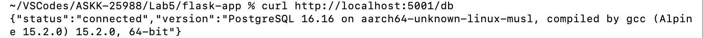
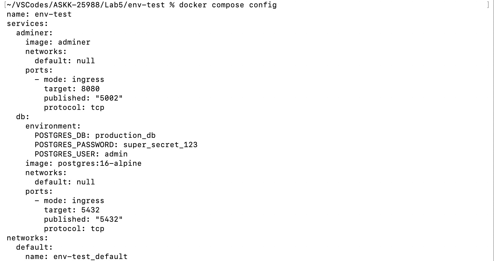

### Sprawozdanie z laboratorium nr 5

**Przedmiot:** Aplikacje w środowisku kontenerowym  

**Temat:** Docker Compose — podstawy

**Data wykonania:** 

**Autor:** Miłosz Samotyjak

**Numer indeksu:** 25988

**Grupa:** 235IC A1

---

#### 1. Cel laboratorium

Praktyczne poznanie Docker Compose: definiowanie usług, sieci, wolumenów w pliku YAML, zarządzanie stosem aplikacji wielokontenerowych.

---

#### 2. Wstęp teoretyczny

[Opcjonalnie — krótkie wprowadzenie teoretyczne dotyczące omawianych technologii/narzędzi, np. czym jest Docker, wolumeny, sieci itp.]

docker-compose

---

#### 3. Przebieg ćwiczeń

##### Ćwiczenie 1.1 — Prosty serwer Nginx

**Opis:** Stworzono prosty plik `docker-compose.yaml` dla serwera Nginx, uruchomiono go, sprawdzono jego status, logi i stronę startową a na koniec zatrzymano serwer.

**Użyte polecenia:**

```zsh
mkdir -p ~/VSCodes/ASKK-25988/Lab5/ex1 && cd ~/VSCodes/ASKK-25988/Lab5/ex1

# Uruchomienie
docker compose up -d

# Status
docker compose ps

# Logi
docker compose logs

# Sprawdzenie
curl http://localhost:8080

# Zatrzymanie
docker compose down
```

**Wynik działania:**

```zsh
~/VSCodes/ASKK-25988/Lab4 % mkdir -p ~/VSCodes/ASKK-25988/Lab5/ex1 && cd ~/VSCodes/ASKK-25988/Lab5/ex1

~/VSCodes/ASKK-25988/Lab5/ex1 % docker compose up -d
[+] Running 2/2
 ✔ Network ex1_default  Created                                                                   0.0s 
 ✔ Container ex1-web-1  Started                                                                   0.2s 

~/VSCodes/ASKK-25988/Lab5/ex1 % docker compose ps
NAME        IMAGE          COMMAND                  SERVICE   CREATED         STATUS         PORTS
ex1-web-1   nginx:alpine   "/docker-entrypoint.…"   web       8 seconds ago   Up 7 seconds   0.0.0.0:8080->80/tcp, [::]:8080->80/tcp

~/VSCodes/ASKK-25988/Lab5/ex1 % docker compose logs
web-1  | /docker-entrypoint.sh: /docker-entrypoint.d/ is not empty, will attempt to perform configuration
web-1  | /docker-entrypoint.sh: Looking for shell scripts in /docker-entrypoint.d/
web-1  | /docker-entrypoint.sh: Launching /docker-entrypoint.d/10-listen-on-ipv6-by-default.sh
web-1  | 10-listen-on-ipv6-by-default.sh: info: Getting the checksum of /etc/nginx/conf.d/default.conf
web-1  | 10-listen-on-ipv6-by-default.sh: info: Enabled listen on IPv6 in /etc/nginx/conf.d/default.conf
web-1  | /docker-entrypoint.sh: Sourcing /docker-entrypoint.d/15-local-resolvers.envsh
web-1  | /docker-entrypoint.sh: Launching /docker-entrypoint.d/20-envsubst-on-templates.sh
web-1  | /docker-entrypoint.sh: Launching /docker-entrypoint.d/30-tune-worker-processes.sh
web-1  | /docker-entrypoint.sh: Configuration complete; ready for start up
web-1  | 2026/11/23 15:19:05 [notice] 1#1: using the "epoll" event method
web-1  | 2026/11/23 15:19:05 [notice] 1#1: nginx/1.31.7
web-1  | 2026/11/23 15:19:05 [notice] 1#1: built by gcc 15.2.0 (Alpine 15.2.0) 
web-1  | 2026/11/23 15:19:05 [notice] 1#1: OS: Linux 6.12.54-linuxkit
web-1  | 2026/11/23 15:19:05 [notice] 1#1: getrlimit(RLIMIT_NOFILE): 1048576:1048576
web-1  | 2026/11/23 15:19:05 [notice] 1#1: start worker processes
web-1  | 2026/11/23 15:19:05 [notice] 1#1: start worker process 30
web-1  | 2026/11/23 15:19:05 [notice] 1#1: start worker process 31
web-1  | 2026/11/23 15:19:05 [notice] 1#1: start worker process 32
web-1  | 2026/11/23 15:19:05 [notice] 1#1: start worker process 33
web-1  | 2026/11/23 15:19:05 [notice] 1#1: start worker process 34
web-1  | 2026/11/23 15:19:05 [notice] 1#1: start worker process 35
web-1  | 2026/11/23 15:19:05 [notice] 1#1: start worker process 36
web-1  | 2026/11/23 15:19:05 [notice] 1#1: start worker process 37

~/VSCodes/ASKK-25988/Lab5/ex1 % curl http://localhost:8080
<!DOCTYPE html>
<html>
<head>
<title>Welcome to nginx!</title>
<style>
html { color-scheme: light dark; }
body { width: 35em; margin: 0 auto;
font-family: Tahoma, Verdana, Arial, sans-serif; }
</style>
</head>
<body>
<h1>Welcome to nginx!</h1>
<p>If you see this page, nginx is successfully installed and working.
Further configuration is required for the web server, reverse proxy, 
API gateway, load balancer, content cache, or other features.</p>

<p>For online documentation and support please refer to
<a href="https://nginx.org/">nginx.org</a>.<br/>
To engage with the community please visit
<a href="https://community.nginx.org/">community.nginx.org</a>.<br/>
For enterprise grade support, professional services, additional 
security features and capabilities please refer to
<a href="https://f5.com/nginx">f5.com/nginx</a>.</p>

<p><em>Thank you for using nginx.</em></p>
</body>
</html>

~/VSCodes/ASKK-25988/Lab5/ex1 % docker compose down
[+] Running 2/2
 ✔ Container ex1-web-1  Removed                                                                   0.3s 
 ✔ Network ex1_default  Removed
```

**Screenshot:**


Rys. 1 - Wynik `docker compose ps`.

---

##### Ćwiczenie 1.2 — Wiele usług

**Opis:** Uruchomiono 3 usługi: Nginx, bazę danych PostgreSQL i Redis w ramach jednego `docker-compose` oraz sprawdzono logi i wersję bazy PostgreSQL.

**Użyte polecenia:**

```zsh
mkdir -p ~/VSCodes/ASKK-25988/Lab5/ex2 && cd ~/VSCodes/ASKK-25988/Lab5/ex2

docker compose up -d
docker compose ps
docker compose logs db
docker compose exec db psql -U postgres -c "SELECT version();"
docker compose down
```

**Wynik działania:**

```zsh
~/VSCodes/ASKK-25988/Lab5/ex1 % mkdir -p ~/VSCodes/ASKK-25988/Lab5/ex2 && cd ~/VSCodes/ASKK-25988/Lab5/ex2

~/VSCodes/ASKK-25988/Lab5/ex2 % docker compose up -d
[+] Running 4/4
 ✔ Network ex2_default    Created                                                                 0.0s 
 ✔ Container ex2-web-1    Started                                                                 0.3s 
 ✔ Container ex2-cache-1  Started                                                                 0.3s 
 ✔ Container ex2-db-1     Started                                                                 0.3s 

~/VSCodes/ASKK-25988/Lab5/ex2 % docker compose ps
NAME          IMAGE                COMMAND                  SERVICE   CREATED         STATUS         PORTS
ex2-cache-1   redis:7-alpine       "docker-entrypoint.s…"   cache     6 seconds ago   Up 6 seconds   6379/tcp
ex2-db-1      postgres:16-alpine   "docker-entrypoint.s…"   db        6 seconds ago   Up 6 seconds   5432/tcp
ex2-web-1     nginx:alpine         "/docker-entrypoint.…"   web       6 seconds ago   Up 6 seconds   0.0.0.0:8080->80/tcp, [::]:8080->80/tcp

~/VSCodes/ASKK-25988/Lab5/ex2 % docker compose logs db
db-1  | The files belonging to this database system will be owned by user "postgres".
db-1  | This user must also own the server process.
db-1  | 
db-1  | The database cluster will be initialized with locale "en_US.utf8".
db-1  | The default database encoding has accordingly been set to "UTF8".
db-1  | The default text search configuration will be set to "english".
db-1  | 
db-1  | Data page checksums are disabled.
db-1  | 
db-1  | fixing permissions on existing directory /var/lib/postgresql/data ... ok
db-1  | creating subdirectories ... ok
db-1  | selecting dynamic shared memory implementation ... posix
db-1  | selecting default max_connections ... 100
db-1  | selecting default shared_buffers ... 128MB
db-1  | selecting default time zone ... UTC
db-1  | creating configuration files ... ok
db-1  | running bootstrap script ... ok
db-1  | sh: locale: not found
db-1  | 2026-11-23 15:26:22.437 UTC [35] WARNING:  no usable system locales were found
db-1  | performing post-bootstrap initialization ... ok
db-1  | syncing data to disk ... ok
db-1  | 
db-1  | 
db-1  | Success. You can now start the database server using:
db-1  | 
db-1  |     pg_ctl -D /var/lib/postgresql/data -l logfile start
db-1  | 
db-1  | initdb: warning: enabling "trust" authentication for local connections
db-1  | initdb: hint: You can change this by editing pg_hba.conf or using the option -A, or --auth-local and --auth-host, the next time you run initdb.
db-1  | waiting for server to start....2026-11-23 15:26:22.732 UTC [41] LOG:  starting PostgreSQL 16.15 on aarch64-unknown-linux-musl, compiled by gcc (Alpine 15.2.0) 15.2.0, 64-bit
db-1  | 2026-11-23 15:26:22.732 UTC [41] LOG:  listening on Unix socket "/var/run/postgresql/.s.PGSQL.5432"
db-1  | 2026-11-23 15:26:22.734 UTC [44] LOG:  database system was shut down at 2026-11-23 15:26:22 UTC
db-1  | 2026-11-23 15:26:22.736 UTC [41] LOG:  database system is ready to accept connections
db-1  |  done
db-1  | server started
db-1  | CREATE DATABASE
db-1  | 
db-1  | 
db-1  | /usr/local/bin/docker-entrypoint.sh: ignoring /docker-entrypoint-initdb.d/*
db-1  | 
db-1  | waiting for server to shut down....2026-11-23 15:26:22.870 UTC [41] LOG:  received fast shutdown request
db-1  | 2026-11-23 15:26:22.871 UTC [41] LOG:  aborting any active transactions
db-1  | 2026-11-23 15:26:22.872 UTC [41] LOG:  background worker "logical replication launcher" (PID 47) exited with exit code 1
db-1  | 2026-11-23 15:26:22.872 UTC [42] LOG:  shutting down
db-1  | 2026-11-23 15:26:22.873 UTC [42] LOG:  checkpoint starting: shutdown immediate
db-1  | 2026-11-23 15:26:22.897 UTC [42] LOG:  checkpoint complete: wrote 926 buffers (5.7%); 0 WAL file(s) added, 0 removed, 0 recycled; write=0.007 s, sync=0.016 s, total=0.025 s; sync files=301, longest=0.006 s, average=0.001 s; distance=4283 kB, estimate=4283 kB; lsn=0/1925D18, redo lsn=0/1925D18
db-1  | 2026-11-23 15:26:22.899 UTC [41] LOG:  database system is shut down
db-1  |  done
db-1  | server stopped
db-1  | 
db-1  | PostgreSQL init process complete; ready for start up.
db-1  | 
db-1  | 2026-11-23 15:26:22.991 UTC [1] LOG:  starting PostgreSQL 16.15 on aarch64-unknown-linux-musl, compiled by gcc (Alpine 15.2.0) 15.2.0, 64-bit
db-1  | 2026-11-23 15:26:22.991 UTC [1] LOG:  listening on IPv4 address "0.0.0.0", port 5432
db-1  | 2026-11-23 15:26:22.991 UTC [1] LOG:  listening on IPv6 address "::", port 5432
db-1  | 2026-11-23 15:26:22.993 UTC [1] LOG:  listening on Unix socket "/var/run/postgresql/.s.PGSQL.5432"
db-1  | 2026-11-23 15:26:22.995 UTC [57] LOG:  database system was shut down at 2026-11-23 15:26:22 UTC
db-1  | 2026-11-23 15:26:22.997 UTC [1] LOG:  database system is ready to accept connections

~/VSCodes/ASKK-25988/Lab5/ex2 % docker compose exec db psql -U postgres -c "SELECT version();"
                                            version                                             
------------------------------------------------------------------------------------------------
 PostgreSQL 16.15 on aarch64-unknown-linux-musl, compiled by gcc (Alpine 15.2.0) 15.2.0, 64-bit
(1 row)

~/VSCodes/ASKK-25988/Lab5/ex2 % docker compose down
[+] Running 4/4
 ✔ Container ex2-web-1    Removed                                                                 0.2s 
 ✔ Container ex2-db-1     Removed                                                                 0.1s 
 ✔ Container ex2-cache-1  Removed                                                                 0.3s 
 ✔ Network ex2_default    Removed                                                                 0.2s
```

**Screenshot:**


Rys. 2 - Trzy usługi działające jednocześnie.

---

##### Ćwiczenie 2.1 — Flask + PostgreSQL

**Opis:** Stworzono plik `docker-compose.yaml` z aplikacją Flask i bazą danych PostgreSQL, uruchomiono cały stos i przetestowano działanie wszystkich endpointów.

**Użyte polecenia:**

```zsh
mkdir -p ~/VSCodes/ASKK-25988/Lab5/flask-app && cd ~/VSCodes/ASKK-25988/Lab5/flask-app

docker compose up -d --build
docker compose ps
curl http://localhost:5001
curl http://localhost:5001/db
curl http://localhost:5001/health
```

**Wynik działania:**

```zsh
~/VSCodes/ASKK-25988/Lab5/ex2 % mkdir -p ~/VSCodes/ASKK-25988/Lab5/flask-app && cd ~/VSCodes/ASKK-25988/Lab5/flask-app

~/VSCodes/ASKK-25988/Lab5/flask-app % docker compose up -d --build
[+] Building 0.4s (12/12) FINISHED                                                                     
 => [internal] load local bake definitions                                                        0.0s
 => => reading from stdin 539B                                                                    0.0s
 => [internal] load build definition from Dockerfile                                              0.0s
 => => transferring dockerfile: 195B                                                              0.0s
 => [internal] load metadata for docker.io/library/python:3.11-slim                               0.0s
 => [internal] load .dockerignore                                                                 0.0s
 => => transferring context: 2B                                                                   0.0s
 => [1/5] FROM docker.io/library/python:3.11-slim@sha256:e88e9763f943ec1834f992a4b51e0f245004868  0.0s
 => => resolve docker.io/library/python:3.11-slim@sha256:e88e9763f943ec1834f992a4b51e0f245004868  0.0s
 => [internal] load build context                                                                 0.0s
 => => transferring context: 684B                                                                 0.0s
 => CACHED [2/5] WORKDIR /app                                                                     0.0s
 => CACHED [3/5] COPY requirements.txt .                                                          0.0s
 => CACHED [4/5] RUN pip install --no-cache-dir -r requirements.txt                               0.0s
 => [5/5] COPY . .                                                                                0.0s
 => exporting to image                                                                            0.1s
 => => exporting layers                                                                           0.0s
 => => exporting manifest sha256:875bfdc994b8f6bfdf8b418a58a6eb7f0e82dc3cd4533f0794884fa545d5d0d  0.0s
 => => exporting config sha256:aab6dd97dd88f98b4ed2387e93c507572401a4d6a6a287a1423fa86a98bca463   0.0s
 => => exporting attestation manifest sha256:342cc50e6436e713cd67775c34e502779f609d8221202040499  0.0s
 => => exporting manifest list sha256:0f7ba12346c894ae0fde5fcf8a76c231cb2565b677ff5464e255e16f16  0.0s
 => => naming to docker.io/library/flask-app-app:latest                                           0.0s
 => => unpacking to docker.io/library/flask-app-app:latest                                        0.0s
 => resolving provenance for metadata file                                                        0.0s
[+] Running 4/4
 ✔ flask-app-app              Built                                                               0.0s 
 ✔ Network flask-app_default  Created                                                             0.0s 
 ✔ Container flask-app-db-1   Healthy                                                             5.8s 
 ✔ Container flask-app-app-1  Started                                                             5.8s 

~/VSCodes/ASKK-25988/Lab5/flask-app % docker compose ps
NAME              IMAGE                COMMAND                  SERVICE   CREATED          STATUS                    PORTS
flask-app-app-1   flask-app-app        "python app.py"          app       12 seconds ago   Up 6 seconds              0.0.0.0:5001->5000/tcp, [::]:5001->5000/tcp
flask-app-db-1    postgres:16-alpine   "docker-entrypoint.s…"   db        12 seconds ago   Up 11 seconds (healthy)   5432/tcp

~/VSCodes/ASKK-25988/Lab5/flask-app % curl http://localhost:5001
<h1>Flask + PostgreSQL w Docker Compose</h1>%

~/VSCodes/ASKK-25988/Lab5/flask-app % curl http://localhost:5001/db
{"status":"connected","version":"PostgreSQL 16.16 on aarch64-unknown-linux-musl, compiled by gcc (Alpine 15.2.0) 15.2.0, 64-bit"}

~/VSCodes/ASKK-25988/Lab5/flask-app % curl http://localhost:5001/health
{"status":"ok"}
```

**Screenshot:**



Rys. 3 - Aplikacja Flask połączona z PostgreSQL.

---

##### Ćwiczenie 2.2 — Dodanie Adminer

**Opis:** Dodano usługę Adminer do istniejącego pliku `docker-compose.yaml` i za jej pomocą połączono się z bazą danych.

**Użyte polecenia:**

```zsh
docker compose up -d
# Otwórz http://localhost:8080 — Server: db, User: postgres, Password: secret
```

**Wynik działania:**

```zsh
~/VSCodes/ASKK-25988/Lab5/flask-app % docker compose up -d
[+] Running 3/3
 ✔ Container flask-app-db-1       Healthy                                                         0.6s 
 ✔ Container flask-app-app-1      Running                                                         0.0s 
 ✔ Container flask-app-adminer-1  Started                                                         0.2s 
```

**Screenshot:**


Rys. 4 - Adminer połączony z bazą danych.

---

##### Ćwiczenie 3.1 — Plik .env

**Opis:** Stworzono plik `.env` dla docker-compose i sprawdzono interpolację zmiennych środowiskowych (automatyczne podstawienie wartości pod placeholdery typu `${POSTGRES_PASSWORD}`).

**Użyte polecenia:**

```zsh
mkdir -p ~/VSCodes/ASKK-25988/Lab5/env-test && cd ~/VSCodes/ASKK-25988/Lab5/env-test

# Sprawdź interpolację zmiennych
docker compose config

# Uruchom
docker compose up -d
docker compose exec db psql -U admin -d production_db -c "SELECT current_user, current_database();"
docker compose down
```

**Wynik działania:**

```zsh
~/VSCodes/ASKK-25988/Lab5/env-test % docker compose config
name: env-test
services:
  adminer:
    image: adminer
    networks:
      default: null
    ports:
      - mode: ingress
        target: 8080
        published: "5002"
        protocol: tcp
  db:
    environment:
      POSTGRES_DB: production_db
      POSTGRES_PASSWORD: super_secret_123
      POSTGRES_USER: admin
    image: postgres:16-alpine
    networks:
      default: null
    ports:
      - mode: ingress
        target: 5432
        published: "5432"
        protocol: tcp
networks:
  default:
    name: env-test_default

~/VSCodes/ASKK-25988/Lab5/env-test % docker compose up -d 
[+] Running 3/3
 ✔ Network env-test_default      Created                                                          0.0s 
 ✔ Container env-test-adminer-1  Started                                                          0.2s 
 ✔ Container env-test-db-1       Started                                                          0.2s 

~/VSCodes/ASKK-25988/Lab5/env-test % docker compose exec db psql -U admin -d production_db -c "SELECT current_user, current_database();"
 current_user | current_database 
--------------+------------------
 admin        | production_db
(1 row)

~/VSCodes/ASKK-25988/Lab5/env-test % docker compose down
[+] Running 3/3
 ✔ Container env-test-db-1       Removed                                                          0.3s 
 ✔ Container env-test-adminer-1  Removed                                                          0.2s 
 ✔ Network env-test_default      Removed                                                          0.2s
```

**Screenshot:**



Rys. 5 - Zmienne z .env użyte w konfiguracji.

---

##### Ćwiczenie 3.2 — env_file

**Opis:** Stworzono i wstrzyknięto plik `.env` dla aplikacji Python a następnie odczytano wartości wstrzykniętych zmiennych środowiskowych za pomocą prostego skryptu.

**Użyte polecenia:**

```zsh
docker compose run --rm app
```

**Wynik działania:**

```zsh
~/VSCodes/ASKK-25988/Lab5/env-test % docker compose run --rm app
[+] Creating 1/1
 ✔ Network env-test_default  Created                                                              0.0s 
SECRET_KEY=my-secret-key-123
LOG_LEVEL=debug
DEBUG=true
```

---

#### 4. Pliki konfiguracyjne

##### Dockerfile

```dockerfile
# [WKLEJ TUTAJ ZAWARTOŚĆ PLIKU Dockerfile]
```

##### docker-compose.yaml

```yaml
# [WKLEJ TUTAJ ZAWARTOŚĆ PLIKU docker-compose.yaml]
```

##### Inne pliki

```
# [WKLEJ TUTAJ ZAWARTOŚĆ INNYCH ISTOTNYCH PLIKÓW, NP. .env, nginx.conf ITP.]
```

---

#### 5. Napotkane problemy i ich rozwiązania

| Problem | Rozwiązanie |
|---------|-------------|
| [OPIS PROBLEMU 1] | [JAK ZOSTAŁ ROZWIĄZANY] |
| [OPIS PROBLEMU 2] | [JAK ZOSTAŁ ROZWIĄZANY] |

---

#### 6. Wnioski

[Podsumowanie — czego się nauczyłeś/aś, jakie wnioski wynikają z przeprowadzonych ćwiczeń, co było najtrudniejsze, co najciekawsze.]

---

#### 7. Bibliografia / źródła

- [Docker Documentation](https://docs.docker.com/)
- [INNE WYKORZYSTANE ŹRÓDŁA]
